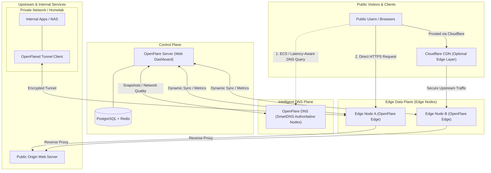
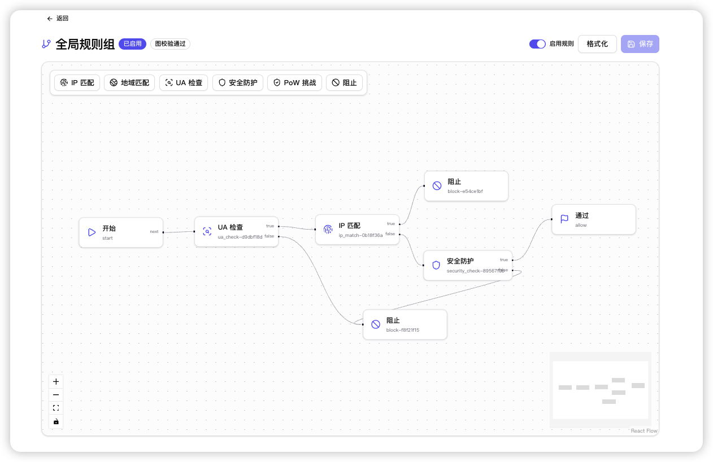
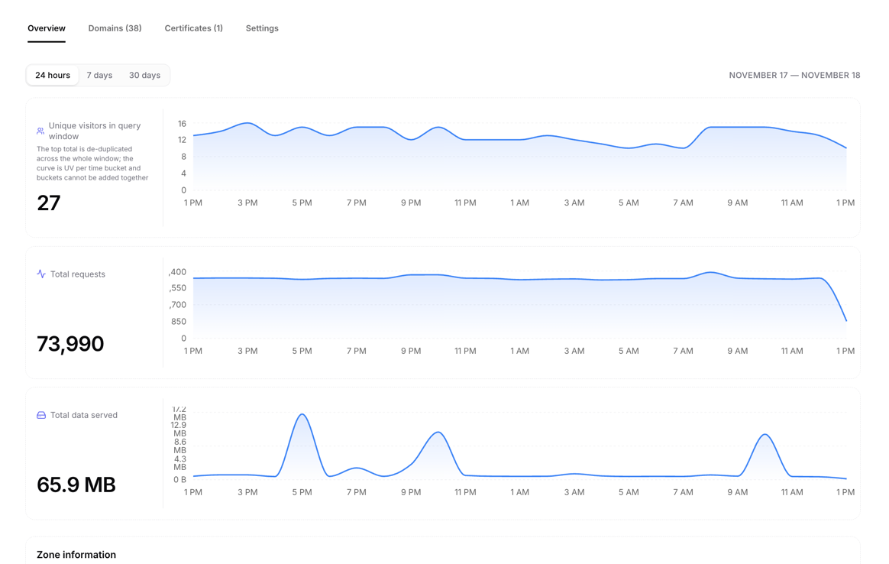

<div align="center">

<h1>
  <picture>
    <source media="(prefers-color-scheme: dark)" srcset="./docs/assets/brand/openflare-horizontal-white.svg">
    
  </picture>
</h1>

**Distributed Reverse Proxy, Edge Security Gateway, and Authoritative SmartDNS**

**[English](./README.md) | [简体中文](./README.zh-CN.md)**

<p align="center">
  <a href="https://raw.githubusercontent.com/Rain-kl/OpenFlare/main/LICENSE">
    
  </a>
  <a href="https://github.com/Rain-kl/OpenFlare/releases/latest">
    
  </a>
  <a href="https://github.com/Rain-kl/OpenFlare/pkgs/container/openflare">
    
  </a>
  <a href="https://t.me/OpenFlareCDN">
    
  </a>
</p>

</div>

---

## 📖 What is OpenFlare?

OpenFlare is an open-source distributed reverse proxy, edge security gateway, and authoritative SmartDNS platform built for multi-server clusters rather than single-host setups.

It pairs a central control plane with OpenFlare Edge proxy nodes and standalone OpenFlare DNS (SmartDNS) servers to provide cluster orchestration, zero-reload config sync, quality-aware DNS routing, edge WAF protection, and encrypted tunnels:

* **Zero-Reload Cluster Sync**: Manage multiple edge nodes from one control plane and push incremental configuration updates without reloading proxy processes or dropping connections.
* **Authoritative SmartDNS (`OpenFlare DNS`)**: Run standalone authoritative DNS servers with a visual scheduling flow editor, EDNS0 Client Subnet (ECS) support, multi-window latency and packet-loss routing, and offline snapshot failover. DNS accounts for Cloudflare, Alibaba Cloud DNS, and Tencent Cloud DNSPod are managed in the same console.
* **Edge Security and Anti-CC**: Filter traffic at the edge with a WAF rule engine, MaxMind GeoIP country rules, and client-side cryptographic Proof of Work (PoW) challenges (similar to Cloudflare Turnstile).
* **Encrypted Tunnels (`openflared`)**: Expose private homelab or internal web services through edge proxies without public IPs or open inbound ports, similar to Cloudflare Tunnel.
* **Pages Static Hosting**: Deploy static sites and SPAs from GitHub Releases or uploaded archives directly to edge nodes with version rollbacks and SPA fallback routing.
* **Automated Certificates and SSO**: Issue and renew multi-domain Let's Encrypt certificates via ACME, and sign in with GitHub OAuth or standard OIDC providers.

---

## 🌐 Flexible Deployment: Standalone or Behind Cloudflare

OpenFlare can run as an independent edge gateway or behind Cloudflare and other public CDNs:

### 1. Standalone Edge Gateway (Private CDN)
Suitable for multi-region VPS clusters and homelabs:
* Run your own CDN, SmartDNS routing, and reverse proxy cluster while keeping traffic and operational data on your own servers.
* Route visitors to the lowest-latency healthy edge node by country, ASN, and measured network quality, with built-in PoW challenges, WAF rules, and automated SSL certificates, without paying for commercial CDN security or traffic-steering add-ons.

### 2. Behind Cloudflare (Hardened Origin Shield)
Acts as an origin shield and routing layer behind Cloudflare:
* **Origin IP Exposure Protection**: If attackers bypass Cloudflare and connect directly to an origin IP, OpenFlare's edge WAF and PoW challenges block the requests at the gateway.
* **Local Log and Metric Retention**: Keep full, searchable request logs and latency metrics locally, avoiding the retention and detail limits of Cloudflare's Free tier.
* **Multi-Provider DNS and Internal Routing**: Manage DNS records across Cloudflare, Alibaba Cloud DNS, and Tencent Cloud DNSPod in one place, and route incoming Cloudflare traffic to internal backends or private services over encrypted tunnels.

---

## 📊 Comparison: Traditional Nginx vs NPM vs OpenFlare

| Feature | Traditional Nginx (`nginx.conf`) | Nginx Proxy Manager (NPM) | **OpenFlare** |
| :--- | :--- | :--- | :--- |
| **Cluster Architecture** | Manual per-host editing via SSH | Single node only; no cluster sync | Central control plane + distributed edge nodes |
| **SmartDNS & Traffic Steering** | Not supported | Not supported | Built-in authoritative SmartDNS (latency, ASN, GeoIP, visual rules) |
| **Configuration Sync** | Requires `nginx -s reload` (connection churn) | Reloads on every change | Shared-memory incremental sync (zero reload) |
| **Anti-CC / Bot Protection** | Basic `limit_req` rate limiting only | Not supported | Built-in Turnstile-style PoW client challenge |
| **In-Network Tunnels** | Requires separate third-party tools (frp) | Not supported | Built-in `openflared` tunnels (no inbound ports) |
| **WAF & Threat Defense** | Requires manual ModSecurity compilation | Basic exploit rules only | Dynamic WAF, GeoIP, and checksum-synced IP lists |
| **Static Pages Hosting** | Manual directory copying and setup | Static file proxying only | Automated GitHub Release deployment and rollbacks |
| **Works with Cloudflare** | Manual `set_real_ip_from` list maintenance | Manual proxy header tuning | Automatic real IP restoration for origin shield setups |

---

## 🏗️ Architecture



---

## Edge Performance Benchmarks

**Load generator: US-A connecting directly to isolated instance IPs. Serving a 923 B Pages file.**

| Measured metric | JP-B (Oracle 3C-18G Arm) | US-C (EPYC-Milan 1C-2G) |
| --- | ---: | ---: |
| HTTP/2 throughput, full WAF, 16 connections × 24 streams | **1,158 requests/s** (3 workers) | **718 requests/s** (1 worker) |
| HTTP/2 throughput, WAF off, 16 connections × 24 streams | **2,990 requests/s** (3 workers) | **2,169 requests/s** (1 worker) |
| Peak retest, WAF off, 22-second sample | **3,948 requests/s** (6 workers, 32 × 24) | **2,273 requests/s** (2 workers, 16 × 24) |

[Benchmark report: test configuration, WAF comparison, and thread scaling.](./docs/en/reference/pingora-benchmark.md)

---

## 🖥️ UI Preview

### Dashboard Overview


### Edge WAF & Access Rules


### Domain & Traffic Analytics


---

## ⚡ Quick Start

### 1. Launch OpenFlare Server

Deploy the control plane using `docker-compose`:

```bash
# Download environment template
curl -o .env.example https://raw.githubusercontent.com/Rain-kl/OpenFlare/refs/heads/main/.env.example
cp .env.example .env
```

```yaml
services:
  openflare:
    image: ghcr.io/rain-kl/openflare:latest
    restart: unless-stopped
    env_file: .env
    environment:
      TZ: ${TZ:-Asia/Shanghai}
    ports:
      - "3000:3000"
    volumes:
      - openflare_uploads:/app/uploads
    depends_on:
      postgres:
        condition: service_healthy
      redis:
        condition: service_healthy

  postgres:
    image: postgres:17-alpine
    restart: unless-stopped
    environment:
      POSTGRES_DB: ${DB_NAME:-openflare}
      POSTGRES_USER: ${DB_USERNAME:-openflare}
      POSTGRES_PASSWORD: ${DB_PASSWORD:-replace-with-strong-password}
    volumes:
      - openflare_postgres_data:/var/lib/postgresql/data
    healthcheck:
      test: ["CMD-SHELL", "pg_isready -U ${DB_USERNAME:-openflare} -d ${DB_NAME:-openflare}"]
      interval: 10s
      timeout: 5s
      retries: 5

  redis:
    image: valkey/valkey:8.0-alpine
    restart: unless-stopped
    command: ["valkey-server", "--appendonly", "yes"]
    volumes:
      - openflare_redis_data:/data
    healthcheck:
      test: ["CMD", "valkey-cli", "ping"]
      interval: 10s
      timeout: 5s
      retries: 5
      start_period: 5s

volumes:
  openflare_uploads:
  openflare_postgres_data:
  openflare_redis_data:
```

* **Dashboard URL**: `http://localhost:3000`
* **Default Credentials**: `admin` / `12345678`

> [!WARNING]
> Change the default password `12345678` immediately upon first login.  
> The BETA version is in active development and testing; avoid using it in mission-critical production environments without regular backups.

### 2. Connect Edge Agent Node

Install OpenFlare Edge on a Linux `amd64` or `arm64` edge server with systemd. Allow inbound TCP ports `80` and `443`. In the dashboard, copy the Discovery Token from **System Settings → OpenFlare → Discovery Token & Deployment**. Replace the server URL and token in this command:

```bash
curl -fsSL https://raw.githubusercontent.com/Rain-kl/OpenFlare/main/scripts/install-openflare-edge.sh | sudo bash -s -- --server-url 'https://openflare.example.com' --token-type discovery --token '<DISCOVERY_TOKEN>'
```

The installer downloads the latest stable Edge release and starts the `openflare-edge` systemd service. To attach an existing node, use its node token and set `--token-type node`.

Update an installed Edge node to the latest stable release:

```bash
curl -fsSL https://raw.githubusercontent.com/Rain-kl/OpenFlare/main/scripts/update-openflare-edge.sh | sudo bash
```

Switch an installed Edge node to the most recently published prerelease:

```bash
curl -fsSL https://raw.githubusercontent.com/Rain-kl/OpenFlare/main/scripts/update-openflare-edge.sh | sudo bash -s -- canary
```

### 3. Deploy OpenFlare DNS (Optional SmartDNS)

To route visitors across your edge cluster with SmartDNS, install `OpenFlare DNS` on one or more Linux (`amd64` or `arm64`) hosts with inbound ports `53/udp` and `53/tcp` open. You can also copy a prefilled command from **DNS → SmartDNS → Authoritative Instances**:

```bash
curl -fsSL https://raw.githubusercontent.com/Rain-kl/OpenFlare/main/scripts/install-openflare-dns.sh -o install-openflare-dns.sh && \
  sudo bash install-openflare-dns.sh \
    --controller-url https://openflare.example.com \
    --discovery-token '<DISCOVERY_TOKEN>' \
    --public-addr '<PUBLIC_IP>' \
    --listen 0.0.0.0:53
```

Online Linux systemd instances can be upgraded individually or in batches from the SmartDNS console. See the [SmartDNS Guide](https://openflare.cc/en/guide/smartdns) and [OpenFlare DNS Deployment](https://openflare.cc/en/deployment/openflare-dns) for NS delegation and Docker instructions.

---

## 📚 Documentation

Official Documentation: **[https://openflare.cc](https://openflare.cc)**

* [Quick Start](https://openflare.cc/en/guide/quick-start)
* [SmartDNS Guide](https://openflare.cc/en/guide/smartdns)
* [Deployment Guide](https://openflare.cc/en/deployment/deployment)
* [OpenFlare DNS Deployment](https://openflare.cc/en/deployment/openflare-dns)
* [Configuration Reference](https://openflare.cc/en/reference/configuration)
* [System Design](https://openflare.cc/en/design/)

<details>
<summary><b>🔍 Minimum & Recommended Hardware Specifications</b></summary>

| Component | Minimum Requirements | Recommended Requirements | Note |
| :--- | :--- | :--- | :--- |
| **Server Control Plane** | 1 CPU / 2 GB RAM / 20 GB Disk | 2 CPU / 4 GB RAM / 50 GB+ Disk | Scale disk based on access log retention |
| **Agent Data Plane** | 1 CPU / 512 MB RAM / 2 GB Disk | 2 CPU / 2 GB RAM / 10 GB+ Disk | Scale based on concurrent connections and WAF load |
| **OpenFlare DNS (SmartDNS)** | 1 CPU / 256 MB RAM / 1 GB Disk | 2 CPU / 512 MB RAM / 5 GB Disk | Authoritative DNS node with local snapshot failover |
| **Relay Node** | 1 CPU / 1 GB RAM / 5 GB Disk | 2 CPU / 2 GB RAM / 20 GB Disk | Mainly bound by bandwidth and network throughput |
| **OpenFlared Client** | 1 CPU / 256 MB RAM / 1 GB Disk | 1 CPU / 512 MB RAM / 5 GB Disk | Low memory footprint |

</details>

---

## 💬 Community

* **Telegram Group**: [https://t.me/OpenFlareCDN](https://t.me/OpenFlareCDN) — usage discussions, deployment questions, and community feedback.
* **GitHub Issues**: [Rain-kl/OpenFlare/issues](https://github.com/Rain-kl/OpenFlare/issues) — bug reports and feature requests.

---

## ⚖️ Trademark Disclaimer

OpenFlare is an independent, community-driven open-source project. It is not affiliated with, endorsed by, or sponsored by Cloudflare, Inc. Cloudflare and related trademarks are the property of their respective owners.

---

## 📄 License

This project is licensed under the [Apache License 2.0](./LICENSE).

## ⭐ Star History

<a href="https://www.star-history.com/?repos=Rain-kl%2FOpenFlare&type=date&legend=bottom-right">
 <picture>
   <source media="(prefers-color-scheme: dark)" srcset="https://api.star-history.com/chart?repos=Rain-kl/OpenFlare&type=date&theme=dark&legend=top-left" />
   <source media="(prefers-color-scheme: light)" srcset="https://api.star-history.com/chart?repos=Rain-kl/OpenFlare&type=date&legend=top-left" />
   
 </picture>
</a>
