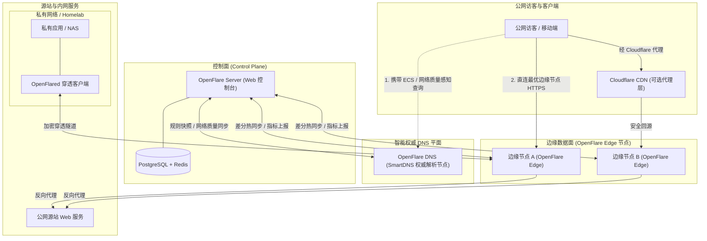

<div align="center">

<h1>
  <picture>
    <source media="(prefers-color-scheme: dark)" srcset="./docs/assets/brand/openflare-horizontal-white.svg">
    
  </picture>
</h1>

**分布式反向代理、边缘安全网关与智能权威 DNS**  
*Distributed Reverse Proxy, Edge Security Gateway, and Authoritative SmartDNS*

**[简体中文](./README.zh-CN.md) | [English](./README.md)**

<p align="center">
  <a href="https://raw.githubusercontent.com/Rain-kl/OpenFlare/main/LICENSE">
    
  </a>
  <a href="https://github.com/Rain-kl/OpenFlare/releases/latest">
    
  </a>
  <a href="https://github.com/Rain-kl/OpenFlare/pkgs/container/openflare">
    
  </a>
  <a href="https://t.me/OpenFlareCDN">
    
  </a>
</p>

</div>

---

## 📖 什么是 OpenFlare？

OpenFlare 是一套开源的分布式反向代理、边缘安全网关与智能权威 DNS 平台，面向多服务器和边缘集群，而不是单机管理面板。

它由集中控制面、OpenFlare Edge 边缘节点和独立的 OpenFlare DNS（SmartDNS）权威解析节点组成，提供多节点配置同步、基于网络质量的 DNS 调度、边缘 WAF 与内网穿透：

* **多节点热同步（Zero-Reload）**：由单一控制面板管理多台边缘节点，通过差分同步下发配置，无需重载代理进程，避免连接中断。
* **智能权威 DNS（SmartDNS）**：提供独立的权威 DNS 服务端 `OpenFlare DNS`，支持可视化调度规则编排、EDNS0 客户端子网（ECS）识别、多时间窗口网络质量监测与离线快照容灾，可按地域、运营商/ASN 和实时延迟将访客分配至健康节点；同时支持在同一控制台管理 Cloudflare、阿里云 DNS 和腾讯云 DNSPod 账号。
* **边缘安全防护与防 CC**：内置 WAF 规则引擎、国家级 GeoIP 访问控制，以及类似 Cloudflare Turnstile 的客户端密码学 PoW 人机验证，在边缘拦截异常流量。
* **加密内网穿透（Tunnels）**：无需公网 IP 或路由器端口映射，通过 `openflared` 客户端建立加密隧道，将内网 Web 服务接入边缘网关并复用同一套安全防护规则。
* **静态 Pages 边缘托管**：支持从 GitHub Release 产物或上传压缩包自动部署至边缘节点本地分发，支持多版本回滚与 SPA 路由。
* **自动化证书与统一认证**：通过 ACME 协议自动申请和续期 Let's Encrypt 多域名证书，支持 GitHub OAuth 和标准 OIDC 单点登录。

---

## 🌐 灵活的部署模式：独立自建 vs 协同 Cloudflare

OpenFlare 可以作为独立边缘网关运行，也可以部署在 Cloudflare 等公网 CDN 之后配合使用：

### 1. 独立自建模式 (Standalone Edge Gateway)
适用于多台 VPS、跨地域云服务器或 Homelab：
* 自行搭建私有 CDN、智能 DNS 调度与反向代理集群，数据和流量完全留在自有服务器。
* 按访客地域、ASN 与实时网络延迟自动分流至低延迟健康节点，内置 PoW 人机验证、动态 WAF、自动 SSL 证书与内网穿透，无需依赖商业 CDN 的高价安全或调度套餐。

### 2. Cloudflare 源站防护盾模式 (Behind Cloudflare / Origin Shield)
作为 Cloudflare 后方的源站集群网关：
* **防范源站真实 IP 泄露**：即使攻击者通过历史解析或漏洞绕过 Cloudflare 直连源站 IP，OpenFlare 边缘的 WAF 与 PoW 人机挑战仍会在网关层直接拦截。
* **保留完整私有访问日志**：弥补商业 CDN 免费版日志保留期短、字段有限的限制，在本地保存完整的请求日志与网络延迟指标。
* **多云 DNS 与统一内网路由**：统一管理 Cloudflare、阿里云 DNS 和腾讯云 DNSPod 域名解析，并将来自 Cloudflare 的流量分发至源站多服务或内网穿透应用。

---

## 📊 横向对比：传统 Nginx vs Nginx Proxy Manager vs OpenFlare

| 维度 | 传统 Nginx (`nginx.conf`) | Nginx Proxy Manager (NPM) | **OpenFlare** |
| :--- | :--- | :--- | :--- |
| **集群架构** | 每台机器独立维护，频繁 SSH | 仅支持单机，无法多节点协同 | 集中控制面 + 分布式边缘节点集群 |
| **智能 DNS 与流量调度** | 不支持 | 不支持 | 内置权威 SmartDNS（延迟、ASN、地域与可视化调度规则） |
| **配置生效方式** | 每次需 `nginx -s reload`，连接可能抖动 | 每次变更均需重载 | 共享内存差分热同步（Zero-Reload） |
| **防 CC / 爬虫人机验证** | 仅支持基础 `limit_req` 限流 | 不支持 | 内置类似 Turnstile 的 PoW 客户端挑战 |
| **内网穿透 (Tunnels)** | 需要额外集成第三方工具（如 frp） | 不支持 | 内置 `openflared` 穿透隧道，无需开放入站端口 |
| **WAF 与安全防护** | 需要自行编译和配置 ModSecurity | 仅基础 Exploits 规则 | 动态 WAF、国家级 GeoIP、基于校验和同步的 IP 组 |
| **静态 Pages 托管** | 手动上传并配置静态目录 | 仅静态文件代理 | 自动拉取 GitHub Release 并支持版本回滚 |
| **配合 Cloudflare** | 需要手动维护 `set_real_ip_from` 列表 | 需要手动配置代理请求头 | 自动还原客户端真实 IP，适合作为源站防护网关 |

---

## 🏗️ 架构拓扑



---

## Pingora 性能实测

**2026 年 11 月 20 日 · OpenFlare Edge `0.1.8` · 压测客户端：US-A**

| 实测指标 | JP-B | US-C |
| --- | ---: | ---: |
| HTTP/2 吞吐：完整 WAF，16 连接 × 24 流 | **1,158 请求/秒**（3 线程） | **718 请求/秒**（1 线程） |
| HTTP/2 吞吐：关闭 WAF，16 连接 × 24 流 | **2,990 请求/秒**（3 线程） | **2,169 请求/秒**（1 线程） |
| 峰值复测：关闭 WAF，采样 22 秒 | **3,948 请求/秒**（6 线程，32 × 24） | **2,273 请求/秒**（2 线程，16 × 24） |

US-A 直连隔离实例 IP，不经 Cloudflare。测试使用 923 B 的 Pages 文件，关闭限流，访问日志写入内存文件系统 `tmpfs`。新版异步落盘尚未在这两台节点上复测。

[完整报告：测试配置、WAF 对照与线程扩展。](./docs/reference/pingora-benchmark.md)

---

## 🖥️ 界面预览

### 仪表盘与实时观测


### 边缘 WAF 与访问控制


### 域名与流量分析


---

## ⚡ 快速开始

### 1. 启动 Server 控制端

使用 `docker-compose` 启动控制面：

```bash
# 获取环境变量模板
curl -o .env.example https://raw.githubusercontent.com/Rain-kl/OpenFlare/refs/heads/main/.env.example
cp .env.example .env
```

```yaml
services:
  openflare:
    image: ghcr.io/rain-kl/openflare:latest
    restart: unless-stopped
    env_file: .env
    environment:
      TZ: ${TZ:-Asia/Shanghai}
    ports:
      - "3000:3000"
    volumes:
      - openflare_uploads:/app/uploads
    depends_on:
      postgres:
        condition: service_healthy
      redis:
        condition: service_healthy

  postgres:
    image: postgres:17-alpine
    restart: unless-stopped
    environment:
      POSTGRES_DB: ${DB_NAME:-openflare}
      POSTGRES_USER: ${DB_USERNAME:-openflare}
      POSTGRES_PASSWORD: ${DB_PASSWORD:-replace-with-strong-password}
    volumes:
      - openflare_postgres_data:/var/lib/postgresql/data
    healthcheck:
      test: ["CMD-SHELL", "pg_isready -U ${DB_USERNAME:-openflare} -d ${DB_NAME:-openflare}"]
      interval: 10s
      timeout: 5s
      retries: 5

  redis:
    image: valkey/valkey:8.0-alpine
    restart: unless-stopped
    command: ["valkey-server", "--appendonly", "yes"]
    volumes:
      - openflare_redis_data:/data
    healthcheck:
      test: ["CMD", "valkey-cli", "ping"]
      interval: 10s
      timeout: 5s
      retries: 5
      start_period: 5s

volumes:
  openflare_uploads:
  openflare_postgres_data:
  openflare_redis_data:
```

* **访问控制台**：`http://localhost:3000`
* **默认账号密码**：`admin` / `12345678`

> [!WARNING]
> 初次登录后，请立即在控制台修改默认密码 `12345678`。  
> BETA 版本处于开发与测试阶段，生产环境请提前做好数据备份。

### 2. 部署边缘 Agent 节点

在支持 systemd 的 Linux `amd64` 或 `arm64` 边缘服务器上安装 OpenFlare Edge，并开放 TCP 入站端口 `80` 和 `443`。在控制台「系统设置 → OpenFlare → Discovery Token 与部署」中复制 Discovery Token，然后替换命令中的控制端地址和令牌：

```bash
curl -fsSL https://raw.githubusercontent.com/Rain-kl/OpenFlare/main/scripts/install-openflare-edge.sh | sudo bash -s -- --server-url 'https://openflare.example.com' --token-type discovery --token '<Discovery Token>'
```

安装脚本会下载最新正式版 Edge 并启动 `openflare-edge` systemd 服务。若要接管已有节点，请使用该节点的专属令牌，并将 `--token-type` 设为 `node`。

将已部署的 Edge 节点更新到最新正式版：

```bash
curl -fsSL https://raw.githubusercontent.com/Rain-kl/OpenFlare/main/scripts/update-openflare-edge.sh | sudo bash
```

将已部署的 Edge 节点切换到最近发布的预发布版本：

```bash
curl -fsSL https://raw.githubusercontent.com/Rain-kl/OpenFlare/main/scripts/update-openflare-edge.sh | sudo bash -s -- canary
```

### 3. 部署智能 DNS 权威节点（可选）

如需为多地域边缘集群启用智能权威 DNS 调度，可在放行 `53/udp` 和 `53/tcp` 的 Linux（`amd64` 或 `arm64`）服务器上部署 `OpenFlare DNS`，也可以在控制台「DNS → SmartDNS → 权威实例」中直接复制预填充令牌的安装命令：

```bash
curl -fsSL https://raw.githubusercontent.com/Rain-kl/OpenFlare/main/scripts/install-openflare-dns.sh -o install-openflare-dns.sh && \
  sudo bash install-openflare-dns.sh \
    --controller-url https://openflare.example.com \
    --discovery-token '<Discovery Token>' \
    --public-addr '<节点公网 IP>' \
    --listen 0.0.0.0:53
```

在线的 Linux systemd 实例可在 SmartDNS 控制台单个或批量远程升级。NS 委派配置与 Docker 部署方式详见 [SmartDNS 使用指南](https://openflare.cc/guide/smartdns) 与 [OpenFlare DNS 部署指南](https://openflare.cc/deployment/openflare-dns)。

---

## 📚 官方文档

完整配置与部署说明见官方文档：**[https://openflare.cc](https://openflare.cc)**

* [快速入门指南](https://openflare.cc/guide/quick-start)
* [SmartDNS 智能权威解析指南](https://openflare.cc/guide/smartdns)
* [生产部署与架构说明](https://openflare.cc/deployment/deployment)
* [OpenFlare DNS 部署指南](https://openflare.cc/deployment/openflare-dns)
* [配置项详细参考](https://openflare.cc/reference/configuration)
* [系统底层设计](https://openflare.cc/design/)

<details>
<summary><b>🔍 查看各组件最低与推荐硬件配置要求</b></summary>

| 组件 | 最低硬件配置 | 推荐硬件配置 | 说明 |
| :--- | :--- | :--- | :--- |
| **Server 控制面** | 1 核 CPU / 2 GB 内存 / 20 GB 磁盘 | 2 核 CPU / 4 GB 内存 / 50 GB+ 磁盘 | 按访问日志存储时长和吞吐量扩展 |
| **Agent 数据面** | 1 核 CPU / 512 MB 内存 / 2 GB 磁盘 | 2 核 CPU / 2 GB 内存 / 10 GB+ 磁盘 | 取决于并发代理量与 WAF 规则量 |
| **OpenFlare DNS (SmartDNS)** | 1 核 CPU / 256 MB 内存 / 1 GB 磁盘 | 2 核 CPU / 512 MB 内存 / 5 GB 磁盘 | 独立权威解析节点，支持离线快照容灾 |
| **Relay 中继节点** | 1 核 CPU / 1 GB 内存 / 5 GB 磁盘 | 2 核 CPU / 2 GB 内存 / 20 GB 磁盘 | 主要受网络带宽与并发吞吐限制 |
| **OpenFlared 客户端** | 1 核 CPU / 256 MB 内存 / 1 GB 磁盘 | 1 核 CPU / 512 MB 内存 / 5 GB 磁盘 | 内存占用低，保持网络连接畅通即可 |

</details>

---

## 💬 社区交流

* **Telegram 群组**：[https://t.me/OpenFlareCDN](https://t.me/OpenFlareCDN) —— 使用交流、部署答疑与社区反馈。
* **GitHub Issues**：[Rain-kl/OpenFlare/issues](https://github.com/Rain-kl/OpenFlare/issues) —— 缺陷反馈与功能建议。

---

## ⚖️ 商标免责声明 (Trademark Disclaimer)

OpenFlare is an independent, community-driven open-source project. It is not affiliated with, endorsed by, or sponsored by Cloudflare, Inc. Cloudflare and related trademarks are the property of their respective owners.

OpenFlare 是一个由社区驱动的独立开源项目，与 Cloudflare, Inc. 无任何附属、认可或赞助关系。Cloudflare 及其相关商标均为其各自持有者的财产。

---

## 📄 开源协议

本项目基于 [Apache License 2.0](./LICENSE) 协议开源。

## ⭐ Star History

<a href="https://www.star-history.com/?repos=Rain-kl%2FOpenFlare&type=date&legend=bottom-right">
 <picture>
   <source media="(prefers-color-scheme: dark)" srcset="https://api.star-history.com/chart?repos=Rain-kl/OpenFlare&type=date&theme=dark&legend=top-left" />
   <source media="(prefers-color-scheme: light)" srcset="https://api.star-history.com/chart?repos=Rain-kl/OpenFlare&type=date&legend=top-left" />
   
 </picture>
</a>
