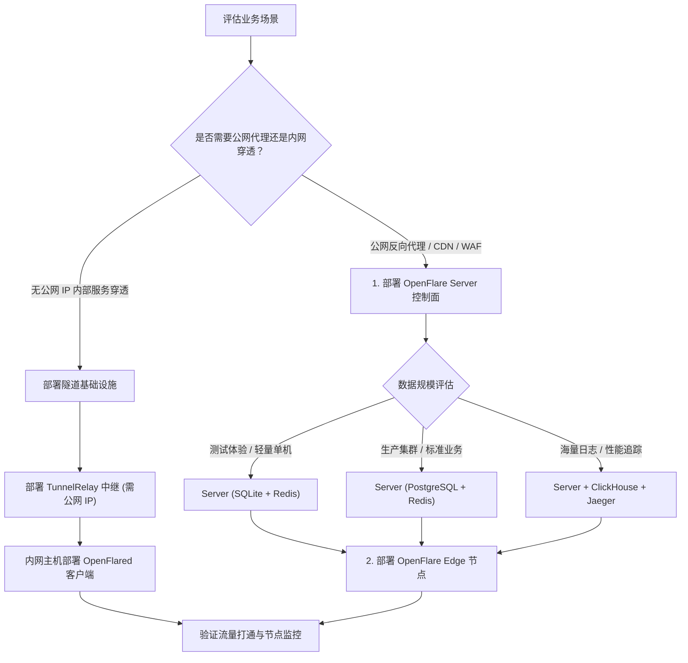

# 部署概览

OpenFlare 采用控制面与数据面解耦的分离架构。本节提供系统架构组件选型、部署决策路径与分模块部署指南。

## 核心组件与职责

| 组件 | 角色定位 | 核心职责 | 监听端口 / 网络依赖 | 部署参考 |
| --- | --- | --- | --- | --- |
| OpenFlare Server | 控制面 (Control Plane) | 管理后台 UI、管理 API、Agent 通信、站点配置生成与下发、指标聚合 | 默认监听 `:3000`；依赖 Redis；数据库支持 SQLite / PostgreSQL；可选 ClickHouse | [Server 部署](./server.md) |
| OpenFlare Edge | 数据面 (Data Plane) | 基于 OpenFlare Edge 构建的边缘网关，处理 TLS/HTTPS 终结、WAF 规则过滤、缓存加速、Pages 托管、主动探测与反向代理 | 默认监听 `:80` 与 `:443`；出网访问 Server HTTPS 端口 | [Edge 部署](./openflare-edge.md) |
| OpenFlare DNS | 智能权威 DNS (SmartDNS) | 独立高性能权威 DNS 解析节点，结合网络质量矩阵、ECS 识别与调度策略完成智能分流，支持离线快照容灾 | 默认监听 `53/udp` 与 `53/tcp`；出网访问 Server HTTPS 端口 | [SmartDNS 部署](./openflare-dns.md) |
| Relay (TunnelRelay) | 隧道中继 (Relay Node) | 管理 `frps` 守护进程，提供内网穿透公网接入端点，转发来自 Edge 的流量 | 默认监听 `:7000` (frpc 连接) 与 `:8080` (HTTP Vhost) | [Relay 部署](./relay.md) |
| OpenFlared | 隧道客户端 (Tunnel Client) | 管理 `frpc` 守护进程，部署于内网服务器，与公网 Relay 建立加密隧道 | 仅需出网访问 Server 端口与 Relay 的 `:7000` 端口 | [OpenFlared 部署](./openflared.md) |

## 部署决策路径

根据实际业务场景与基础设施规模选择部署路径：

### 推荐部署步骤

1. 部署控制面：先部署 [OpenFlare Server](./server.md)。测试环境可使用内置 SQLite，生产环境推荐使用 PostgreSQL 与 Redis 编排。
2. 部署边缘网关：在各地域节点部署 [OpenFlare Edge](./openflare-edge.md)。可在控制台使用发现令牌快速注册，或按 [边缘节点快速接入](./agent.md) 通过专属令牌接入并挂载性能策略。
3. 部署智能权威 DNS（可选）：若需按地域、ASN 与实时网络延迟自动分流，在公网节点部署 [OpenFlare DNS (SmartDNS)](./openflare-dns.md) 并完成 NS 子域委派。
4. 部署隧道基础设施（可选）：若需穿透无公网 IP 的内网机房或开发机服务，在公网机器部署 [Relay 中继](./relay.md)，并在内网环境运行 [OpenFlared 客户端](./openflared.md)。
5. 升级与运维保障：定期参考 [升级与维护指南](./upgrade.md) 对控制面、边缘节点与 SmartDNS 实例执行版本更新与备份。

## 文档目录索引

### 架构与概览
- [部署架构与说明](./deployment.md)：网络流量路径、硬件资源基线、源码编译与容器部署概览。

### 组件部署
- [Server 控制面部署](./server.md)：包含 SQLite 单机版、PostgreSQL 生产推荐版、ClickHouse / Jaeger 完整观测版及源码部署方式。
- [边缘节点快速接入](./agent.md)：边缘节点令牌类型、快速安装参数与运行状态检查。
- [OpenFlare Edge 部署指南](./openflare-edge.md)：OpenFlare Edge 节点发布包规范、Linux systemd 低权限加固、Docker 部署、双进程监督模型与平滑升级机制。
- [OpenFlare SmartDNS 部署](./openflare-dns.md)：独立权威解析节点 `openflare-dns` 的 Linux 一键安装、systemd 权限加固、Docker 容器部署与控制台远程更新。

### 隧道基础设施
- [Relay 隧道中继部署](./relay.md)：TunnelRelay 节点配置规范、frps 进程管理与端口映射要求。
- [OpenFlared 客户端部署](./openflared.md)：内网客户端配置参数、frpc 子进程托管与自动版本同步机制。

### 运维维护
- [升级与维护指南](./upgrade.md)：OpenResty 至 OpenFlare Edge 迁移流程、Server 镜像与源码升级、边缘节点自动更新及容灾恢复。
