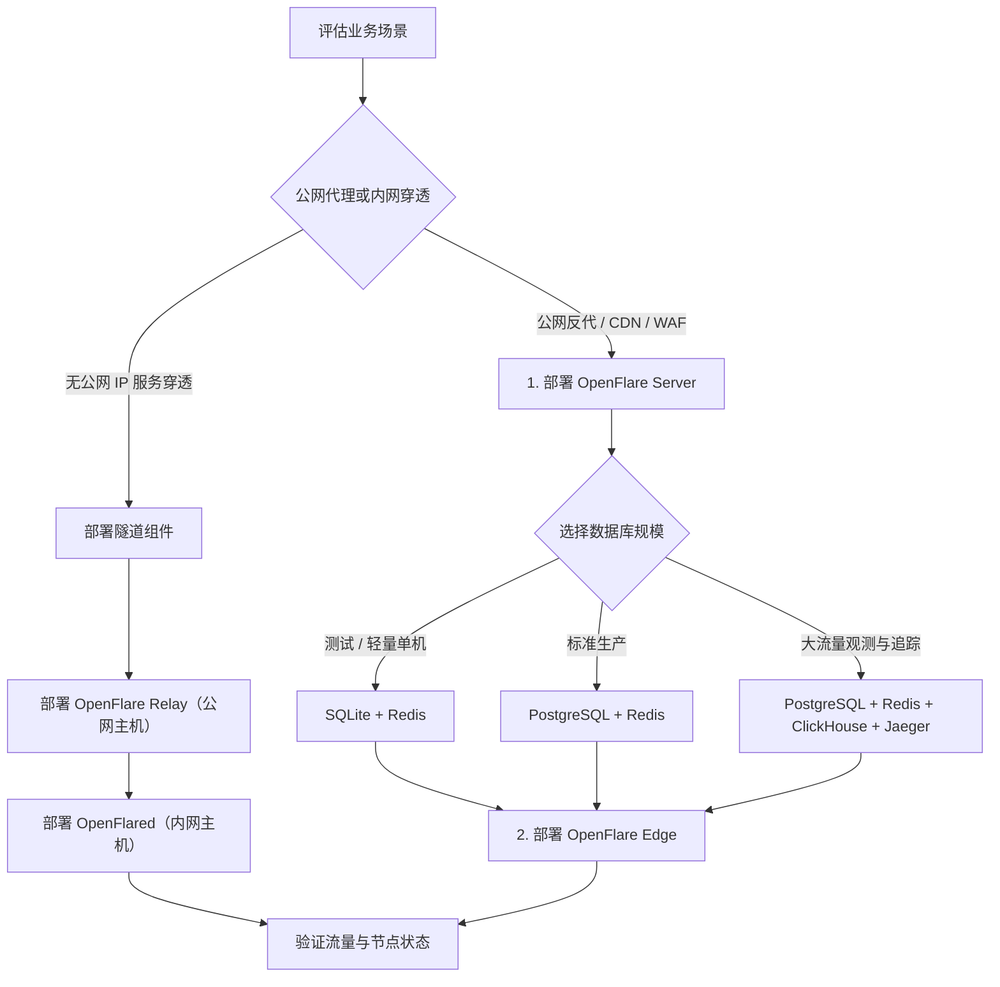

# 部署概览

OpenFlare 将控制面与数据面拆分为五个独立组件，可按业务场景按需组合部署。

## 组件分工

| 组件 | 定位 | 核心职责 | 端口与依赖 | 文档 |
| --- | --- | --- | --- | --- |
| OpenFlare Server | 控制面 | 控制台、管理 API、配置编译、任务调度与指标聚合 | 默认 `:3000`；依赖 Redis；主库支持 SQLite 或 PostgreSQL；可选 ClickHouse | [Server 部署](./server.md) |
| OpenFlare Edge | 数据面网关 | TLS 终结、WAF 过滤、缓存、Pages 托管、主动探测与反代 | `80/tcp`、`443/tcp`（容器内 `8080`/`8443`）；出网访问 Server | [部署 OpenFlare Edge](./openflare-edge.md) |
| OpenFlare DNS | 权威 DNS（SmartDNS） | 基于网络质量与 ECS 的权威 DNS 解析与离线快照容灾 | `53/udp`、`53/tcp`（容器内 `5353`）；出网访问 Server | [部署 OpenFlare DNS](./openflare-dns.md) |
| OpenFlare Relay | 隧道中继（`openflare-relay`） | 终结加密隧道、运行 Relay Gateway 并转发 L4 TCP/UDP 流量 | `7443/tcp`、`7444/tcp`、`8443/tcp` 及已分配 L4 端口 | [部署 OpenFlare Relay](./relay.md) |
| OpenFlared | 隧道连接器（`openflared`） | 在内网主动连接健康中继并将流量转发至内网服务 | 无入站端口；出网访问 Server 与 Relay | [部署 OpenFlared](./openflared.md) |

## 部署路径与顺序

1. **部署控制面**：按 [Server 部署](./server.md) 启动 OpenFlare Server（测试用 SQLite，生产用 PostgreSQL 与 Redis）。
2. **部署边缘网关**：按 [部署 OpenFlare Edge](./openflare-edge.md) 接入边缘节点，并在控制台分配性能策略。
3. **部署权威 DNS（可选）**：按 [部署 OpenFlare DNS](./openflare-dns.md) 部署独立解析节点并配置 NS 委派。
4. **部署隧道组件（可选）**：在公网主机部署 [OpenFlare Relay](./relay.md)，在内网主机部署 [OpenFlared](./openflared.md)。
5. **规划与维护**：端口与资源规划见 [部署规划与基线](./deployment.md)，更新与回滚见 [升级与维护](./upgrade.md)。
