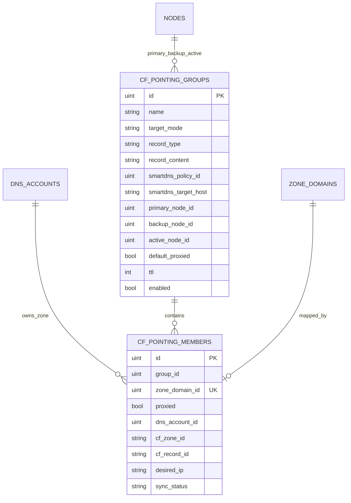

# 多云 DNS 指向与故障切换设计

OpenFlare 通过统一 DNS 账号与指向分组，将 `of_zone_domains` 中的具体或通配符 FQDN 幂等同步至外部 DNS 服务商（Cloudflare、阿里云 DNS、腾讯云 DNSPod），支持节点 IP 指向（含主备故障切换）、自定义记录与 SmartDNS CNAME 指向。该模块独立于 Zone 核心模型，不将 Zone 变为通用 DNS 控制台。

## 1. 统一 DNS 账号与作用域解析

* **多服务商适配（`internal/openflare/dnsprovider`）**：支持 `cloudflare`（支持橙云代理与一键委派）、`alidns`（阿里云 DNS，支持一键委派）与 `tencentcloud`（腾讯云 DNSPod）。
* **凭据与作用域发现（`internal/apps/openflare/dnsaccount`）**：账号加密保存在 `of_dns_accounts`，保存及每日定时任务自动拉取账号可见 Zone 列表存入 `scopes`，并更新 `verification_status`（`ready` / `error`）与 `last_checked_at`。
* **最长后缀路由（`dnsaccount.Resolve`）**：对成员域名按最长匹配注册区选择对应 DNS 账号；若多个账号存在同长度匹配区，优先沿用成员已绑定的 `dns_account_id` 或旧连接绑定的账号，避免跨账号误改记录。
* **历史连接平滑兼容**：迁移 `202611280002` 将早期独立 Cloudflare 连接（`of_cf_connections`）导入 `of_dns_accounts`；若关联账号尚未执行新作用域探测，仍保留既有解析回退路径。

## 2. 指向模式与分组模型

### 三种目标模式（`of_cf_pointing_groups.target_mode`）

| 模式 | 生成记录 | 核心行为 |
| --- | --- | --- |
| **`node`（节点模式）** | 单条 `A` 记录 | 指向 `active_node_id` 节点 IPv4；支持主备节点与心跳故障自动切换/回切 |
| **`custom`（自定义模式）** | `A`、`AAAA` 或 `CNAME` | 按分组 `record_type` 与 `record_content` 同步目标记录 |
| **`smartdns`（SmartDNS 模式）** | 仅 DNS `CNAME` | 指向委派区下 `smartdns_target_host` 并绑定 `smartdns_policy_id`，强制关闭橙云代理 |

### 代理（橙云）与分组 TTL

* **代理标记（`proxied`）**：仅在服务商支持代理（Cloudflare）且非 `smartdns` 模式时生效；新增成员初始化为分组 `default_proxied`，此后仅成员自身 `proxied` 决定同步状态；阿里云与腾讯云记录自动置为 `false`。
* **分组 TTL**：支持 `1`（Cloudflare 自动；阿里云/腾讯云回落 `600s`）或手动整数 `60–86400` 秒（历史兼容零值按 `300s` 处理）。开启 `proxied` 时强制使用自动 TTL。

## 3. 节点故障切换与隔离联动

* **周期故障检测（`cloudflare:failover_check` → `CheckNodeFailover`）**：对启用中的 `node` 模式分组检查 `active_node_id` 与 `primary_node_id` / `backup_node_id` 健康状态（未隔离、非 `offline`、非 `unhealthy`、无 `last_error` 且 `last_seen_at` 在 60 秒内）：
  * 主节点健康时自动回切至 `primary_node_id`；
  * 主节点异常且配置了健康的 `backup_node_id` 时切换 `active_node_id` 至备用节点，并立即派发整组同步任务。
* **节点紧急隔离联动（`FailoverQuarantinedNode`）**：控制台对节点触发紧急隔离时，立即将受影响的 `node` 分组切至健康备用或主节点并入队同步，阻断异常节点继续接收解析流量。

## 4. 幂等同步与并发控制

1. **64 分片成员锁**：`ReconcileMember` 按 `memberID % 64` 加锁，防止并发任务重复创建远端记录。
2. **缓存优先与唯一接管**：当成员已缓存 `cf_record_id` 且归属账号与 `cf_zone_id` 一致时先查询并就地更新（记录类型变更时先删旧建新）；缓存失效则按 `name + type` 列举：0 条新建、1 条接管更新、多条同名同类型记录拒绝接管并报错，防止误删用户原有负载记录。
3. **移除清理**：成员移出分组或删除分组时通过 `DeleteManagedRecord` 清理本模块托管记录，不触碰其他无关记录。
4. **异步执行载体**：批量与事件触发通过 Asynq 任务 `cloudflare:sync_member`、`cloudflare:sync_group`、`cloudflare:sync_by_node` 异步执行，节点心跳 IP 变化采用 best-effort 入队，不阻塞心跳响应。
