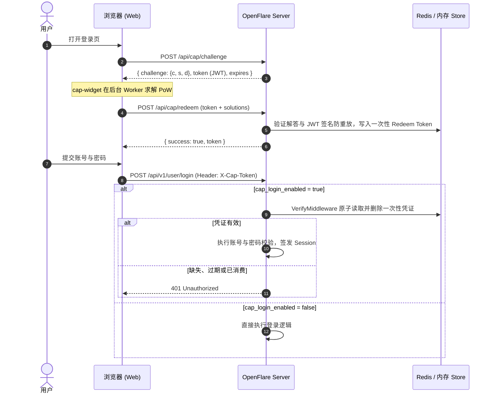

# 登录验证码设计 (Cap PoW 集成)

OpenFlare 控制面在用户登录端点集成开源工作量证明（PoW）人机验证组件 Cap，由浏览器后台计算 SHA-256 难题换取一次性凭证，在不依赖第三方图像验证码 API 的前提下防范针对 `admin` 等管理员账户的暴力破解与撞库请求。

---

## 1. 产品边界与模块分工

* **配置开关**：管理员可通过系统设置项 `cap_login_enabled` 动态开启或关闭登录验证码校验。
* **控制面后端（`internal/apps/cap/`、`pkg/cap/`）**：
  * `POST /api/cap/challenge`：公开接口，签发带过期时间的难题 JWT（默认 `scope = "login"`）与难度参数 `{ c, s, d }`；
  * `POST /api/cap/redeem`：校验解答与难题 JWT 签名，核销难题并向前端颁发一次性凭证 `token`（有效期写入 Redis 或内存 `Store`）；
  * `POST /api/v1/user/login`：挂载 `cap.VerifyMiddleware(mgr, "login")` 中间件，当开启验证时读取请求头 `X-Cap-Token` 并执行单次消费校验，无效或已消费则拦截返回 `401 Unauthorized`。
* **前端登录页**：按配置状态挂载 `cap-widget` Web Component 在 Worker 中无感求解，并在提交登录表单时附加 `X-Cap-Token` 请求头。

---

## 2. 验证流与防重放机制

### 安全机制说明

1. **难题时效绑定**：难题签名 JWT 内置过期时间戳，过期难题在 `/api/cap/redeem` 直接拒绝。
2. **难题防重放（Non-reusable Challenge）**：提交解答兑换凭证时以签名摘要作为防重放键，禁止同一难题被重复兑换多个 `X-Cap-Token`。
3. **登录凭证一次性消费（Single-use Token）**：`VerifyMiddleware` 采用原子读取并删除语义，凭证在首次校验后立即失效，防止截获历史 `X-Cap-Token` 重放撞库。
4. **多实例一致性**：生产环境启用 Redis 时自动使用 `pkgcap.NewRedisStore(db.Redis)` 在多副本之间共享凭证状态，未配置 Redis 时回落本地内存缓存。
