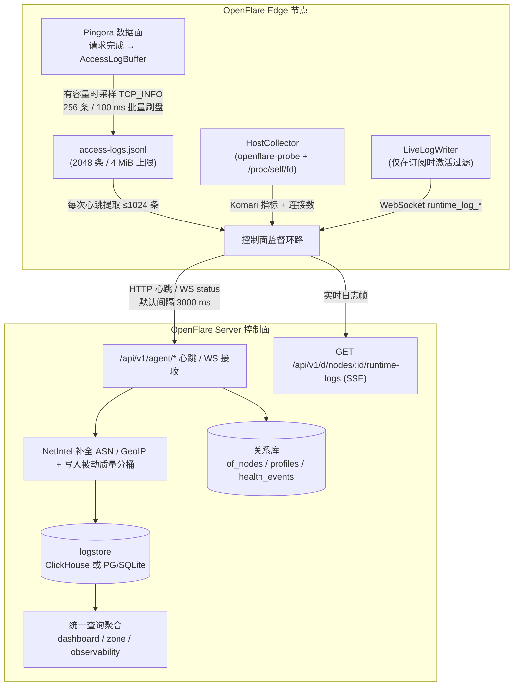

# 边缘可观测性与流量统计架构

OpenFlare 可观测性体系围绕 **「边缘只采集原始事实，控制面统一入库与聚合解释」** 构建，由 `openflare-edge` 在数据面采集访问明细、宿主机资源计数、网关连接瞬时状态、被动 `TCP_INFO` 与按需实时运行日志，控制面通过 `internal/repository/logstore` 持久化至可切换的日志主库（ClickHouse 或 PostgreSQL/SQLite）并向看板、Zone 与节点页面提供统一口径的查询聚合。

---

## 1. 三层观测口径与互不对账原则

系统严格隔离三层物理意义不同的指标，前端与 API 不混用口径或互相校验相等性：

| 层级 | 核心问题 | 数据源 | 存储表 / 位置 | 典型产品指标 |
| :--- | :--- | :--- | :--- | :--- |
| **L1 业务交付** | 实际交付了多少内容、服务了多少请求 | `openflare-edge` 每请求生成的 `access_logs` | `of_node_access_logs`（CH 含小时物化视图 `of_access_log_hourly`） | 已提供数据（`sum(bytes_sent)`）、接收数据（`sum(request_length)`）、请求数、独立访客（`uniqExact(remote_addr)`）、状态码、Top 域名、WAF 审计与来源地区 |
| **L2 边缘健康** | 代理运行时是否存活、当前建立连接数 | 控制面最近状态 + `edge_health` 瞬时连接读数 | 主库 `of_nodes` 最新状态列（`openresty_status`、`openresty_message`、`openresty_connections`） | 节点健康状态、在线/离线阈值判定、当前已建立连接数 |
| **L3 宿主机容量与主动探测** | 节点硬件利用率、宿主网卡与多点延迟 | `openflare-probe` OS 读数（Komari 对齐）与隔离探测子进程 | `of_node_metric_snapshots`、`of_node_system_profiles`、`of_node_ping_records` | CPU/GPU/内存/Swap/负载/磁盘 IO、宿主机网卡 `net_in`/`net_out`/`net_total_*`、Ping 延迟曲线 |

此外，被动采集的 `tcp_rtt_us`、`tcp_retrans` 与主动诊断结果协同汇入 [网络情报与链路质量感知架构](./network-quality-design.md)（`of_network_quality_samples`）；面向管理员的即时排障通过内存广播通道按需流式输出 `runtime_logs`，不进入分析明细库。

> **口径隔离约束**：「已提供数据」是经代理响应体的 `sum(bytes_sent)`；「宿主机网卡出站」来自 OS 网卡计数器 `net_total_up` 的相邻非负差分；「当前连接数」是瞬时读数。三者分属不同层，**永不做相等性校验**。

---

## 2. 数据流、采集频率与缓冲模型

### 2.1 采集与发送机制

| 环节 | 机制与默认参数 | 说明 |
| :--- | :--- | :--- |
| **访问明细（L1）** | `AccessLogBuffer`（上限 `2048` 条 / `16 MiB` 内存信号量）按 `256` 条或 `100 ms` 刷写至 `$STATE_DIR/access-logs.jsonl`（带 `flock`，`0600`，上限 `2048` 条 / `4 MiB`） | 心跳每次提取最多 `1024` 条上报，仅在控制面返回 HTTP 200 确认后截断已确认前缀；队列满时跳过非关键 `TCP_INFO` 采样并按丢弃计数保护转发主链路 |
| **节点连接计数（L2）** | 基于 `/proc/self/fd` 统计当前进程处于 `connected` 状态的套接字数量 | 直接写回主库 `of_nodes` 最新状态；历史 `of_node_edge_health` 时序表已移除 |
| **主机容量（L3）** | 经 `openflare_probe::ProbeCollector` 读取 OS 读数（Komari 模型），按每次心跳节拍上报 | `net_total_up` / `net_total_down` 与 `disk_*_bytes` 上报累计原值；控制面计算相邻非负差分（若差值 `< 0` 视作重启清零，当段记 `0`） |
| **离线补传** | `buffered[]` 按采集时间窗暂存断网期间的 `host_metrics`、`edge_health` 与 `access_logs` 事实批次 | 默认保留窗口约 `60` 分钟（`observability_replay_minutes`），恢复连接后沿同一入库逻辑回放 |
| **心跳与离线判定** | 默认心跳间隔 `3000 ms`（`agent_heartbeat_interval`）；连续 `60000 ms` 未收到有效心跳标记为离线（`node_offline_threshold`） | WebSocket 连接正常时复用同一 `NodePayload` 结构上报 `status` 消息，不重复发起 HTTP 心跳 |

### 2.2 按需实时运行日志（Runtime Logs）

* **零闲置开销**：`edge/src/telemetry/runtime_logs.rs` 注册动态 `tracing` 过滤层，仅当存在活跃订阅者（`has_subscribers() == true`）时才捕获日志行；内部广播缓冲区容量 `128` 行、单行上限 `4096` 字节。
* **WS → SSE 中继**：管理员请求 `GET /api/v1/d/nodes/{id}/runtime-logs` 时，控制面通过 WebSocket 向目标节点下发 `runtime_log_subscribe`（每批最多 `8` 行、节拍 `100 ms`、单次租约 `45s` 并随 SSE `: keepalive` 续租），向前端推流 `ready`、`logs` 与 `closed` 事件；节点进入隔离态或浏览器断开时立即取消订阅。

---

## 3. 聚合口径与多库统一

所有业务流量统计（全局概览看板、Zone 统计与单节点详情）均以 `of_node_access_logs` 为唯一数据源执行统一查询：

* **已提供数据 / 接收数据**：`sum(bytes_sent)` 与 `sum(request_length)`；
* **请求数与错误数**：`count()` 与 `countIf(status_code >= 500)`；
* **独立访客（UV）**：对整窗原始日志执行 `uniqExact(remote_addr)`，**禁止**对小时物化视图行做 UV 求和（`of_access_log_hourly` 基于 `SummingMergeTree` 仅累加可加和字段，不存储 UV）；
* **WAF 审计与缓存结果**：原始入库 `waf_action`、`waf_audit` 与 `cache_status`（`HIT`、`MISS`、`BYPASS`、`EXPIRED`、`STALE`、`UPDATING`、`REVALIDATED`、`-`）；控制面在展示层派生「命中缓存 / 回源 / 未使用缓存」三态标签。

> [!NOTE]
> `NodePayload` 顶层字段 `openresty_status`、`openresty_message` 与节点表列 `openresty_connections` 保留既有字段名以维持跨版本线缆协议与数据库列兼容性，其运行时数据源全部来自 OpenFlare Edge（`engine = "pingora"`）。

---

## 4. 代码映射

| 领域 | 路径 |
| :--- | :--- |
| 通信协议与结构体 | `internal/openflare/protocol/agent.go` |
| 节点采集与缓冲 | `edge/src/telemetry/access_log.rs`、`edge/src/telemetry/host.rs`、`edge/src/telemetry/runtime_logs.rs` |
| 控制面接收与 WS 流转 | `internal/apps/openflare/agent/observability.go`、`internal/apps/openflare/node/runtime_logs.go` |
| 日志双库抽象与查询 | `internal/repository/logstore/` |
| 聚合视图与 Zone 统计 | `internal/apps/openflare/observability/analytics.go`、`internal/apps/openflare/zone/stats.go` |

协议完整字段定义与 DDL 参见 [OpenFlare Edge 上报协议与观测数据模型](./observability-data-model.md)，日志双库切换规则参见 [日志存储解耦](./logstore.md)。
