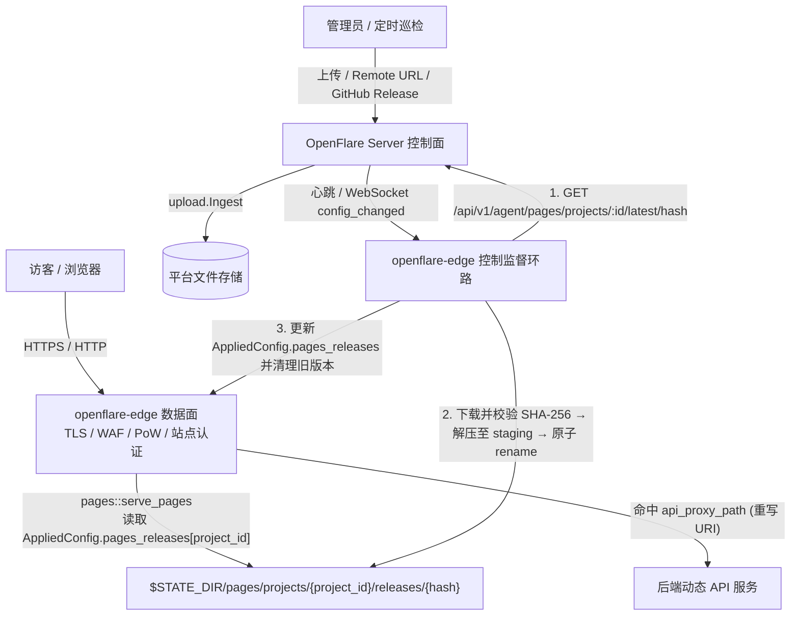

# Pages 静态托管设计

OpenFlare Pages 将「预构建静态产物导入」与「反向代理域名绑定」统一纳入控制面管理：控制面接收本地归档上传或从外部来源拉取预构建包，经统一安全性与入口校验后持久化为不可变部署（Deployment）；`openflare-edge` 通过 `sites.v1` 项目锚点按需同步当前激活包的最新哈希与内容，在本地直接提供支持 `ETag`、`Range`、SPA Fallback 与内嵌 API 代理的静态服务。

---

## 1. 核心定位与部署源

* **三类部署源**：每个项目可保持纯手工上传（`manual`），或绑定单个可变来源（`Remote URL` / `GitHub Release`）。变更或移除来源配置不影响既有的不可变部署与现役线上版本。
* **产物流水线统一**：本地上传与外部同步统一走「下载 / 接收归档 → 流式内容与路径安全校验 → `upload.Ingest` 入库 → 创建或复用 Deployment」。手工上传默认停留在候选态（`candidate`），需管理员显式激活；外部源手动同步与 GitHub `latest` 自动更新（启用 `auto_update_enabled` 后）在同一业务事务内创建并激活新部署，支持一键原子回滚历史版本。
* **后台来源巡检**：内置系统任务 `openflare:pages_source_scan`（默认每 5 分钟运行一次，每批最多串行检查 20 个启用自动检查的 GitHub `latest` 来源）按「恢复过期租约 → 补偿孤儿上传 → 扫描到期来源」执行；手动同步与自动同步通过 `config_version` 与租约机制互斥防重。

---

## 2. 系统架构与数据流

### 控制面实体（`internal/apps/openflare/pages`）

| 表名 | 核心职责 |
| :--- | :--- |
| `of_pages_projects` | 项目名称、Slug、启用状态、子目录 `root_dir`、入口文件（默认 `index.html`）、`spa_fallback_enabled` / `spa_fallback_path` 与 API 反代规则（`api_proxy_enabled` / `api_proxy_path` / `api_proxy_pass` / `api_proxy_rewrite`） |
| `of_pages_project_sources` | 可变外部来源配置（`source_type`、`config_version` 防旧任务覆盖；完整远程 URL 仅保存在服务端配置中，不泄露至对外响应或日志） |
| `of_pages_project_source_runtime` | 与来源 1:1 关联运行态游标（ETag、已见/已应用 revision、退避与租约，状态为 `idle` / `checking` / `update_available` / `syncing` / `failed` / `attention`） |
| `of_pages_deployments` | 不可变部署事实（项目内递增部署号、整包 SHA-256 `checksum`、`upload_id`、文件数与总字节数、来源 provenance 快照） |
| `of_pages_deployment_files` | 常规文件路径与实际字节数清单 |

### 双轨版本关系

主配置版本（`sites.v1`）中 Pages 路由携带稳定的项目锚点（`pages_project_id` 与入口/SPA/API 代理策略），不锁定具体某次 `deployment_id`。项目内激活回滚或发布新版本时**无需重发主配置**——`openflare-edge` 在定期对账与事件唤醒中直接轮询各引用项目的 `latest/hash` 并原子切换内存中的 `pages_releases[project_id]` 映射。

---

## 3. 安全校验、容量边界与生命周期

### 3.1 控制面入库约束

* **支持格式**：`zip`、`tar.gz`/`tgz`、`tar.xz`/`txz`、`tar.bz2`/`tbz2`、`tar`、`7z`。
* **体积与数量限制**：压缩包上限由 `pages_max_package_size_mb`（默认 `100 MiB`，可调范围 `1–2048`）控制；展开后单文件及总大小上限为「包上限 × 4」（不低于 `100 MiB`）；常规文件数不超过 `1,000` 个。校验过程采用流式读取实际字节，不一次性将归档读入内存。
* **安全防御**：拒绝任何软链接（symlink）、`..` 路径逃逸与绝对路径，自动剥离打包产生的单一公共根目录前缀，并校验配置的入口文件确实存在于解包目录。
* **历史版本裁剪**：`pages_max_history_count`（默认 `20`，`0` 表示不限制）在部署后自动裁剪超出上限的非激活部署，并通过 `upload.Remove` 幂等清理关联上传记录（`history_count=1` 时保留当前激活与最新候选版本）。

### 3.2 边缘节点同步与服务（`edge/src/pages/`）

1. **防竞态两阶段校验**：`PagesSyncer` 拉取 `/api/v1/agent/pages/projects/{project_id}/latest/hash`，若本地 `releases/{hash}` 尚未就绪，则流式下载 `/latest/package`（节点硬上限 `2 GiB`），并在下载完成后**再次查询 `latest/hash`** 确认期间未发生切换与整包 SHA-256 一致。
2. **隔离解压与复核**：解压至随机临时目录 `.{hash}-<ts>.tmp`（拒绝软链接、特殊文件、路径逃逸及超过 `1,000` 文件 / `8 GiB` 单文件与总容量上限），遍历实际文件树核对文件数、总字节与入口文件存在性后写入 `.openflare-pages.json` 标记，再原子重命名为 `releases/{hash}`。
3. **请求执行路径（`edge/src/pages/serving.rs`）**：
   * 在 Pingora 请求管线完成 Site Auth、WAF 与 PoW 校验后，优先判定 `pages_api_target`；若命中 `api_proxy_path`，按 `api_proxy_rewrite` 改写 URI 与查询串并转发至 `api_proxy_pass` 上游（兼容 WebSocket 升级）；
   * 静态请求先过滤 `..`、`\`、`\0` 与 `.openflare-pages.json` 等非法片段；命中目录且缺少末尾 `/` 时响应 `301` 补全斜杠；文件不存在且启用 `spa_fallback_enabled` 时回退渲染 `spa_fallback_path`（默认 `index.html`）；非 `GET`/`HEAD` 请求返回 `405`；
   * 响应自动生成强 `ETag`（`"{mtime:x}-{size:x}"`）与 `Last-Modified`（支持 `304 Not Modified`），完整支持 `Accept-Ranges: bytes`、`If-Range` 与单段 `Range`（`206 Partial Content` / `416 Range Not Satisfiable`），以 `64 KiB` 分块流式写出。开启站点认证时强制附加 `Cache-Control: private, no-store`。
4. **旧包清理**：新版本在 `AppliedConfig.pages_releases` 切换就绪后清理同一项目目录下不再活跃的旧 `releases/*`，降低节点磁盘占用。
