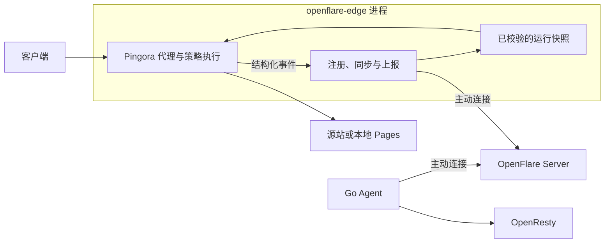

# Pingora 边缘节点设计

本设计定义 OpenFlare 的两条边缘节点开发线。现有 Go Agent 与 OpenResty 继续维护和发布。Pingora 开发线以独立的 Rust 程序 `openflare-edge` 提供节点接入、规则执行、流量代理和遥测上报，两类节点接入同一个 OpenFlare 主控。实现顺序和验收条件见 [Pingora 边缘节点开发说明](./pingora-edge-development.md)。

## 节点与主控的职责

| 组件 | 职责 |
| --- | --- |
| OpenFlare Server | 管理节点凭证、路由、证书、安全策略、Pages 部署与发布版本，按节点所属发布组返回目标配置，记录实际生效版本。 |
| Go Agent 和 OpenResty | 继续使用现有安装、发布和运行方式。Agent 拉取配置并驱动 OpenResty，适用现有 [Agent 与发布模型](./agent-design.md)。 |
| Rust 节点 | 一个二进制、一个常驻进程。注册、同步、文件下载、配置校验、请求处理及遥测由进程内模块完成。Pingora 提供 HTTP 代理框架。 |

Rust 节点主动连接主控。主控发布期望的配置版本，节点自行拉取、应用、回滚并上报结果。进程启停、崩溃恢复和监听套接字交接都在节点或部署环境本地完成。节点的业务监听使用 HTTP/1.1 和 HTTP/2，HTTP/3 不作为发布条件。缓存使用固定版本的 Pingora 缓存接口，随上游演进。 [Pingora 0.9.1 能力说明](https://github.com/cloudflare/pingora/tree/0.9.1#feature-highlights)

首阶段以现有 Go Agent 与 OpenResty 的对外行为为基线。同一份业务配置在两个引擎上应产生一致的路由选择、回源行为、安全决策和客户端响应。线程数、连接池等性能参数沿用 Pingora 默认值，本阶段后置性能调优。影响客户端行为的产品默认值仍按功能契约实现，例如请求体超过默认限制时的响应。

## 接入与离线启动

安装时只需要对应平台的二进制、主控 HTTPS 地址、接入凭证，以及可写的状态目录。监听端口的权限由部署环境提供。首次使用发现凭证时，节点生成并持久化 `registration_key`，注册重试时复用该值。注册成功后，原子保存主控返回的节点 ID 与专属凭证，并停止使用发现凭证。已分配节点可用节点专属凭证接入。配置规则、证书绑定和 Pages 部署均在主控发布，无需登录节点编辑文件。

首次启动没有有效快照时，节点能注册和报告等待配置，但不接管正式流量。曾成功应用配置的节点先从磁盘恢复上次有效版本，再连接主控检查更新。主控不可达时继续按本地快照代理，重连使用带抖动的退避。认证失效与网络中断分别上报或记录，认证失效时保留本地身份并停止拉取，避免重复注册生成节点。

请求处理只读本地快照和节点状态。运行中的 WAF、PoW、限流、证书选择与上游选择均在本地执行。节点只监听业务端口，健康状态、配置结果和遥测复用节点主动建立的连接。

## 两种引擎的发布隔离

现有节点使用全局活跃版本。Rust 节点上线时，主控对 Pingora 节点新增独立的发布组与活跃指针。发布组第一阶段只需要一个默认 Pingora 试点组。Go 节点仍读取现有指针，试点的发布、失败和回滚不改变 Go 节点的期望配置。两种引擎继续共用管理界面的路由、证书、安全策略和 Pages 资源。

主控记录经过认证的节点引擎和所属发布组，以此决定可见的版本、资源及通知。缺少引擎标记的历史节点按 Go/OpenResty 处理。新节点在接入时登记引擎，单次心跳或请求参数不能改变已绑定的引擎或发布组。待实现的能力协商包含配置契约版本和支持的特性，主控在发布前检查目标组是否能执行配置。节点也独立校验，遇到不支持的必需规则或认证配置时拒绝整个候选版本。

Pingora 使用独立的版本化配置载荷。主控从同一份业务发布快照派生载荷，表达路由、源站、证书引用、规则图和资源清单。Rust 节点读取业务字段并编译为内存结构。现有 `source_config_json` 是设计编译输入时的语义参考，由 Go/OpenResty 继续消费。新契约单独定义规范与测试样例，避免依赖 Nginx 模板、生成的配置文件或 Lua 模块布局。

| 标识 | 作用 |
| --- | --- |
| 节点版本 | `openflare-edge` 自有 SemVer，独立于 Server、Go Agent 和 Pingora 依赖版本。 |
| 契约版本 | 标记 Rust 配置载荷结构及语义。阻止旧节点误用需要新能力的配置。 |
| 配置版本 | 对应主控的业务发布快照，用于审计和回滚。 |
| 发布序号与载荷摘要 | 同一发布组的发布序号单调递增，摘要校验实际下发的载荷。回滚到早期配置时使用新的发布序号。 |

现有 OpenResty 的 `checksum` 与其渲染和发布模型关联，Pingora 载荷声明自己的内容摘要。证书、Pages 部署包、WAF IP 组等各自携带 ID 与摘要。允许独立更新的资源通过版本化引用和单独同步路径更新，回显实际生效的资源版本。 [现有 Agent 发布模型](./agent-design.md)

## 配置热更新与回滚

1. 节点收到 WebSocket 通知或从心跳发现目标版本变化后主动拉取。重连时重新查询当前目标。合并重复通知，同一节点只执行一轮配置准备，较旧的候选不能覆盖已知的新目标。
2. 校验契约版本、摘要、必需特性和资源引用。按大小限制下载缺失的证书、规则数据与 Pages 包，在后台准备路由表、证书索引和匹配器。失败时保持正在服务的快照，并报告失败的版本和原因。
3. 将完整候选写入独立目录，校验并持久化资源后，原子替换本地的当前快照引用，同时保留上一份有效快照。然后在进程内一次性发布新的不可变快照。重启时优先从持久化引用恢复。应用结果只在实际切换后上报。
4. 后续请求读取新版本，在途请求沿用已选定的路由和策略。TLS 握手和请求处理分别在各自入口读取生效数据。WebSocket、SSE 等长连接只保留其处理所需的对象，避免长时间持有整份旧快照。

主控回滚时将旧配置作为新的发布目标。节点仍走完整校验、准备和切换流程。下载失败、磁盘写失败或配置无效时，保留旧快照并退避重试。若启动时最新快照损坏，尝试恢复保留的上一个版本，实际版本随下一次心跳上报。

## 运行、恢复与二进制升级

路由、证书与支持热更新的策略走进程内切换。监听地址或二进制变化通过本地部署流程更换进程。单次替换保持一份发布包，计划内升级期间可短暂运行新旧两个进程。启用 Pingora 平滑升级时，由旧进程交接可复用的监听套接字，新进程完成快照准备后接受新连接，旧进程在排空期限内处理已有连接。升级包需预先验证，新进程就绪和回退条件由本地流程判断。 [Pingora 平滑升级](https://github.com/cloudflare/pingora/blob/0.9.1/docs/user_guide/graceful.md) · [Pingora 就绪示例](https://github.com/cloudflare/pingora/blob/0.9.1/pingora/examples/graceful_upgrade.rs)

原生部署可用 systemd 监督 Rust 进程，容器使用容器运行环境的重启策略。进程退出后以本地最后有效快照恢复，不等待主控。单进程致命故障会断开该实例的连接。要求节点故障期间继续接流量时，在入口部署多个独立实例并按健康状态摘除故障实例。

## 请求处理与功能边界

在 Pingora 的请求处理阶段执行路由、安全策略和响应处理。过滤器的执行顺序以 OpenResty 的现有结果为准，特别是同一路由同时启用 WAF、PoW、站点认证和 Pages API 代理时。请求完成后生成结构化访问明细，按现有观测模型上报。 [Pingora 请求处理阶段](https://github.com/cloudflare/pingora/blob/0.9.1/docs/user_guide/phase.md) · [观测数据传输模型](./observability-transport-model.md)

- 代理内部沿用框架默认 I/O 设置。流式上传、SSE、请求体检查和回源重试等涉及客户端或源站的行为，以现有功能结果为准。需要在回源前拒绝的请求应先完成必要检查。
- 节点自行实现的配置下载、规则检查和遥测缓冲使用固定默认上限。这些边界用于确保配置失败或主控不可达时仍能继续代理，首版不提供性能调优入口。
- 缓存策略由主控配置。Rust 节点通过独立适配层使用上游缓存接口，配置语义、容量和行为以该节点版本支持的 Pingora 能力为准。已启用但不支持的必需缓存策略在发布时拦截，避免生成行为不同的配置。
