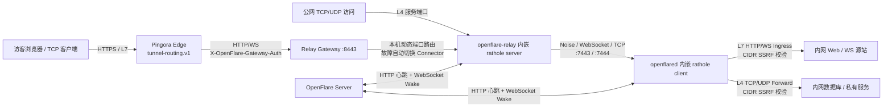

# 内网穿透隧道设计文档

本文档说明 OpenFlare 原生内网穿透子系统的架构设计、控制面数据模型、多中继高可用调度机制、内嵌 rathole 数据面协议、边界安全校验与独立版本升级机制。

---

## 设计背景与架构演进

内网源站通常部署于局域网、私有 VPC 或无公网 IP 的环境，无法直接对外暴露入站端口。OpenFlare 彻底废除早期基于外部 `frps`/`frpc` 进程的包装方案，改以原生 Rust 工作区 `tunnel/`（内嵌 `rathole` 引擎）构建新一代高可用穿透体系：

1. **进程内嵌与零外部二进制依赖**：`openflare-relay` 与 `openflared` 直接通过库形式链接 `rathole`，通过内存管理配置与运行时生命周期，消除第三方可执行文件路径依赖及子进程孤儿残留风险。
2. **中继池与可用区容灾（Closest-K）**：引入 `Pool → Relay → Tunnel → Connector → Attachment` 多对多调度模型，支持按 `zone_tag` 故障域分散接入多台健康中继，结合 RTT 探测与迟滞切换（Make-Before-Break）实现跨中继高可用。
3. **L7 与 L4 双协议穿透**：同时支持 Pingora Edge 协同的 L7 HTTP/WebSocket 反向代理，以及通过中继节点直接暴露的 L4 TCP/UDP 端口转发。
4. **独立发布线与双槽位自更新**：隧道组件采用 `tunnel-v*` 独立版本标签与二进制双槽位（`next → trial → active`）自更新通道，与 Server 主版本解耦演进。

---

## 控制面数据模型

控制面在主数据库维护 6 张核心关系表（统一采用 `w_` 前缀，无物理外键，由 `internal/repository/openflare_tunnel.go` 与 `internal/apps/openflare/tunnel/` 驱动）：

| 数据表 | 核心职责 |
| :--- | :--- |
| `w_tunnel_relay_pools` | 中继池定义：配置默认传输偏好（`auto` / `noise` / `websocket` / `tcp`）、回退传输顺序、默认高可用中继数（`ha_relays`）、就近探测策略、允许/禁止回源 CIDR 及升级渠道。 |
| `w_tunnel_relays` | 公网中继实例：记录公网传输地址、网关地址、`transport_port`（默认 7443）、`ws_port`（默认 7444）、`gateway_port`（默认 8443）、Noise 公私钥、网关签名密钥、`zone_tag`、`colocated_edge_node_id`、排水状态（`draining`）、隔离状态与运行时遥测。 |
| `w_tunnels` | 逻辑隧道实体：绑定所属中继池（`pool_id`）、默认传输协议与独立 CIDRs 安全策略，签发唯一 `tunnel_token` 并支持紧急隔离与密钥轮换。 |
| `w_tunnel_connectors` | 内网连接器实例：同一隧道可横向部署多个 `openflared` 副本（按持久化 `connector_id` 区分），记录公网出口 IP、版本号、契约版本与在线租约（`lease_expires_at`）。 |
| `w_tunnel_attachments` | 隧道附加状态账本：记录各连接器当前附着的中继、活跃传输协议、服务编号、往返时延（RTT）与负载摘要。 |
| `w_tunnel_services` | L4/L7 转发服务定义：声明 `tcp` / `udp` 监听端口、目标内网地址及扩展选项（L7 HTTP/WS 可直接由 `/proxy-routes` 绑定 `tunnel_id` 自动接入，亦支持静态服务配置）。 |

> [!NOTE]
> 数据库迁移 `202611230004`–`202611230006` 及 ClickHouse 迁移 `202611230001` 会清除旧版 FRP 表结构与 `tunnel_relay`/`tunnel_client` 遗留节点记录，保证现有实例平滑升级至新体系。

---

## 系统架构与通信链路

### 1. 控制面接入与引导令牌（Bootstrap Token）

`oftok1_` 引导令牌采用无填充 Base64URL 编码的 JSON 载荷，内置 `server_url`、`kind`（`relay` 或 `tunnel`）、原始接入密钥与目标池标识（`pool`）。运维人员在主机或容器启动 `openflare-relay` 或 `openflared` 时，仅需传递 `--token oftok1_...`（或写入 `--token-file`），进程即自动解析控制面地址与身份凭据：

- **中继端自动发现注册**：使用池级 `discovery_token` 或单节点 `access_token` 请求 `POST /api/v1/relay/register`，控制面分配全局唯一 `relay_id`、Noise X25519 密钥对与 `gateway_secret`，并在本地 `$STATE_DIR/relay_identity.json`（权限 `0600`）持久化来源令牌摘要（`source_token_sha256`），确保常规重启与自更新升级期间复用既有身份而不重复注册。
- **实时唤醒与增量同步**：中继与客户端分别维持 `/api/v1/relay/ws` 与 `/api/v1/tunnel/ws` 长连接以接收拓扑变更、配置修订通知、升级计划及隔离/吊销广播；同时辅以周期性心跳（默认 5 秒心跳、30 秒租约 TTL）与配置拉取保证最终一致性。

### 2. 多中继发现与 Make-Before-Break 容灾调度

`openflared` 周期向控制面 `GET /api/v1/tunnel/relays/discover` 拉取所属池内的候选健康中继（排除已隔离或处于 `draining` 排水状态的中继），并在本地执行就近调度：

1. **并行延迟探测**：向各中继网关的 `/_openflare/health` 发送探测请求，维护指数加权移动平均（EWMA）RTT，并结合中继当前负载、权重与健康状态评分。
2. **故障域分散（Zone Diversity）**：优先从不同 `zone_tag` 的可用区中挑选最优的前 `K` 个中继（由 `ha_relays` 控制，默认 2 个），避免所有连接集中于同一机房。
3. **迟滞与先建后断（Make-Before-Break）**：仅当候选替代中继连续 2 轮探测优于现役中继且超过阈值时才触发替换，并在新中继 rathole 隧道就绪后再注销旧连接，抑制网络微抖动引起的震荡。
4. **多传输协议自适应与回退**：按中继池指定的 `preferred_transport` 与 `fallback_transports` 依次尝试 `noise`（基于端口 `7443` 的端到端加密通道）、`websocket`（端口 `7444` 穿透受限防火墙）或原生 `tcp`。

### 3. L7 边缘协同（`tunnel-routing.v1`）与 L4 安全直连

- **Pingora Edge 动态路由**：控制面向边缘节点额外发布 `tunnel-routing.v1` 清单（包含各隧道的健康中继 Gateway 端点列表、同可用区优先策略与网关密钥）。当站点的反向代理上游设置为某个 `tunnel_id` 时，Pingora Edge 将请求直接调度至就近或同机中继 Gateway（附带 `X-OpenFlare-Gateway-Auth`、目标内网地址及 `insecure_skip_verify` 选项）。
- **Relay Gateway 故障转移**：Relay Gateway 在校验边缘请求鉴权头后，按活跃连接器列表顺序转发至内嵌 rathole 实例，在单个 Connector 异常断开时自动故障转移至同隧道的其余健康副本。
- **L4 服务确定性凭据派生**：针对 TCP/UDP 转发服务，控制面基于 `tunnel_id`、`service_id` 与内部密钥确定性派生服务标识与 rathole `token`，同时校验同一中继下 `listen_port` 与 `gateway_port` / `transport_port` / `ws_port` 无端口冲突。
- **CIDR SSRF 防护**：`openflared` 在发起内网 L7/L4 建连前，强制对解析后的目标 IP（含 IPv4 映射的 IPv6 地址如 `::ffff:169.254.169.254`）核验 `allowed_cidrs` 与 `blocked_cidrs`（默认禁止 `169.254.169.254/32` 云元数据地址）。禁止或未命中的目标将被立即拦截（L7 返回 `403 Forbidden`，L4 拒绝转发）。

### 4. 紧急隔离、密钥轮换与双槽位自更新

- **一键紧急隔离（Quarantine）**：在控制台对指定 Relay 或 Tunnel 执行隔离后，控制面立即吊销其接入令牌、失效会话缓存并通过 WebSocket 下发强制下线指令，Pingora Edge 在下一配置版本同步中自动剔除相关中继，解除隔离时同步签发全新令牌并生成新部署命令。
- **双槽位二进制热更新**：在受 systemd 托管（携带 `NOTIFY_SOCKET` 与 `INVOCATION_ID`）的 Linux 非 root 运行环境下，`openflare-relay` 与 `openflared` 支持从 GitHub Release（`tunnel-v*`）拉取发布包并核验 `SHA256SUMS` 与 `--version` 输出，经 `next → trial → active` 双槽位切换完成原子替换与服务自愈。
