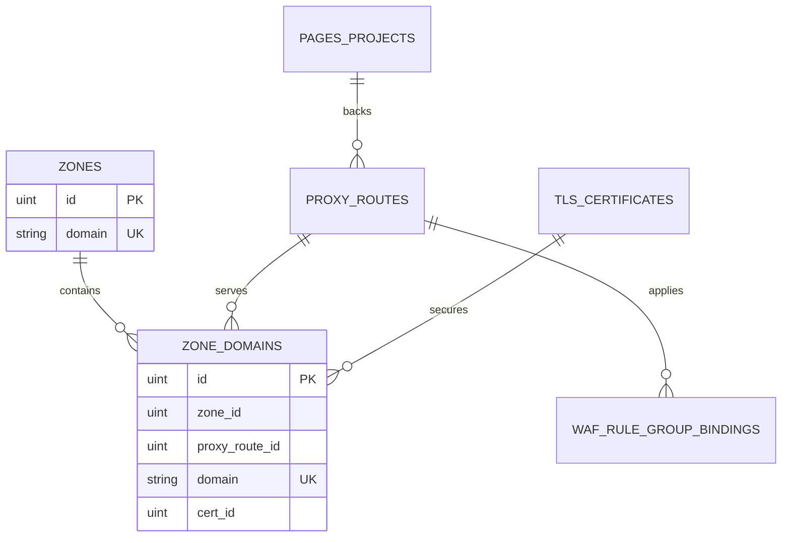

# Zone 与域名资源设计

OpenFlare 以可注册根域（Zone）作为站点域名的管理边界。管理员通过稳定的 Zone ID 入口维护根域下显式声明的具体域名或通配符域名，并将域名关联至反代路由与 TLS 证书；反向代理策略（上游、缓存、限流、WAF 与 Pages）仍以路由为配置单元。

Zone 核心不内建权威 DNS 记录托管；如需将域名记录同步至外部 DNS 服务商或接入 SmartDNS 调度，使用独立模块[多云 DNS 指向与故障切换设计](./cloudflare-pointing.md)。

---

## 1. 范围与约束

* **根域解析**：Zone 根域通过 Public Suffix List（`publicsuffix`）识别，例如 `api.example.co.uk` 归属于 `example.co.uk`。管理端路由采用稳定 ID（`/websites`、`/websites/:zoneId`），避免将域名放入路径参数。
* **具体与通配符域名**：Zone 根域禁止使用通配符；Zone 域名支持具体 FQDN 或最左侧单标签通配符（例如 `*.example.com`、`*.s3.example.com`）。校验阶段去除 `*.` 前缀后核对注册根域归属，拒绝非法 DNS 标签与空白字符。
* **多对一绑定边界**：一个 Zone 域名至多绑定一条反代路由；一条反代路由可跨 Zone 绑定多个域名，共享同一套上游、WAF、限流与缓存配置。

---

## 2. 核心数据模型

* **`of_zones`**：持久化全局唯一的注册根域（创建后不可就地改名）。删除 Zone 前须先清空其下全部域名。
* **`of_zone_domains`**：持久化 `zone_id`、ASCII/Punycode 唯一域名 `domain`、可空 `proxy_route_id` 与可空 `cert_id`。所有外联字段均建索引且不设物理外键。删除已绑定路由的域名须先解除绑定。
* **编译期组装**：`of_proxy_routes` 仅保留路由策略，不再持久化域名或证书列；编译 `sites.v1` 快照时，控制面在内存中从关联的 `of_zone_domains` 聚合 `domains` 与 `domain_cert_ids` 下发至边缘节点。

---

## 3. API 与前端集成

管理端在 `internal/apps/openflare/zone/` 暴露 `GET/POST /api/v1/d/zones`、`/zones/:id/update|delete|overview|stats|domains` 等接口；反代路由写入通过 `zone_domain_ids` 完成绑定，控制面在单一事务内校验域名归属、全局唯一性与 TLS 证书 SAN 覆盖范围。

控制台 `/websites/:zoneId` 聚合展示当前 Zone 的域名清单、关联路由、引用证书与流量统计（`24h` / `7d` / `30d`）；支持按 `*` 快捷补全通配符子域并联动管理 DNS 指向状态。

---

## 4. 通配符运行与统计语义

1. **边缘路由与 TLS SNI 匹配（`openflare-edge`）**：
   * `edge/src/config.rs`（`find_route` 与 `domain_matches`）对通配符执行**单层左标签匹配**（`*.example.com` 匹配 `a.example.com`，不匹配 `example.com` 根域，也不跨级匹配 `a.b.example.com`），当精确域名与通配符同时命中时优先匹配精确域名。
   * HTTPS 路由要求证书 SAN 显式覆盖对应通配符（例如 `*.s3.example.com` 需含 `*.s3.example.com` SAN），发布前由控制面统一核验。
2. **Zone 流量统计归属（`zone/stats.go` + `logstore`）**：
   * Zone 流量报表按请求 `host` 精确或通配符后缀匹配统计流量、UV 与字节数，在 ClickHouse、PostgreSQL 与 SQLite 上保持一致的去重归并口径——若同时登记了 `*.example.com` 与更具体的子规则（如 `*.a.example.com` 或 `x.a.example.com`），各域归属互不重复计数。
3. **探测与监控边界**：
   * Uptime Kuma 自动监控与诊断探测优先选取绑定路由的具体域名；若路由仅包含通配符域名，则跳过新增/更新探测任务并记录原因，保留现有监控项不受影响。

---

## 5. 数据不变性与演进说明

当前系统中 `of_zone_domains` 为域名与证书绑定关系的唯一权威数据源，所有新增域名均遵循 ASCII/IDNA（Punycode）规范入库。历史版本曾通过分阶段迁移（Goose `202607120002` 与 `202607130001`）完成旧路由内嵌域名列与 `of_managed_domains` 表的迁移清理，现行代码已完全移除历史冗余列及兼容写入路径。
