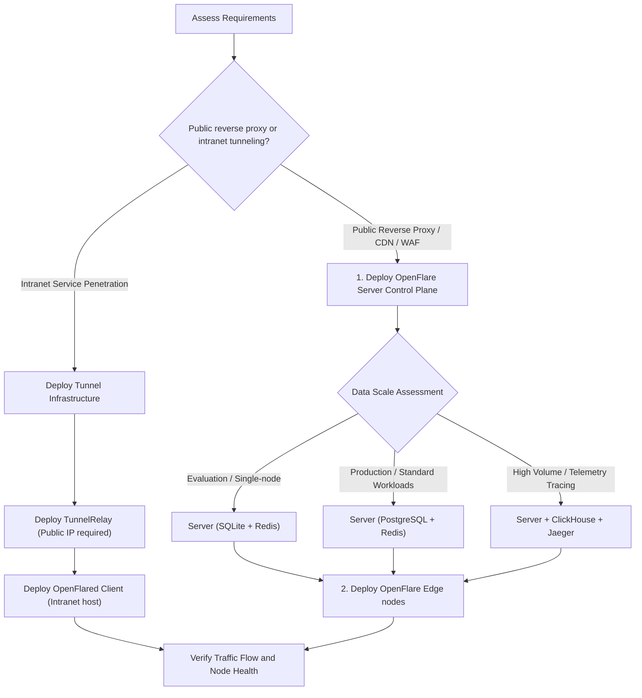

# Deployment overview

OpenFlare separates control plane responsibilities from data plane execution. The system consists of five primary components:

## Core components and roles

| Component | Role | Responsibilities | Ports / Network requirements | Deployment guide |
| --- | --- | --- | --- | --- |
| OpenFlare Server | Control plane | Admin console UI, Admin APIs, Agent APIs, configuration generation and distribution, metrics aggregation | Listens on `:3000` by default; requires Redis; supports SQLite or PostgreSQL; optional ClickHouse | [Server deployment](./server.md) |
| OpenFlare Edge | Data plane | OpenFlare Edge-based edge gateway handling TLS/HTTPS termination, WAF rule enforcement, caching, Pages hosting, active probing, and reverse proxy forwarding | Listens on `:80` and `:443` by default; outbound access to Server HTTPS port | [Edge deployment](./openflare-edge.md) |
| OpenFlare DNS | Intelligent authoritative DNS (SmartDNS) | Standalone high-performance authoritative DNS server steering visitors by network quality, ECS, and scheduling policies with offline snapshot failover | Listens on `53/udp` and `53/tcp` by default; outbound access to Server HTTPS port | [OpenFlare DNS deployment](./openflare-dns.md) |
| Relay (TunnelRelay) | Tunnel relay | Supervises the `frps` daemon, providing a public entry point for intranet penetration and forwarding traffic received from Edge | Listens on `:7000` (frpc connections) and `:8080` (HTTP Vhost) | [Relay deployment](./relay.md) |
| OpenFlared | Tunnel client | Supervises `frpc` daemons on private intranet servers, maintaining an encrypted tunnel with the public Relay | Outbound access only to Server port and Relay `:7000` | [OpenFlared deployment](./openflared.md) |

## Deployment decision paths

Select your deployment topology based on your traffic profile and network topology:

### Recommended deployment flow

1. Deploy OpenFlare Server: Start the control plane with [Server deployment](./server.md). Use SQLite for local testing or PostgreSQL with Redis for production.
2. Deploy edge gateways: Set up [OpenFlare Edge](./openflare-edge.md) on gateway servers, or follow [Edge node quick access](./agent.md).
3. Deploy OpenFlare DNS (optional): For region, ASN, and latency-aware authoritative traffic steering, deploy [OpenFlare DNS (SmartDNS)](./openflare-dns.md) and delegate an NS subdomain.
4. Deploy tunnel infrastructure (optional): For private services without public IPs, run a [Relay node](./relay.md) and install [OpenFlared](./openflared.md).
5. Maintain and upgrade: Follow the [Upgrade & maintenance guide](./upgrade.md).

## Section directory

### Architecture and overview
- [Architecture & deployment notes](./deployment.md): Network flow diagrams, hardware baseline requirements, source builds, and Docker Compose configurations.

### Components
- [Server deployment](./server.md): SQLite single-container, PostgreSQL production, ClickHouse/Jaeger observability, and source compilation.
- [Edge node quick access](./agent.md): Node tokens, installation parameters, and health checks.
- [OpenFlare Edge deployment](./openflare-edge.md): Packaging specifications, systemd low-privilege profiles, Docker deployments, and atomic updates.
- [OpenFlare DNS deployment](./openflare-dns.md): Standalone `openflare-dns` authoritative server Linux installation, systemd hardening, Docker deployment, and remote upgrades.

### Tunnel infrastructure
- [Relay deployment](./relay.md): TunnelRelay node configuration, frps daemon management, and port mapping rules.
- [OpenFlared client deployment](./openflared.md): Intranet client configuration, frpc child process management, and automated version synchronization.

### Maintenance
- [Upgrade & maintenance](./upgrade.md): Migrating from OpenResty to OpenFlare Edge, container and source upgrades, automatic edge updates, and recovery steps.
