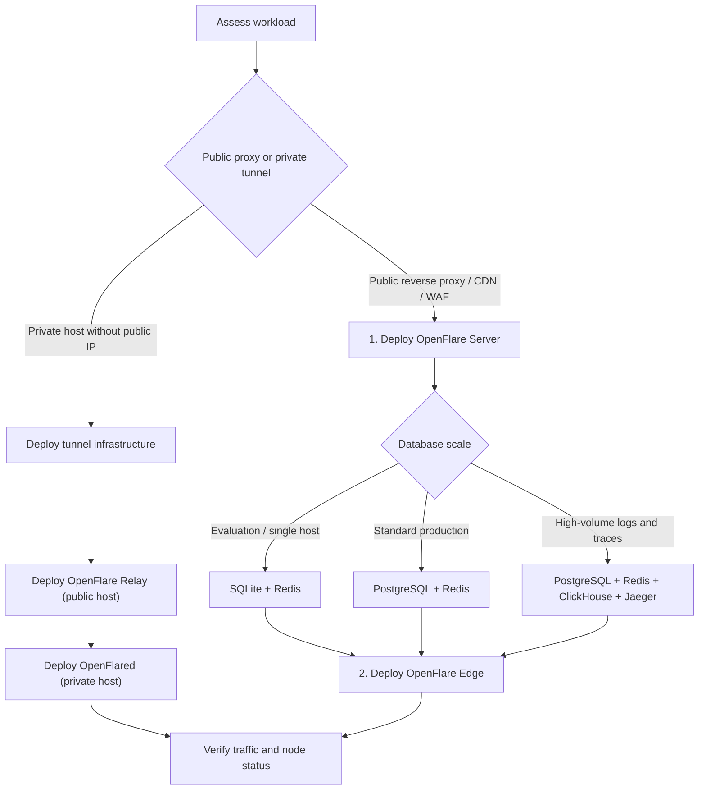

# Deployment overview

OpenFlare splits its control plane and data plane across five components that can be deployed incrementally.

## Components

| Component | Role | Responsibilities | Ports and dependencies | Guide |
| --- | --- | --- | --- | --- |
| OpenFlare Server | Control plane | Web console, Admin APIs, node protocols, config compilation, job scheduling, and metric aggregation | `:3000` by default; requires Redis; SQLite or PostgreSQL; optional ClickHouse | [Server deployment](./server.md) |
| OpenFlare Edge | Data plane gateway | TLS termination, WAF, caching, Pages hosting, active probing, and reverse proxying | `80/tcp`, `443/tcp` (`8080`/`8443` in container); outbound HTTPS to Server | [Deploy OpenFlare Edge](./openflare-edge.md) |
| OpenFlare DNS | Authoritative DNS (SmartDNS) | Quality- and ECS-aware authoritative DNS resolution with offline snapshot failover | `53/udp`, `53/tcp` (`5353` in container); outbound HTTPS to Server | [Deploy OpenFlare DNS](./openflare-dns.md) |
| OpenFlare Relay | Tunnel relay (`openflare-relay`) | Terminates encrypted tunnels, serves the Relay Gateway, and forwards L4 TCP/UDP ports | `7443/tcp`, `7444/tcp`, `8443/tcp`, and assigned L4 ports | [Deploy OpenFlare Relay](./relay.md) |
| OpenFlared | Tunnel connector (`openflared`) | Initiates outbound tunnels from private hosts to healthy relays and forwards traffic locally | No inbound ports; outbound access to Server and Relays | [Deploy OpenFlared](./openflared.md) |

## Deployment path and order

1. **Control plane**: Deploy OpenFlare Server following [Server deployment](./server.md) (SQLite for evaluation; PostgreSQL and Redis for production).
2. **Edge gateways**: Deploy edge nodes following [Deploy OpenFlare Edge](./openflare-edge.md) and assign performance policies in the console.
3. **Authoritative DNS (optional)**: Deploy standalone DNS nodes following [Deploy OpenFlare DNS](./openflare-dns.md) and delegate an NS subdomain.
4. **Tunnel infrastructure (optional)**: Run [OpenFlare Relay](./relay.md) on a public host and [OpenFlared](./openflared.md) on private hosts.
5. **Planning and lifecycle**: See [Deployment planning & baselines](./deployment.md) for ports and sizing, and [Upgrades & maintenance](./upgrade.md) for updates and rollbacks.
