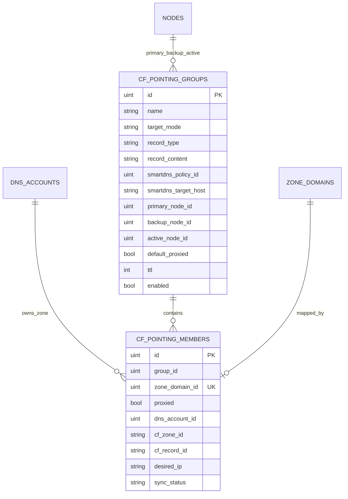

# Multi-Provider DNS Pointing & Failover Design

OpenFlare idempotently reconciles explicit and wildcard hostnames (`of_zone_domains`) to external DNS providers—Cloudflare, Alibaba Cloud DNS, and Tencent Cloud DNSPod—using unified DNS accounts and pointing groups. It supports node-backed `A` records with automated failover, custom `A`/`AAAA`/`CNAME` records, and SmartDNS `CNAME` delegation without turning Zones into a general-purpose DNS control plane.

## 1. Unified DNS Accounts & Scope Routing

* **Provider adapters (`internal/openflare/dnsprovider`)**: Supports `cloudflare` (with proxy toggle and one-click delegation), `alidns` (Alibaba Cloud DNS, with one-click delegation), and `tencentcloud` (Tencent Cloud DNSPod).
* **Credential & zone discovery (`internal/apps/openflare/dnsaccount`)**: Encrypted credentials reside in `of_dns_accounts`. Verification and scheduled daily refreshes populate authorized `scopes`, `verification_status` (`ready` / `error`), and `last_checked_at`.
* **Longest-suffix routing (`dnsaccount.Resolve`)**: Selects the account owning the most specific matching zone for a hostname; when multiple accounts match at equal specificity, preference follows the member's `dns_account_id` or migrated connection account.
* **Legacy credential migration**: Migration `202611280002` imports legacy standalone Cloudflare credentials from `of_cf_connections` into `of_dns_accounts`, retaining a fallback path until the linked account runs scope verification.

## 2. Target Modes & Data Model

### Group Target Modes (`of_cf_pointing_groups.target_mode`)

| Mode | Record Created | Behavior |
| --- | --- | --- |
| **`node`** | Single `A` record | Points to `active_node_id` IPv4 with primary/backup health failover and failback |
| **`custom`** | `A`, `AAAA`, or `CNAME` | Writes the group's explicit `record_type` and `record_content` |
| **`smartdns`** | DNS-only `CNAME` | Points to `smartdns_target_host` under the delegated zone, bound to `smartdns_policy_id`, with proxy forced off |

### Proxy Flag & Group TTL

* **Proxy (`proxied`)**: Effective only on proxy-capable providers (Cloudflare) outside `smartdns` mode. `default_proxied` initializes newly added members without overwriting existing ones; AliDNS and Tencent Cloud records force `proxied = false`.
* **Group TTL**: Supports `1` (Cloudflare Auto; falls back to `600` s on AliDNS/Tencent Cloud) or manual integers `60–86400` seconds (legacy `0` resolves to `300` s). Proxied records always use automatic TTL.

## 3. Automated Node Failover & Quarantine Handoff

* **Scheduled failover (`cloudflare:failover_check` → `CheckNodeFailover`)**: Evaluates enabled `node` groups against node health (not quarantined, not `offline`, not `unhealthy`, empty `last_error`, `last_seen_at` within 60 s):
  * Automatically fails back to `primary_node_id` once healthy;
  * Switches `active_node_id` to a healthy `backup_node_id` when the primary becomes unhealthy and enqueues group reconciliation.
* **Quarantine failover (`FailoverQuarantinedNode`)**: Immediately switches affected `node` groups away from a quarantined node to a healthy peer and dispatches synchronization.

## 4. Idempotent Reconciliation & Concurrency

1. **64-stripe member locking**: `ReconcileMember` locks by `memberID % 64` to prevent concurrent duplicate record creation.
2. **Cached update & single-record takeover**: Updates cached `cf_record_id` directly when account and `cf_zone_id` match (deleting and recreating if record type changed). Otherwise lists by `name + type`: creates on `0` matches, takes over on `1` match, and errors on multiple matches to avoid overwriting unmanaged load-balanced records.
3. **Cleanup on removal**: `DeleteManagedRecord` removes only the module-managed record when a member or group is deleted.
4. **Async workers**: Group, node-IP-change, and batch updates dispatch through Asynq (`cloudflare:sync_member`, `cloudflare:sync_group`, `cloudflare:sync_by_node`), keeping node heartbeats non-blocking.
