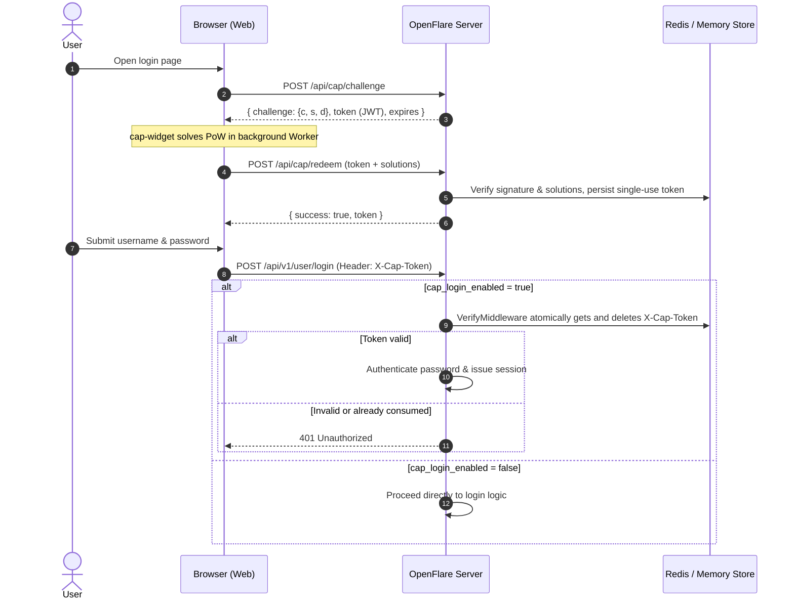

# Login CAPTCHA Design (Cap PoW Integration)

OpenFlare integrates Cap—a self-hosted, image-free Proof-of-Work (PoW) CAPTCHA—on the control-plane login endpoint to protect `admin` and user accounts against automated credential stuffing and brute-force attacks without calling external third-party verification services.

---

## 1. Architecture and Responsibilities

* **Dynamic toggle**: Administrators can enable or disable login verification via `cap_login_enabled`.
* **Control plane (`internal/apps/cap/`, `pkg/cap/`)**:
  * `POST /api/cap/challenge`: Public endpoint issuing a signed JWT challenge (`scope = "login"` by default) and PoW parameters `{ c, s, d }`.
  * `POST /api/cap/redeem`: Verifies the JWT signature and PoW `solutions`, consumes the challenge nonce, and returns a short-lived redemption token stored in Redis or memory.
  * `POST /api/v1/user/login`: Enforces `cap.VerifyMiddleware(mgr, "login")`, consuming the `X-Cap-Token` header on login requests when enabled and aborting with `401 Unauthorized` on missing, expired, or replayed tokens.
* **Frontend**: Mounts `cap-widget` on the login screen to solve challenges silently in a background Web Worker and attaches `X-Cap-Token` upon form submission.

---

## 2. Verification Sequence and Replay Protection

### Security Controls

1. **Bounded challenge lifetime**: Challenge JWTs carry explicit expiration timestamps enforced during `/api/cap/redeem`.
2. **Challenge non-reuse**: Redeeming a challenge marks its JWT signature consumed in the store, preventing multiple tokens from being minted from one solved challenge.
3. **Single-use login tokens**: `VerifyMiddleware` performs atomic get-and-delete verification so intercepted `X-Cap-Token` headers cannot be replayed.
4. **Distributed consistency**: Uses `pkgcap.NewRedisStore(db.Redis)` across clustered control-plane replicas, falling back to an in-memory store when Redis is absent.
