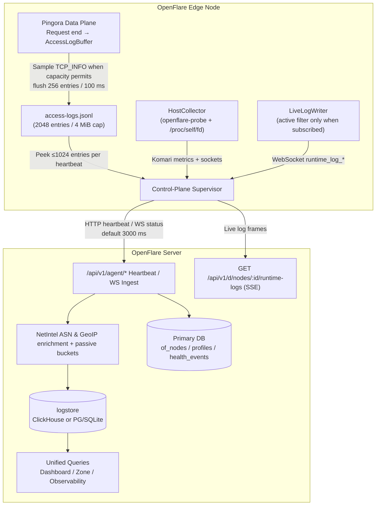

# Edge Observability and Traffic Analytics Architecture

OpenFlare separates telemetry collection from interpretation: `openflare-edge` collects raw request records, host capacity counters, listener connection snapshots, passive `TCP_INFO` latency samples, and on-demand runtime logs, while the control plane persists and aggregates everything through `internal/repository/logstore` (supporting either ClickHouse or PostgreSQL/SQLite).

---

## 1. Three Telemetry Layers (Never Reconciled Across Layers)

Metrics from the three layers carry distinct physical semantics and are never expected to equal one another:

| Layer | Question Answered | Primary Source | Storage Target | Typical Product Metrics |
| :--- | :--- | :--- | :--- | :--- |
| **L1 Business Delivery** | How many requests and response bytes did the proxy deliver? | Per-request records from `openflare-edge` (`access_logs`) | `of_node_access_logs` (with ClickHouse `of_access_log_hourly` MV) | Data provided (`sum(bytes_sent)`), data received (`sum(request_length)`), requests, unique visitors (`uniqExact(remote_addr)`), status distribution, top domains, WAF audits, client region |
| **L2 Edge Health** | Is the proxy healthy and how many sockets are open? | Edge heartbeat state + `edge_health` snapshot | Primary DB `of_nodes` (`openresty_status`, `openresty_message`, `openresty_connections`) | Online/unhealthy badge, offline detection, current connected socket count |
| **L3 Host Capacity & Active Probes** | How loaded is the host OS and what is its latency? | `openflare-probe` OS metrics (Komari-aligned) + isolated probe worker | `of_node_metric_snapshots`, `of_node_system_profiles`, `of_node_ping_records` | CPU/GPU/RAM/swap/load/temp/disk I/O, host NIC `net_in`/`net_out`/`net_total_*`, Ping task latency curves |

Passive `tcp_rtt_us` and `tcp_retrans` signals also feed the [Network Intelligence & Link Quality Architecture](./network-quality-design.md) (`of_network_quality_samples`), whereas `runtime_logs` stream transiently on demand over WebSocket/SSE without writing to analytical tables.

> **Semantic boundary**: "Data provided" sums `bytes_sent` delivered by the proxy, "Host NIC outbound" sums non-negative deltas of cumulative OS NIC counters (`net_total_up`), and "Current connections" is an instantaneous socket count. They measure different scopes and are never cross-checked for equality.

---

## 2. Data Flow, Cadence, and Buffering

### 2.1 Collection Cadence and Guarantees

| Stage | Behavior and Defaults | Notes |
| :--- | :--- | :--- |
| **Access logs (L1)** | `AccessLogBuffer` (`2048` entries / `16 MiB` memory semaphore) flushes every `256` entries or `100 ms` under `flock` to `$STATE_DIR/access-logs.jsonl` (`0600`, capped at `2048` entries / `4 MiB`) | Heartbeats peek up to `1024` records and truncate acknowledged prefixes only after a control-plane HTTP 200 response; `TCP_INFO` reads are skipped when queue headroom is exhausted |
| **Connection count (L2)** | Counts `connected` sockets in `/proc/self/fd` | Stored directly as latest state on `of_nodes`; the legacy `of_node_edge_health` time-series table has been removed |
| **Host metrics (L3)** | Collected by `openflare_probe::ProbeCollector` on each report tick (Komari schema) | `net_total_up`, `net_total_down`, `disk_read_bytes`, and `disk_write_bytes` report raw cumulative OS counters; negative deltas across reboots treat that segment as `0` |
| **Offline backfill** | `buffered[]` preserves window snapshots of `host_metrics`, `edge_health`, and `access_logs` | Retained for `observability_replay_minutes` (default `60` minutes) and ingested through the same server pipeline upon reconnection |
| **Heartbeat & offline** | Default heartbeat `3000 ms` (`agent_heartbeat_interval`); marked offline after `60000 ms` (`node_offline_threshold`) | When WebSocket is connected, `status` messages carry `NodePayload` at the same interval without duplicate HTTP heartbeats |

### 2.2 On-Demand Runtime Log Streaming

* **Zero idle overhead**: `edge/src/telemetry/runtime_logs.rs` guards capture with `has_subscribers()` so normal request traffic incurs no formatting cost when no administrator is tailing logs. The broadcast buffer holds up to `128` lines capped at `4096` bytes each.
* **WS-to-SSE relay**: Requests to `GET /api/v1/d/nodes/{id}/runtime-logs` dispatch `runtime_log_subscribe` over WebSocket (`8`-line / `100 ms` batches, `45s` lease renewed on SSE `: keepalive` ticks) and stream `ready`, `logs`, and `closed` SSE events until client disconnect or node quarantine.

---

## 3. Unified Queries and Multi-Database Parity

Dashboard summaries, node views, and Zone analytics share identical query semantics over `of_node_access_logs`:

* **Delivery & ingress volume**: `sum(bytes_sent)` and `sum(request_length)`;
* **Request & 5xx counts**: `count()` and `countIf(status_code >= 500)`;
* **Unique visitors (UV)**: Exact `uniqExact(remote_addr)` over raw access logs for the queried window. `of_access_log_hourly` uses `SummingMergeTree` for additive counters only and never stores UV;
* **WAF audits & cache status**: Stores `waf_action`, `waf_audit`, and raw `cache_status` (`HIT`, `MISS`, `BYPASS`, `EXPIRED`, `STALE`, `UPDATING`, `REVALIDATED`, `-`), mapped in UI presentation to Hit / Origin / Uncached.

> [!NOTE]
> `NodePayload` retains JSON keys `openresty_status` and `openresty_message` alongside `of_nodes.openresty_connections` strictly for wire and schema compatibility; all live telemetry originates from `openflare-edge` (`engine = "pingora"`).

---

## 4. Code Map

| Area | Location |
| :--- | :--- |
| Wire protocol structs | `internal/openflare/protocol/agent.go` |
| Edge telemetry & spool | `edge/src/telemetry/access_log.rs`, `edge/src/telemetry/host.rs`, `edge/src/telemetry/runtime_logs.rs` |
| Control-plane ingest & live SSE | `internal/apps/openflare/agent/observability.go`, `internal/apps/openflare/node/runtime_logs.go` |
| Dual-DB storage abstraction | `internal/repository/logstore/` |
| Aggregation & Zone stats | `internal/apps/openflare/observability/analytics.go`, `internal/apps/openflare/zone/stats.go` |

See [OpenFlare Edge Reporting Protocol & Observability Data Model](./observability-data-model.md) for payload contracts and table schemas, and [Log Store Decoupling](./logstore.md) for storage routing and database switching.
