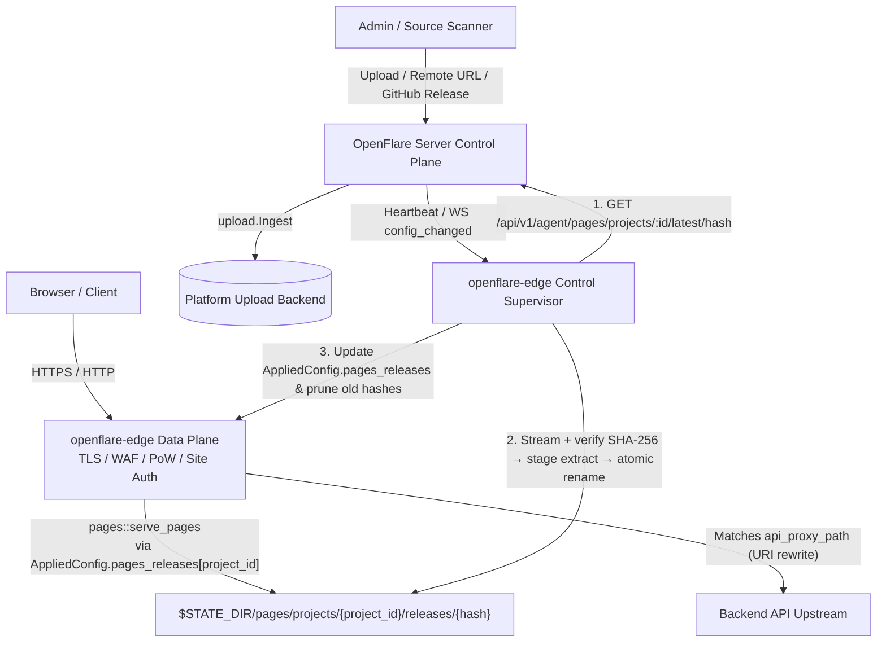

# Pages Static Hosting Design

OpenFlare Pages integrates pre-built static site artifact management with reverse-proxy routing in one control plane. The server ingests archives via uploads, remote URLs, or public GitHub Releases into immutable deployments, while `openflare-edge` synchronizes each referenced `project_id`'s latest hash and bundle on demand to serve static assets with `ETag`, byte `Range` support, SPA fallback, and inline API proxying.

---

## 1. Deployment Sources and Workflow

* **Three source modes**: Projects default to `manual` archive uploads or can attach one mutable source (`Remote URL` or `GitHub Release`). Updating or deleting a source never drops existing deployments or active production releases.
* **Unified artifact pipeline**: Local uploads and external syncs share one pipeline: ingest/download → streaming safety & entry inspection → `upload.Ingest` → deployment record. Manual uploads stop as candidates awaiting explicit activation; manual external syncs and automatic GitHub `latest` updates (`auto_update_enabled`) create-or-load and atomically activate in one transaction, supporting instant rollback.
* **Background source scanning**: The internal `openflare:pages_source_scan` task (every 5 minutes, up to 20 serial GitHub `latest` checks per batch) recovers expired leases, cleans orphaned uploads, and triggers revision-pinned updates fenced by `config_version`.

---

## 2. Architecture and Data Flow

### Control-Plane Tables (`internal/apps/openflare/pages`)

| Table | Responsibility |
| :--- | :--- |
| `of_pages_projects` | Project name, slug, enabled flag, optional `root_dir`, `entry_file` (default `index.html`), `spa_fallback_enabled` / `spa_fallback_path`, and API proxy settings (`api_proxy_enabled`, `api_proxy_path`, `api_proxy_pass`, `api_proxy_rewrite`) |
| `of_pages_project_sources` | Mutable source config (`source_type`, `config_version` fencing; full remote URLs stay internal to server config) |
| `of_pages_project_source_runtime` | 1:1 runtime state (`ETag`, seen/applied revision, backoff, lease; states `idle`, `checking`, `update_available`, `syncing`, `failed`, `attention`) |
| `of_pages_deployments` | Immutable deployment record (monotonic deployment number, archive SHA-256 `checksum`, `upload_id`, counts/sizes, provenance snapshot) |
| `of_pages_deployment_files` | Regular file paths and byte sizes |

### Dual-Track Versioning

`sites.v1` binds routes to a stable `pages_project_id` rather than a specific `deployment_id`. Activating or rolling back deployments inside a project does **not** require republishing the main site snapshot—`openflare-edge` polls `latest/hash` for active project IDs and atomically updates `pages_releases[project_id]` in memory.

---

## 3. Security Limits and Runtime Behavior

### 3.1 Server Inspection and Retention

* **Supported archives**: `zip`, `tar.gz`/`tgz`, `tar.xz`/`txz`, `tar.bz2`/`tbz2`, `tar`, and `7z`.
* **Size and file bounds**: Package uploads respect `pages_max_package_size_mb` (default `100 MiB`, configurable `1–2048`), extracted per-file and total limits equal `4×` package limit (minimum `100 MiB`), and file count caps at `1,000` regular files. Archives stream file-by-file during inspection rather than loading fully into RAM.
* **Extraction safety**: Rejects symlinks, `..` traversal, and absolute paths, strips redundant shared top-level archive folders, and verifies the entry file exists.
* **History retention**: `pages_max_history_count` (default `20`, `0` = unlimited) prunes inactive older deployments and soft-deletes upload records via `upload.Remove` without breaking deduplicated blobs.

### 3.2 Edge Synchronization and Serving (`edge/src/pages/`)

1. **Race-safe download verification**: `PagesSyncer` fetches `/api/v1/agent/pages/projects/{project_id}/latest/hash`, streams `/latest/package` (up to `2 GiB`) when missing locally, verifies SHA-256, and re-queries `latest/hash` afterward to confirm no activation occurred mid-transfer.
2. **Staged extraction & verification**: Unpacks into `.{hash}-<ts>.tmp` (rejecting symlinks, special files, path escapes, `> 1,000` files, or `> 8 GiB` per file/total), reconciles actual file counts and sizes against metadata, writes `.openflare-pages.json`, and atomically renames to `releases/{hash}`.
3. **Request pipeline (`edge/src/pages/serving.rs`)**:
   * After Pingora evaluates Site Auth, WAF, and PoW, `pages_api_target` intercepts requests matching `api_proxy_path`, rewrites paths per `api_proxy_rewrite`, and proxies upstream (supporting WebSocket upgrades).
   * Static handling rejects traversal segments (`..`, `\`, `\0`, `.openflare-pages.json`), issues `301` trailing-slash redirects on directories, applies `spa_fallback_path` when files are absent, rejects non-`GET`/`HEAD` requests (`405`), and streams responses in `64 KiB` chunks with `ETag`, `Last-Modified` (`304`), `Accept-Ranges: bytes`, `If-Range`, and byte-range support (`206` / `416`). Routes with site auth emit `Cache-Control: private, no-store`.
4. **Release pruning**: Once `AppliedConfig.pages_releases` activates the new hash, superseded `releases/*` directories for that project are pruned automatically.
