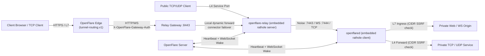

# Tunnel & Intranet Penetration Design

This document describes the architecture, control-plane data model, multi-relay high-availability scheduling, embedded `rathole` transport layer, CIDR SSRF validation, and two-slot self-update mechanism of OpenFlare's native tunnel subsystem.

---

## Background and Architecture Evolution

Private origin servers running behind NAT, firewalls, or private VPCs cannot expose inbound ports directly. OpenFlare replaces earlier external `frps`/`frpc` process wrappers with a native Rust workspace under `tunnel/` linking `rathole` directly in-process:

1. **Embedded engine with zero external binaries**: Both `openflare-relay` and `openflared` embed `rathole` as a library and manage runtime lifecycles in memory, removing external binary path dependencies and orphaned subprocess risks.
2. **Relay pools and zone-diverse high availability (Closest-K)**: A `Pool → Relay → Tunnel → Connector → Attachment` topology schedules connections across distinct `zone_tag` failure domains using parallel RTT probing and make-before-break hysteresis failover.
3. **Unified L7 and L4 forwarding**: Supports L7 HTTP/WebSocket reverse proxying coordinated with `openflare-edge` (`tunnel-routing.v1`) as well as direct L4 TCP/UDP port forwarding on relays.
4. **Independent release train (`tunnel-v*`)**: Relay and connector binaries ship and self-update independently from the control plane through staged `next → trial → active` slots.

---

## Control-Plane Data Model

The control plane maintains six core tables under the `of_` prefix (indexed without physical foreign keys, managed by `internal/repository/openflare_tunnel.go` and `internal/apps/openflare/tunnel/`):

| Table | Responsibility |
| :--- | :--- |
| `of_tunnel_relay_pools` | Relay pool policies: preferred transport (`auto`, `noise`, `websocket`, `tcp`), fallback order, target HA relay count (`ha_relays`), proximity policy, allowed/blocked origin CIDRs, and update channel |
| `of_tunnel_relays` | Public relay instances: advertised host/gateway address, `transport_port` (`7443`), `ws_port` (`7444`), `gateway_port` (`8443`), Noise keypair, gateway HMAC secret, `zone_tag`, `colocated_edge_node_id`, draining/quarantine flags, and runtime telemetry |
| `of_tunnels` | Logical tunnel entities bound to a `pool_id`, default transport, per-tunnel CIDR rules, and revocable `tunnel_token` |
| `of_tunnel_connectors` | Connector replicas identified by persistent `connector_id`, tracking egress IP, binary version, contract version, and online lease (`lease_expires_at`) |
| `of_tunnel_attachments` | Active relay attachments recording active transport, service bindings, measured RTT, and load summary |
| `of_tunnel_services` | L4 TCP/UDP and L7 forwarding definitions (`listen_port`, target origin, options); L7 HTTP/WS routes also bind directly to `tunnel_id` via `/proxy-routes` |

> [!NOTE]
> Historical migrations (`202611230004`–`202611230006` in PG/SQLite and `202611230001` in ClickHouse) dropped legacy FRP tables and node records when moving to the embedded `rathole` architecture.

---

## System Architecture and Transport Links

### 1. Bootstrap Tokens and Registration

`oftok1_` bootstrap tokens wrap Base64URL-encoded JSON carrying `server_url`, `kind` (`relay` or `tunnel`), secret material, and target `pool`. Passing `--token oftok1_...` (or `--token-file`) lets processes bootstrap without extra flags:

* **Automatic relay discovery**: Relays authenticate with pool `discovery_token` or node `access_token` at `POST /api/v1/relay/register`, receiving a unique `relay_id`, Noise X25519 keypair, and `gateway_secret` persisted to `$STATE_DIR/relay_identity.json` (`0600`) with `source_token_sha256` so restarts preserve identity.
* **WebSocket wakes and heartbeats**: Relays (`/api/v1/relay/ws`) and connectors (`/api/v1/tunnel/ws`) receive topology changes, revision updates, upgrade plans, and quarantine revocations in real time alongside 5-second heartbeats (30-second lease TTL).

### 2. Multi-Relay Discovery and Make-Before-Break Failover

`openflared` queries `GET /api/v1/tunnel/relays/discover` for healthy, non-draining, non-quarantined relays in its pool:

1. **Parallel latency probing**: Probes each relay gateway `/_openflare/health` endpoint and tracks EWMA RTT alongside active load and weights.
2. **Zone diversity (Closest-K)**: Selects up to `ha_relays` (default `2`) top relays spread across distinct `zone_tag` failure domains whenever available.
3. **Hysteresis make-before-break**: Replaces an active relay only after a challenger leads consistently for `2` consecutive probe rounds above threshold, verifying the replacement `rathole` session is ready before draining the previous session.
4. **Transport fallback**: Attempts `preferred_transport` and `fallback_transports` in order across encrypted `noise` (`7443`), firewall-friendly `websocket` (`7444`), and raw `tcp`.

### 3. L7 Edge Coordination (`tunnel-routing.v1`) and L4 Safety

* **Dynamic edge routing**: Control plane distributes `tunnel-routing.v1` manifests to `openflare-edge` containing healthy relay gateway endpoints, colocation preference, and gateway auth tokens. Sites targeting `tunnel_id` dispatch via `X-OpenFlare-Gateway-Auth` to the lowest-latency or colocated relay gateway, which fails over across active connectors automatically.
* **Deterministic L4 credentials & SSRF guards**: Control plane derives deterministic `rathole` service tokens and checks `listen_port` uniqueness against `gateway_port`/`transport_port`/`ws_port`. Before opening any local connection, `openflared` resolves destination IPs (unmapping IPv4-mapped IPv6 addresses such as `::ffff:169.254.169.254`) and enforces `allowed_cidrs` and `blocked_cidrs` (blocking `169.254.169.254/32` by default), rejecting unauthorized targets with `403 Forbidden` (L7) or connection drop (L4).

### 4. Quarantine, Rotation, and Self-Update

* **Emergency quarantine**: Isolating a relay or tunnel immediately revokes its tokens, purges caches, pushes WebSocket disconnect commands, and excludes the relay from `tunnel-routing.v1` on the next manifest sync.
* **Two-slot self-update**: Non-root systemd-managed Linux hosts (`NOTIFY_SOCKET` and `INVOCATION_ID`) support staged upgrades from `tunnel-v*` releases with SHA-256 and version checks via `next → trial → active` binary slots.
