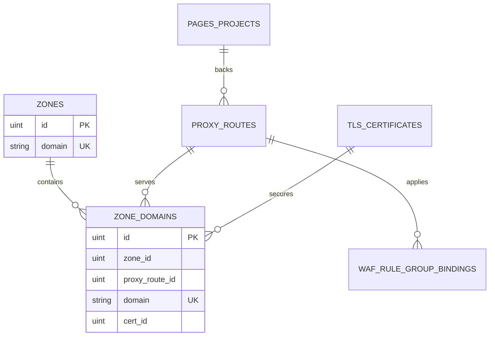

# Zone & Domain Resource Design

OpenFlare uses registrable root domains (Zones) as the top-level ownership boundary for hostnames. Operators manage exact and wildcard hostnames by stable Zone IDs (`/websites/:zoneId`), associating each hostname with a reverse-proxy route and TLS certificate while keeping upstream, caching, WAF, rate-limit, and Pages policies attached to `of_proxy_routes`.

Zone management does not turn OpenFlare into a built-in authoritative DNS registrar; external DNS record synchronization and SmartDNS CNAME pointing are handled separately by [Multi-Provider DNS Pointing & Failover Design](./cloudflare-pointing.md).

---

## 1. Scope and Constraints

* **Public Suffix root resolution**: Zone roots resolve via the Public Suffix List (`publicsuffix`), e.g., `api.example.co.uk` belongs to `example.co.uk`. Admin routes address Zones by numeric ID rather than raw hostname parameters.
* **Exact and wildcard hostnames**: Zone roots cannot contain wildcards. Zone domains accept exact FQDNs or leftmost wildcard labels (such as `*.example.com` or `*.s3.example.com`); validation strips `*.`, verifies root membership, and enforces ASCII DNS label syntax.
* **Many-to-one route binding**: Each Zone domain binds to at most one proxy route, whereas a single proxy route can serve hostnames across multiple Zones.

---

## 2. Core Data Model

* **`of_zones`**: Stores globally unique immutable root domains. A Zone cannot be deleted while any `of_zone_domains` rows remain under it.
* **`of_zone_domains`**: Stores `zone_id`, globally unique ASCII/Punycode `domain`, nullable `proxy_route_id`, and nullable `cert_id`. All relationship columns are indexed without physical foreign keys.
* **Compile-time assembly**: `of_proxy_routes` persists route policies only (holding no domain or certificate columns); when compiling `sites.v1`, the control plane gathers bound `domains` and `domain_cert_ids` from `of_zone_domains` in memory.

---

## 3. API and Console Workflow

Handlers under `internal/apps/openflare/zone/` expose `/api/v1/d/zones` (CRUD, overview, statistics, and domain mutations). Route writes submit `zone_domain_ids`, validated transactionally for Zone ownership, uniqueness, and TLS SAN coverage.

In the console, `/websites/:zoneId` surfaces Zone traffic statistics (`24h`, `7d`, `30d`), bound routes, referenced certificates, wildcard domain entry helpers (`*` shortcut), and DNS pointing status.

---

## 4. Wildcard Runtime & Analytics Semantics

1. **Edge routing & TLS SNI matching (`openflare-edge`)**:
   * In `edge/src/config.rs` (`find_route` and `domain_matches`), wildcard entries match a **single leftmost label** (`*.example.com` matches `a.example.com`, does not match bare `example.com`, and does not match multi-level `a.b.example.com`). Exact hostname matches take precedence over wildcard matches.
   * HTTPS requires the bound certificate's SANs to explicitly cover the wildcard pattern (e.g., `*.s3.example.com`), verified by the control plane before publishing.
2. **Zone traffic analytics attribution (`zone/stats.go` + `logstore`)**:
   * Zone analytics match logged request hosts across ClickHouse, PostgreSQL, and SQLite with overlap deduplication so traffic matching both `*.example.com` and a more specific domain or nested wildcard is never double-counted.
3. **Health checks and Uptime Kuma**:
   * Uptime Kuma sync selects a concrete hostname bound to the route; routes containing only wildcards are skipped cleanly without modifying existing monitors.

---

## 5. Data Invariants and Migration Note

`of_zone_domains` is the sole authoritative source for domain-to-route and domain-to-certificate bindings, storing all hostnames in normalized ASCII/IDNA (Punycode) form. Legacy inline domain columns on `of_proxy_routes` and the older `of_managed_domains` table were migrated and removed in historical Goose migrations (`202607120002` and `202607130001`).
