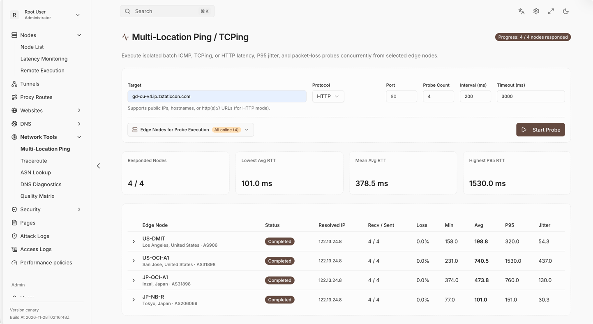
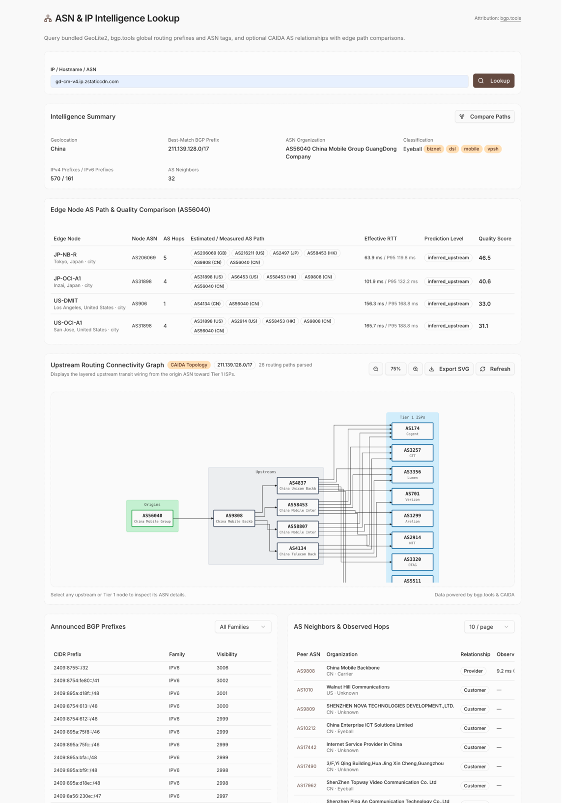
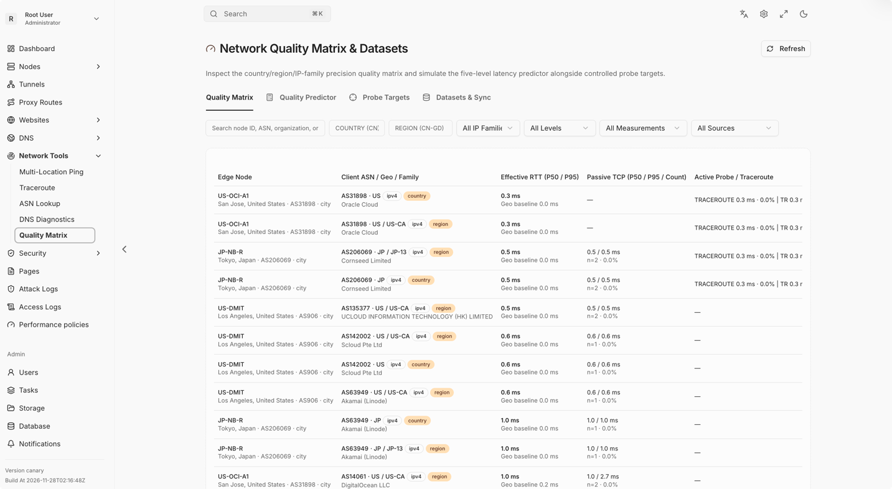

# Network Tools

Dispatch multi-location probes, traceroutes, and ASN/BGP intelligence lookups from edge nodes, and inspect the blended network quality matrix used by SmartDNS steering and WAF rules.

## Console Features

| Page | Purpose |
| :--- | :--- |
| **Multi-Location Ping** | Run concurrent ICMP, TCPing, or HTTP probes from selected edge nodes to compare Min, Avg, P95 latency, loss, and jitter |
| **Traceroute** | Execute multi-round `trippy-core` traceroutes inside isolated probe workers with per-hop GeoIP, ASN, and `bgp.tools` tags |
| **ASN Lookup** | Inspect IP, hostname, or ASN intelligence, announced BGP prefixes, AS neighbors, CAIDA upstream topology, and edge node path comparisons |
| **DNS Diagnostics** | Query resolvers with optional ECS subnets to inspect returned IPs, geo/ASN attribution, and query latency |
| **Quality Matrix** | Inspect the blended node-to-ASN/country/IP-family RTT matrix, run the 5-level latency predictor, and manage probe targets and intelligence datasets |

## Typical Workflow

1. Under **Network Tools** > **Quality Matrix** > **Datasets & Sync**, confirm GeoIP, `bgp.tools`, and CAIDA intelligence datasets are synced.
2. Run **Multi-Location Ping** or **Traceroute** from multiple edge nodes to compare reachability and latency to an origin or target IP:

3. Use **ASN Lookup** to inspect edge node AS path comparisons, CAIDA upstream routing topology, announced BGP prefixes, and AS neighbors:

4. Inspect blended passive TCP and active probe RTT metrics in **Quality Matrix**, or evaluate node rankings with the **Quality Predictor**:

See [Network Quality Assessment & Probing Design](../design/network-quality-design.md) for collection internals.
