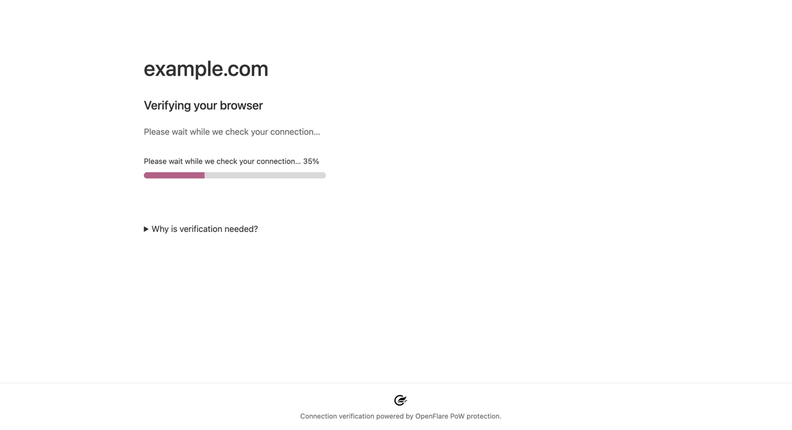

# PoW Challenge Protection

Enforce SHA-256 Proof-of-Work challenges at the edge to mitigate automated scanners and abusive traffic across entire sites or targeted paths.

## 1. Enable PoW on a Route

Open **Websites** > **Proxy Routes** > edit route > **Security** > **PoW Challenge**:

| Field | Description |
| :--- | :--- |
| Status / Mode | Choose `off`, `interactive` (visible challenge page), or `auto_silent` (background worker auto-solve) |
| Difficulty | Required leading zero hex nibbles; default `4` (`16x` work per `+1`; recommended `4–6`) |
| TTL & Cookie Secret | Verified session lifetime; rotating the secret immediately invalidates existing passes |
| Path Mode | `all` protects all paths (with optional exempt prefixes); `blacklist` challenges only matching routes via `exact`, `prefix`, `wildcard`, or `regex` |

## 2. Customize the Challenge Page

Customize the HTML challenge template under **Websites** > **Response Pages** > **PoW challenge** using these placeholders:

| Placeholder | Meaning |
| :--- | :--- |
| `__CHALLENGE__` | Edge-issued challenge nonce prefix |
| `__DIFFICULTY__` | Required leading zero nibble count |
| `__COOKIE_NAME__` | Verification cookie name written on pass |
| `__RETURN_URL__` | Target URL redirected to after verification |
| `__PREFIX__` | Internal PoW verification endpoint prefix |

Client JavaScript hashes `SHA-256(__CHALLENGE__ + nonce)` in a Web Worker or WebCrypto, posts the solution to `POST __PREFIX__/verify`, and redirects to `__RETURN_URL__` once the HttpOnly cookie is set. Leave the built-in template unmodified for default behavior.

## 3. Verification & Legacy Notes

- Visit a protected path in a private browser session: the edge returns an HTTP `403` challenge page, sets the verification cookie upon completion, and redirects back to the requested URL.
- Legacy PoW nodes inside WAF flows remain supported for existing graphs; use per-route PoW settings for all new configurations.

