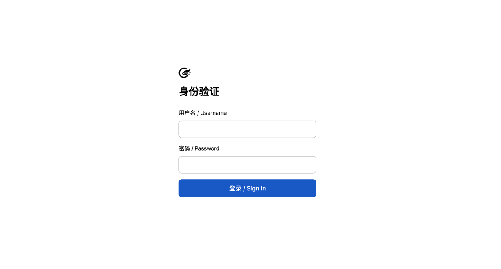
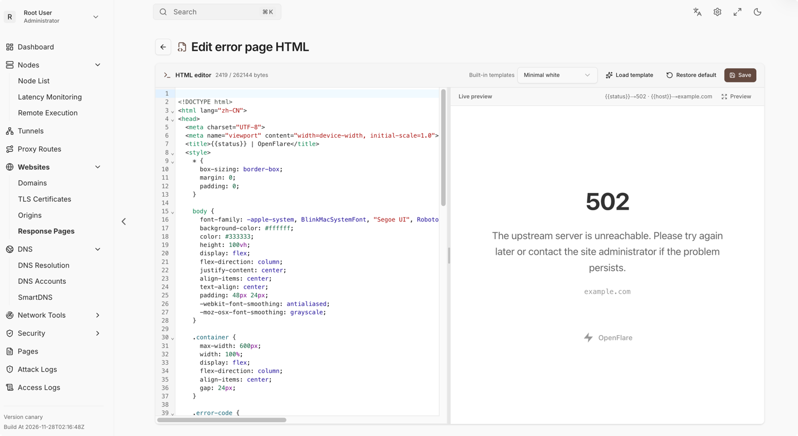
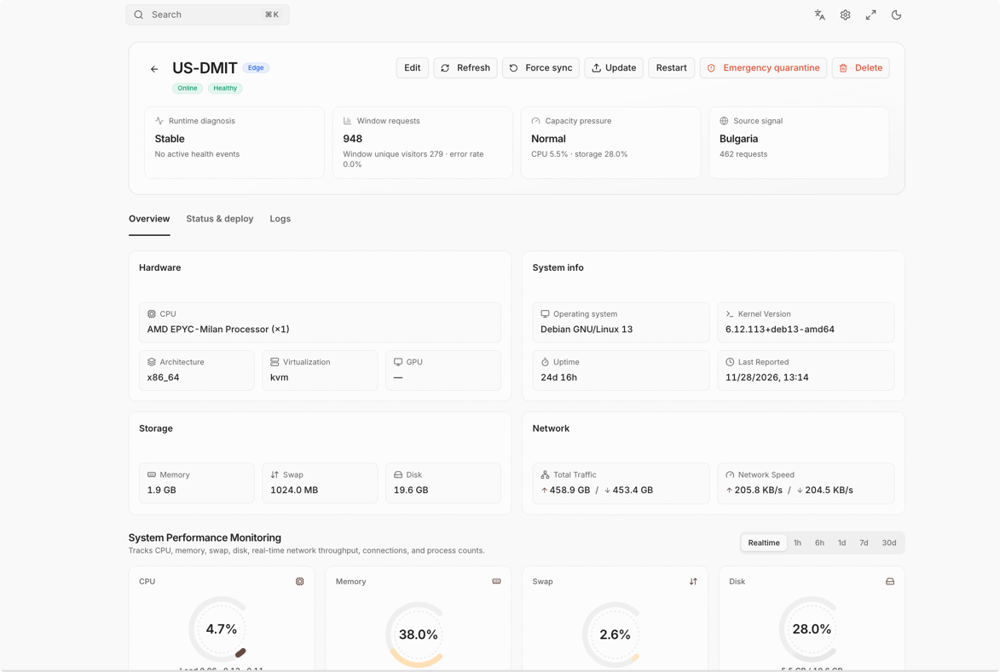
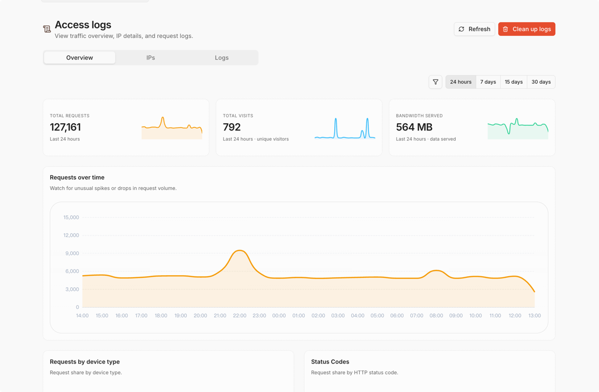

# Configure a reverse proxy

Set up origins, domains, certificates, and proxy routes, then verify edge synchronization and traffic.

## Prerequisites

- OpenFlare Server is running with at least one online `openflare-edge` node under **Nodes** > **Node List**.
- For HTTPS routes, prepare certificates following [TLS certificates and auto-renewal](./certificates.md).

## 1. Create an origin (optional)

Open **Websites** > **Origins**, click **Add origin**, and save a reusable backend name and URL (such as `http://10.0.0.10:8080`).

## 2. Add domains and bind certificates

1. Open **Websites** > **Domains**, click **Add Zone**, and register the root domain (`example.com`; wildcards are rejected here).
2. Add concrete or single-level wildcard hostnames (`api`, `@`, `*`, or `*.s3.example.com`), bind a covering certificate if enabling HTTPS, and save.
3. Click **Clean Unbound Domains** on the zone's **Domains** tab to remove unused entries.

Second-level wildcards such as `*.s3.example.com` require a certificate SAN explicitly covering `*.s3.example.com`; exact hostnames take precedence over wildcards.

## 3. Create a proxy route

1. Open **Proxy Routes**, click **Create**, enter a route name, and select or quick-add domains under **Domain Match**.
2. On the **Reverse Proxy** tab, choose **Direct Upstream**, select a saved origin or enter an `http://` / `https://` URL, and click **Save**.

When the upstream is an IP address and **Origin Host Header** is empty, edge nodes use the visitor's `Host` for upstream TLS SNI, certificate verification, and HTTP `Host`; set **Origin Host Header** if the origin expects a fixed hostname.

### Access authentication (optional)

1. Bind TLS certificates to every domain on the route (plain HTTP requests automatically redirect to HTTPS).
2. On the route's **Access Authentication** tab, select **Identity Authentication** and set credentials and **Session Lifetime** (`1` to `720` hours, default `24`).
3. Customize the shared login page under **Websites** > **Response Pages** > **Sign-in page** (`256 KiB` limit; keep a same-page POST form without `action` submitting `username`/`password` and rendering `{{login_error}}`).



### Custom error response pages (optional)

To customize upstream or gateway error responses (such as `502` or `504`), edit the global HTML template with `{{status}}` and `{{host}}` placeholders and live preview under **Websites** > **Response Pages** (see [Origin Error Page Design](../design/origin-error-page.md)):



### Edge caching (optional)

Enable caching on the route's **Cache** tab (node-wide cache switches and caps live in [OpenFlare Edge performance policies](./performance-policies.md)):

| Strategy | Behavior |
| --- | --- |
| Standard Static Assets (default) | Caches built-in static extensions only (no HTML/JSON); requests with cookies still hit |
| All Cacheable GET | Ignores extension filters; requires `Cache-Control: private` or `no-store` on unshared responses |

Responses with `Set-Cookie` are never cached; for cache misses, see [Troubleshooting](./troubleshooting.md#edge-cache-hit-rate-anomalies).

## 4. Verify sync and access

1. Open the node under **Nodes** > **Node List** and confirm **Status & deploy** shows the latest snapshot applied (use **Force sync** to retry after fixing host-side issues).



2. Verify HTTP/HTTPS responses (use `-H "Host: ..."` against `EDGE_NODE_IP` before DNS cutover), then inspect request volume, device share, and status codes under **Access Logs**:

```bash
curl -I https://your-domain.com
curl -I -H "Host: your-domain.com" http://EDGE_NODE_IP
```


