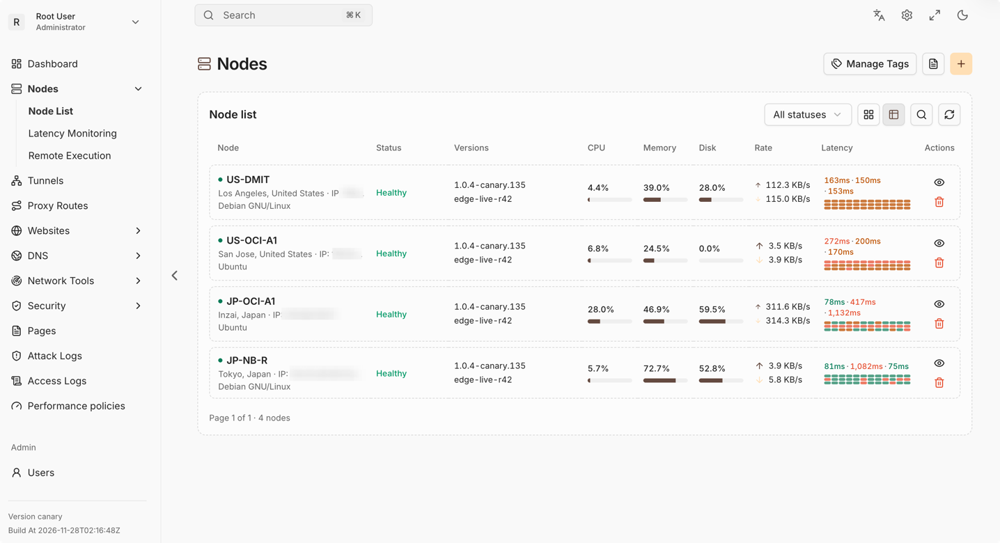
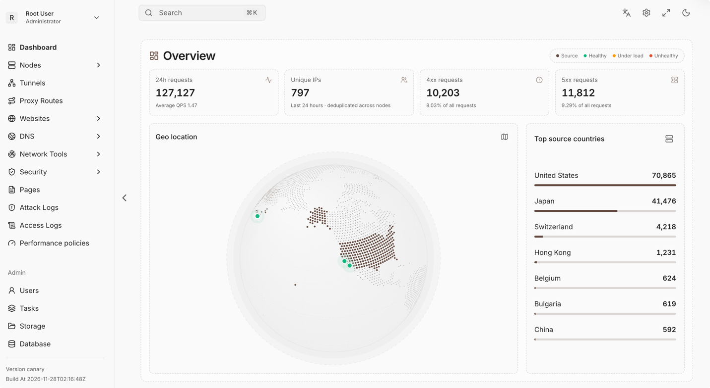

# Quick start

Launch OpenFlare Server and connect your first `openflare-edge` node. For production setups, see [Deployment](../deployment/index.md).

## 1. Start OpenFlare Server

Create `docker-compose.yaml` (uses SQLite + Valkey for fast evaluation; see [Server deployment](../deployment/server.md) for PostgreSQL and ClickHouse profiles):

```yaml
services:
  openflare:
    image: ghcr.io/rain-kl/openflare:latest
    container_name: openflare-server
    restart: unless-stopped
    ports:
      - "3000:3000"
    volumes:
      - ./openflare-data:/data
      - ./uploads:/app/uploads
    environment:
      TZ: Asia/Shanghai
      APP_SESSION_SECRET: 'replace-with-a-long-random-string'
      DB_ENABLED: "false"
      SQLITE_PATH: "/data/openflare.db"
      REDIS_ENABLED: "true"
      REDIS_ADDR: "redis:6379"
    depends_on:
      redis:
        condition: service_healthy

  redis:
    image: valkey/valkey:8.0-alpine
    restart: unless-stopped
    command: ["valkey-server", "--appendonly", "yes"]
    volumes:
      - ./data/valkey:/data
    healthcheck:
      test: ["CMD", "valkey-cli", "ping"]
      interval: 10s
      timeout: 5s
      retries: 5
```

Start the stack and wait for `server listening` in logs:

```bash
docker compose up -d && docker compose logs -f openflare
```

Open `http://localhost:3000` and sign in with `admin` / `12345678`.

> [!WARNING]
> Change the default password right after signing in, and replace `APP_SESSION_SECRET` before exposing the Server.

## 2. Obtain a node token

- **Discovery token (auto-registers new nodes)**: Copy from **System settings** > **OpenFlare** > **Discovery token and deploy**.
- **Node token (pre-created node)**: Create a node under **Nodes** > **Node List** and copy its token from node details.

## 3. Install your first Edge node

On a Linux host with ports `80/tcp` and `443/tcp` open, run the installer (for Docker and all flags, see [Deploy OpenFlare Edge](../deployment/openflare-edge.md)):

```bash
curl -fsSL https://raw.githubusercontent.com/Rain-kl/OpenFlare/main/scripts/install-openflare-edge.sh -o install-openflare-edge.sh
sudo bash install-openflare-edge.sh \
  --server-url https://openflare.example.com \
  --token-type discovery \
  --token '<DISCOVERY_TOKEN>'
```

## 4. Verify the node is online

Confirm the node shows online under **Nodes** > **Node List**, then proceed to [Configure a reverse proxy](./proxy-config.md).



Once traffic reaches your sites, inspect cluster request totals, unique IPs, status distributions, and source countries from **Dashboard**:


