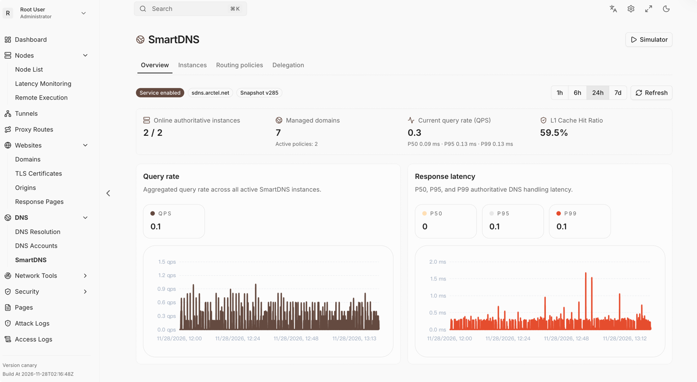
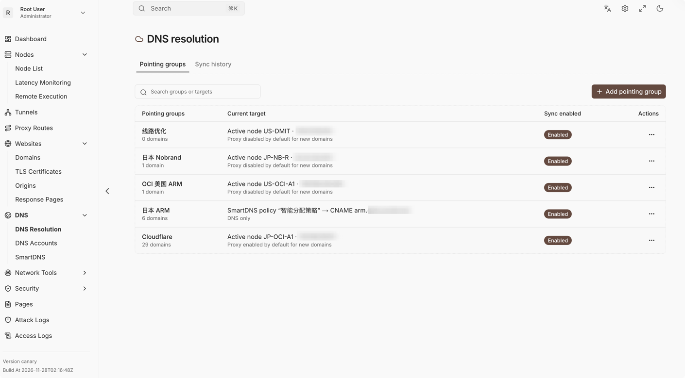
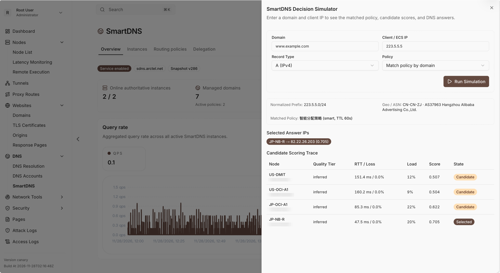

# SmartDNS

Route `A` and `AAAA` answers based on client geography, network topology, and live node capacity using embedded or standalone SmartDNS instances.

## 1. Deploy and Enable

- **Embedded mode (lightweight)**: Set `smartdns.enabled: true` in Server configuration (default `:53`) and expose `53/UDP` and `53/TCP`.
- **Standalone mode (production)**: Deploy `openflare-dns` on dedicated hosts via [Deploy SmartDNS](../deployment/openflare-dns.md) and register with a discovery token.

> On Linux hosts running `systemd-resolved`, disable its stub listener before binding port `53`.

## 2. Console Setup

1. Open **DNS** > **SmartDNS** > **Instances** and confirm at least one instance is **Online** (check **Overview** for online instance count, QPS, L1 cache hit ratio, and latency charts).
2. Under **Routing policies**, select a built-in preset (**Smart Allocation** / **Capacity Load Balance**) or create a custom policy.
3. Under **Delegation**, enter a delegated subdomain (such as `sdns.example.com`) and NS hostnames (such as `ns1.example.com`), adjust default TTL (`60s`), and enable the service.



4. Under **DNS** > **DNS Resolution** > **Pointing groups**, bind domain pointing groups to a **SmartDNS** policy so records route through the generated delegation `CNAME`:



## 3. Registrar Delegation & Constraints

| Constraint | Requirement |
| :--- | :--- |
| NS placement | NS hostnames must live outside the delegated zone unless backed by parent-zone glue records |
| Site records | Point site domains to the delegated subdomain with a DNS-only `CNAME` (proxy disabled) |
| Protocols | Allow both `53/UDP` and `53/TCP` in host firewalls and cloud security groups |
| Zone apex | Root domains cannot use standard `CNAME` without provider ALIAS/ANAME/CNAME flattening |
| Rollout order | Verify online instances and local query answers before adding `NS` records at your registrar |

## 4. Policy Variables (Optional)

Custom **Policies** DAG graphs combine weights (`latency`, `load`, `geo`), tag weights (`use_tag_weights`), and filters over these variables:

| Variable | Description | Example |
| :--- | :--- | :--- |
| `client.country` / `client.region` | Client ISO 2-letter country and region | `"CN"`, `"California"` |
| `client.asn` | Client autonomous system number | `4134` |
| `client.ip_family` | Client IP family | `"v4"` / `"v6"` |
| `domain` / `qtype` | Queried domain and DNS record type | `"www.example.com"`, `"A"` |

## 5. Verification & Troubleshooting

Click **Simulator** in the SmartDNS console to test a domain and client/ECS IP and inspect the matched policy, candidate scoring trace, and selected answer IPs:



You can also verify live answers from the command line:

```sh
dig @<SMARTDNS_IP> www.edge.example.com A +short
dig +trace www.edge.example.com A
```

| Symptom | Check |
| :--- | :--- |
| Timeout / `SERVFAIL` | Verify `openflare-dns` is online and both `53/UDP` and `53/TCP` are open |
| `NXDOMAIN` | Confirm the delegated zone is enabled and the route or global record targets SmartDNS |
| Unexpected node returned | Check GeoIP/ASN coverage for the client IP, node health, and policy filter constraints |
| UDP works, TCP fails | Open `53/TCP` for large responses and `dig +trace` fallback |

See [Network Tools](./network-tools.md) for probing data and [SmartDNS Architecture Design](../design/smartdns-design.md) for internals.
