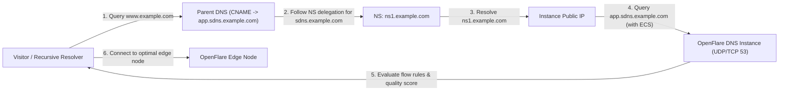

# SmartDNS Authoritative Resolution

OpenFlare SmartDNS combines real-time multi-window network quality matrices, node capacity limits, and a visual scheduling flow editor to deliver low-latency, EDNS0 Client Subnet (ECS)-aware authoritative DNS routing across your OpenFlare Edge cluster.

OpenFlare supports two authoritative execution modes:

- **Standalone `OpenFlare DNS` (`openflare-dns`)**: A high-performance standalone authoritative DNS server with multi-core UDP/TCP listening, sharded in-memory response caching, response rate limiting (RRL), and offline snapshot failover.
- **Control-plane built-in fallback engine**: Runs alongside OpenFlare Server when SmartDNS is enabled for lightweight evaluation or fallback resolution.

---

## How SmartDNS Works

SmartDNS takes authoritative control of a dedicated delegated subdomain via `NS` delegation, and business domains point to hostnames under that delegated subdomain via DNS-only `CNAME` records. Recursive resolvers forward queries (along with ECS subnet details) directly to your `OpenFlare DNS` instances, which return optimal healthy edge node `A`/`AAAA` records.

| Role | Example | Hosted Zone | Description |
| :--- | :--- | :--- | :--- |
| **Business domain** | `www.example.com` | Primary DNS provider | Public site domain pointing to the CNAME target with proxy disabled (DNS-only) |
| **Delegated subdomain** | `sdns.example.com` | Delegated via `NS` to SmartDNS | Authoritative zone managed by SmartDNS |
| **CNAME target hostname** | `app.sdns.example.com` | Inside `sdns.example.com` | Target generated automatically by a pointing group in SmartDNS mode or specified manually |
| **Authoritative NS hostnames** | `ns1.example.com`, `ns2.example.com` | Primary DNS provider (outside `sdns.example.com`) | `A`/`AAAA` records pointing to the public IPs of your `OpenFlare DNS` instances |

---

## Key Requirements Before Setup

1. **Out-of-bailiwick NS hostnames**: Place NS hostnames outside the delegated subdomain (for example, `ns1.example.com` for delegated zone `sdns.example.com`), and create DNS-only `A`/`AAAA` records pointing to your `OpenFlare DNS` public IPs.
2. **DNS-only records (no proxy)**: Both the NS `A`/`AAAA` records and business `CNAME` records must remain DNS-only so recursive resolvers reach port `53` directly and client subnets are preserved.
3. **Firewall ports**: Allow inbound **`53/udp`** and **`53/tcp`** on every `OpenFlare DNS` host.
4. **High availability**: Deploy at least two standalone `OpenFlare DNS` instances (`ns1` and `ns2`) across separate availability zones or providers for production.
5. **Recommended order**: Save delegation settings and bring at least one authoritative instance online before adding parent-zone `NS` records and running public delegation verification.

---

## Quick Configuration Workflow

1. **Connect DNS Accounts**: Open **DNS → DNS Accounts** to configure and verify Cloudflare, Alibaba Cloud DNS, or Tencent Cloud DNSPod credentials with automatic domain scope discovery.
2. **Configure Node Attributes**: In **Nodes**, optionally assign global routing tags, network groups, bandwidth/concurrency limits, and capacity baseline weights to edge nodes.
3. **Deploy Authoritative Instances**: Open **DNS → SmartDNS → Authoritative Instances**, copy the prefilled Linux or Docker deployment command, and bring instances online. See [OpenFlare DNS Deployment](../deployment/openflare-dns.md).
4. **Configure and Verify Delegation**: Open **DNS → SmartDNS → Delegation Settings**, configure the delegated subdomain and NS hostnames, synchronize parent-zone `NS` records via Cloudflare or Alibaba Cloud DNS (or add them manually), and run public NS verification.
5. **Create Scheduling Policies**: Open **DNS → SmartDNS → Scheduling Policies** to build visual flow rules filtering by country, continent, ASN, client subnet, node tags, or network group, and verify decisions with the built-in ECS simulator.
6. **Bind Domains via Pointing Groups**: Open **DNS → DNS Resolution**, create or update a pointing group in **SmartDNS** mode, and bind your business domains.

For full reference details and troubleshooting examples, see the [Chinese SmartDNS Guide](/guide/smartdns).
