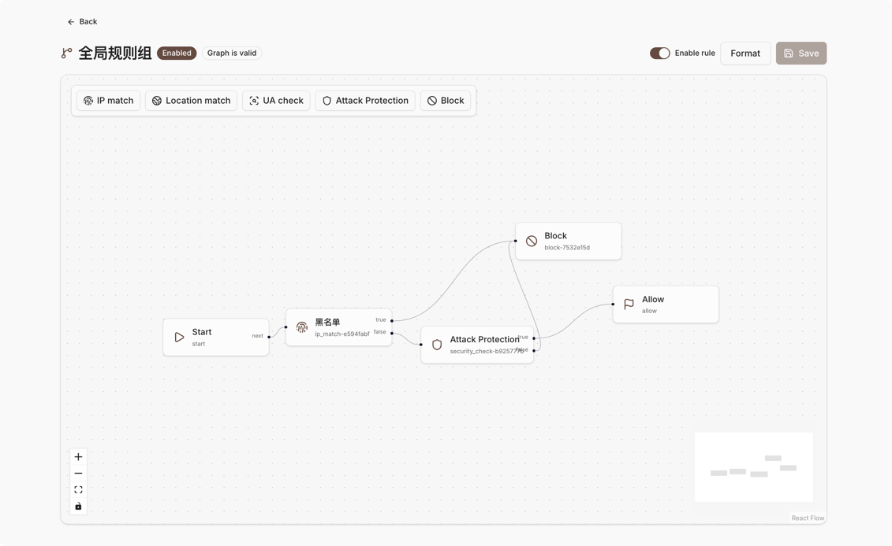
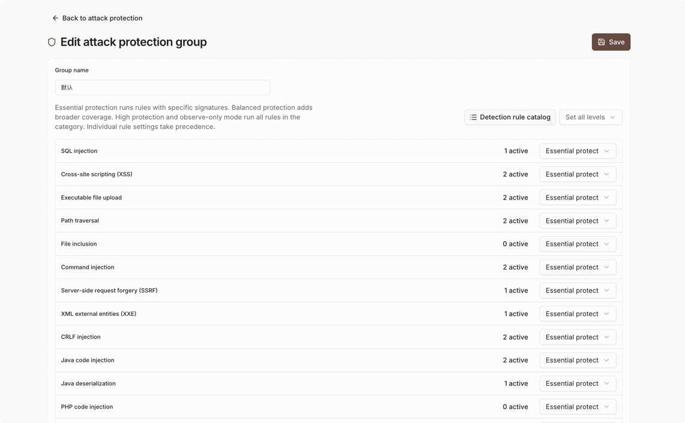

# WAF Protection

Build request inspection graphs, tune attack rule sets, configure global allowlists, and bind WAF policies to proxy routes.

## Core Concepts

| Component | Purpose |
| :--- | :--- |
| WAF Flow | Visual DAG mapping incoming requests through conditions, rule sets, and actions |
| Attack Protection | Managed rule sets targeting SQLi, XSS, and RCE with `detect` (log-only) or `block` modes |
| Attack Logs | Searchable hit records by route, action, client IP, and rule ID for tuning false positives |
| Global Allowlist | Exempts trusted IP groups, domains, or paths from both WAF flows and attack protection |

## 1. Create a WAF Flow

Open **Security** > **WAF** > **Create Rule**, wire the required nodes, and save:

| Node Type | Purpose |
| :--- | :--- |
| Condition nodes | Branch by IP group, region, network group, or HTTP attributes (`Path`, `Header`, `Method`, `User-Agent`) |
| Attack Protection node | Evaluates an assigned Attack Protection rule set against the request |
| Rate Limit / Action nodes | Apply rate limits, allow traffic, block requests, or serve a custom response page |

> WAF-flow PoW nodes are retained for legacy graphs only; configure new protections using route-level [PoW Challenge Protection](./pow-usage.md). For dynamic IP filtering expressions, see [Auto IP Group Rule Syntax](./waf-ip-group-expr.md).

## 2. Tune Attack Rule Sets

1. Open **Security** > **Attack Protection** and pick a preset (Strict / Balanced / Basic) or create a custom group.
2. Run new sites in `detect` mode first, then switch to `block` after confirming zero false positives.
3. Disable noisy individual rules (such as `942100`) via rule overrides instead of disabling the entire group.

See [WAF Orchestration Rule Design](../design/waf-orchestration-design.md) for rule engine and CRS level details.

## 3. Configure the Global Allowlist

Under **WAF Protection** > **Global Allowlist**, allowlist internal callbacks, health probes, or webhook paths by IP group, domain, or path pattern. Matched requests bypass WAF flows and Attack Protection immediately.

## 4. Bind to Routes & Verify

1. Attach one or more WAF flows to a site under **Proxy Routes** (or designate a default flow for new routes).
2. Send a test request and check **WAF Protection** > **Logs** to verify route matching, action, and rule IDs.
