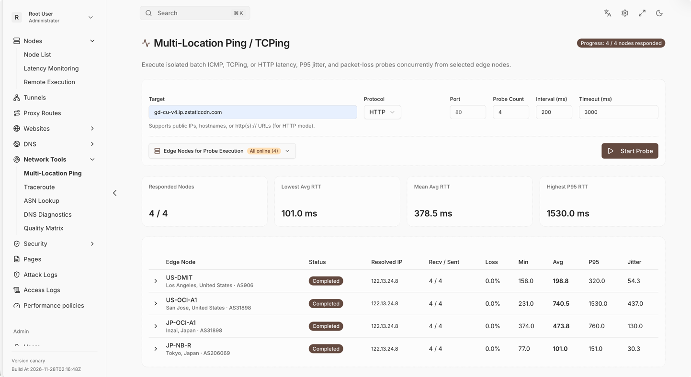
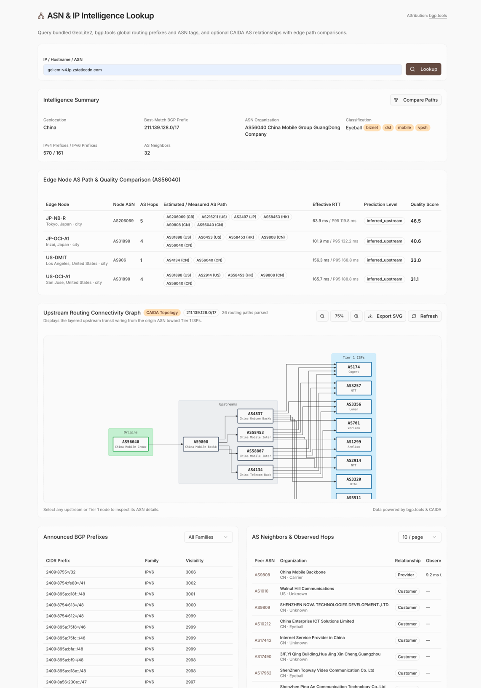
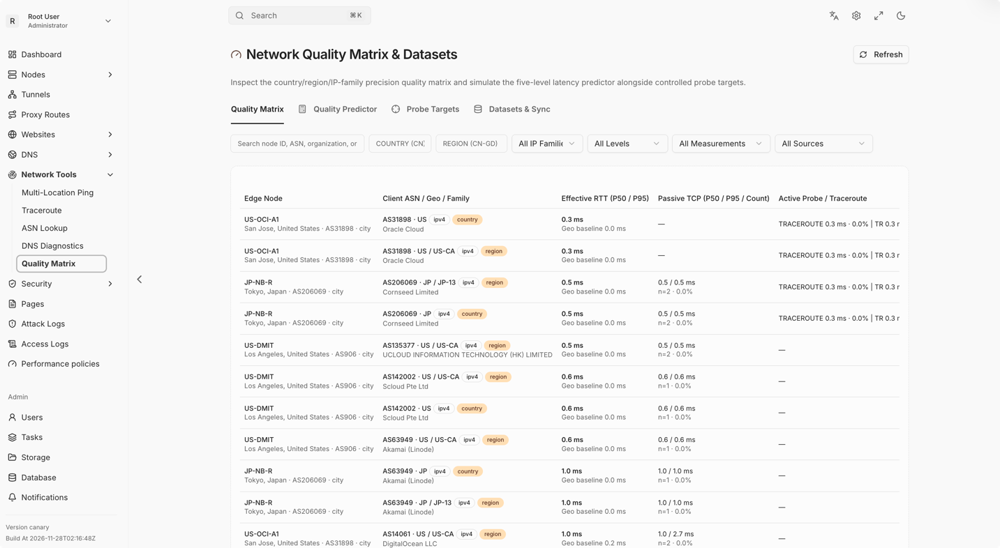

# 网络质量与探测工具

通过边缘节点执行多点主动探测、路由追踪与 ASN/BGP 情报查询，并构建融合网络质量矩阵，为 SmartDNS 智能调度及 WAF 网络组规则提供决策依据。

## 控制台入口

| 功能页面 | 用途 |
| :--- | :--- |
| **多点 Ping** | 从选定边缘节点并发发起 ICMP、TCPing 或 HTTP 探测，对比各节点的 Min / Avg / P95 延迟与抖动 |
| **路由追踪** | 基于 `trippy-core` 从多个边缘节点发起多轮路由追踪，逐跳标注地理位置、ASN 与 `bgp.tools` 标签 |
| **ASN 情报查询** | 查询公网 IP、域名或 ASN 的归属信息、宣告的 BGP 前缀、AS 邻接关系、CAIDA 上游拓扑与各节点路径质量对比 |
| **DNS 诊断查询** | 测试指定递归 DNS 与 ECS 子网的解析结果、权威应答 IP 归属及耗时 |
| **网络质量矩阵** | 查看节点与访客 ASN / 地区 / 地址族的融合延迟矩阵，运行 5 级延迟预测模拟，并管理受控探测靶点与 GeoIP / BGP 数据集同步 |

## 常用操作流程

1. 在 **网络工具** > **网络质量矩阵** > **数据集与同步** 确认 GeoIP、`bgp.tools` 与 CAIDA 等数据源已完成同步。
2. 使用 **多点 Ping** 或 **路由追踪** 对目标域名与 IP 执行多节点即时连通性检测：

3. 通过 **ASN 情报查询** 排查访客或源站所在自治系统的上游直连路径、BGP 前缀宣告与对端邻接关系：

4. 在 **网络质量矩阵** 查看被动 TCP 采样与主动探测融合后的有效延迟（P50 / P95），并在 SmartDNS 调度策略或质量预测器中验证节点选路：

内部指标聚合与无 SQL 约束设计参见 [网络质量评估与探测设计](../design/network-quality-design.md)。
