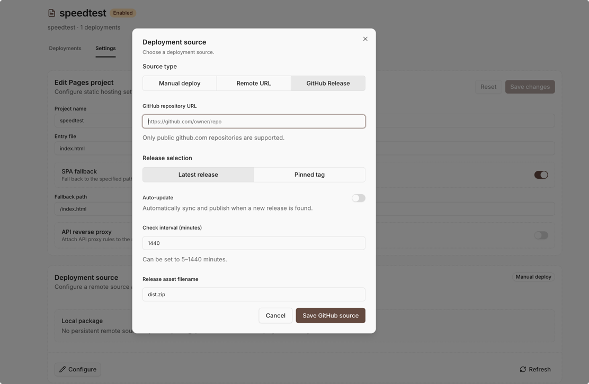
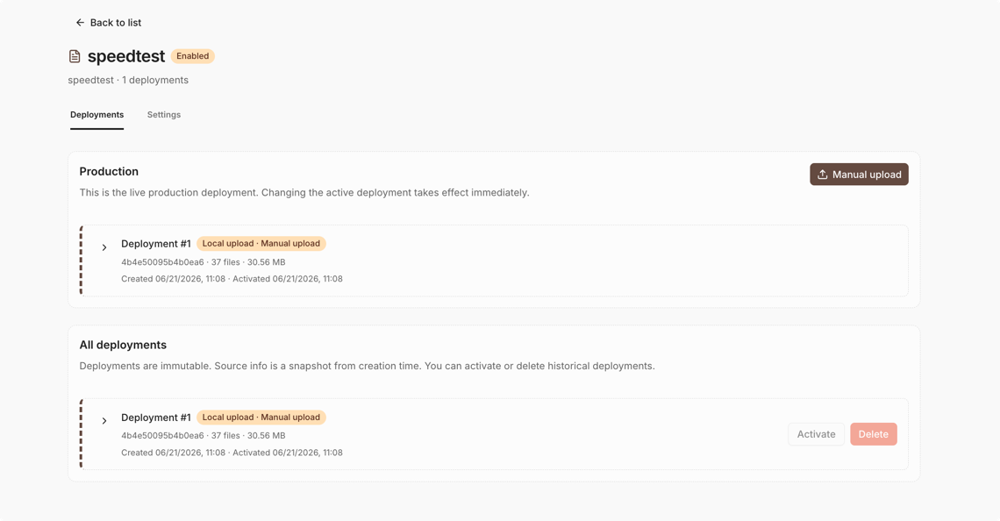

# Pages 静态托管

部署预构建静态产物包至边缘节点，支持 SPA 路由回退、同域 API 反代与秒级版本回滚（不包含源码构建）。

## 1. 创建项目

1. 进入 **Pages** 点击 **创建项目**，填写名称与唯一标识（slug）。
2. 设置 **入口文件**（默认 `index.html`）与 **RootDir**（如 `dist/`；静态文件位于包根目录则留空）。
3. 按需开启 SPA 回退或 API 反向代理后保存。

## 2. 选择部署来源

三种来源可随时切换，切换不会删除已生效或历史部署版本：

| 来源 | 支持方式与限制 |
| :--- | :--- |
| 手动上传 | 上传 `zip`、`tar.gz`/`tgz`、`tar.xz`/`txz`、`tar.bz2`/`tbz2`、`tar` 或 `7z` 产物包生成不可变候选版本，并在历史记录中激活上线 |
| Remote URL | 配置 HTTP(S) 下载地址并选择安全策略：`public`（默认拦截内网/回环/重绑定/自签 TLS）或 `trusted_internal`（需风险确认）；仅支持手动 **同步并发布** |
| GitHub Release | 仅支持公开仓库，指定仓库 URL、资产文件名（区分大小写，默认 `dist.zip`）及模式：`Latest Release` 支持 `5–1440` 分钟定时检测（默认关闭自动更新）；`Fixed Tag` 仅支持手动检查与发布；已有 Tag 替换产物后会进入 **待确认** 状态 |

> 压缩包上限由 `pages_max_package_size_mb`（默认 `100 MiB`，范围 `1–2048 MiB`）限制；解压单文件与总大小上限为 `4x`（至少 `100 MiB`），最多 `1,000` 个常规文件，拒绝符号链接、硬链接与 `..` 路径穿越。

## 3. 配置 SPA 回退与 API 反代

在创建页或项目 **设置** 页中可独立开关：

- **SPA Fallback**：未命中静态文件时回退至指定入口路径（通常为 `/index.html`）。
- **API 反向代理**：填写 **APIProxyPath**（如 `/api`）、**APIProxyPass**（如 `http://10.0.0.5:8080`）及可选 **APIProxyRewrite**，在同域名下代理后端接口。

## 4. 绑定路由与回滚

1. 在 **规则管理** 中将回源模式设为 **Pages** 并选择目标项目，保存后等待节点同步即可访问。
2. 回滚时在 **部署列表** 中激活任意历史版本即可切换；手动回滚会自动关闭来源的自动更新，避免被后续 `latest` 轮询覆盖。

状态机与原子切换实现参见 [Pages 静态托管设计](../design/pages-design.md)。
