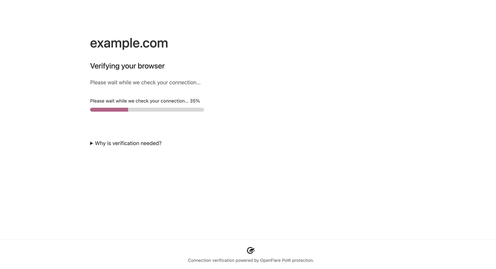

# PoW 工作量证明挑战

在边缘节点对可疑或受保护路径下发 SHA-256 工作量证明挑战，拦截自动化脚本与高频扫描。

## 1. 为代理路由启用 PoW

进入 **网站管理** > **代理路由** > 编辑路由 > **安全设置** > **PoW 挑战**：

| 配置项 | 说明 |
| :--- | :--- |
| 启用状态 / 模式 | 支持 `off`（关闭）、`interactive`（挑战页交互验证）与 `auto_silent`（后台静默计算并自动放行） |
| 挑战难度 | 前导零十六进制位（Nibble）数量；默认 `4`，每 `+1` 计算量增至 `16` 倍，建议控制在 `4–6` |
| 有效时长与 Cookie 密钥 | 验证通过后的 Cookie 有效期；轮换密钥可使全部已签发凭证失效 |
| 路径模式 | `all` 保护全站（支持排除前缀）；`blacklist` 仅对命中规则的路径触发挑战，支持 `exact`、`prefix`、`wildcard` 与 `regex` 匹配 |

## 2. 自定义挑战页面

进入 **网站管理** > **响应页面** > **PoW 挑战页** 可自定义 HTML 挑战模板。模板保存时自动替换为动态挑战参数：

| 占位符 | 含义 |
| :--- | :--- |
| `__CHALLENGE__` | 边缘签发的随机挑战前缀 |
| `__DIFFICULTY__` | 要求的前导零位数 |
| `__COOKIE_NAME__` | 验证通过后写入的凭证 Cookie 名 |
| `__RETURN_URL__` | 挑战通过后的原访问回跳地址 |
| `__PREFIX__` | 内部验证端点前缀 |

前端脚本在 Web Worker / WebCrypto 中暴力计算满足 `SHA-256(__CHALLENGE__ + nonce)` 前导零要求的 `nonce`，随后提交 `POST __PREFIX__/verify` 获取 HttpOnly 验证 Cookie 并跳转至 `__RETURN_URL__`。如无定制需求，保留系统内置模板即可开箱使用。

## 3. 验证与说明

- 使用隐私浏览窗口访问受保护路径：未验证请求将收到 `403` 挑战页，解算完成后写入 Cookie 并自动跳转回目标页。
- WAF 规则流中的独立 PoW 节点仅保留向后兼容；新增站点防护请统一在路由 **PoW 挑战** 中配置。

