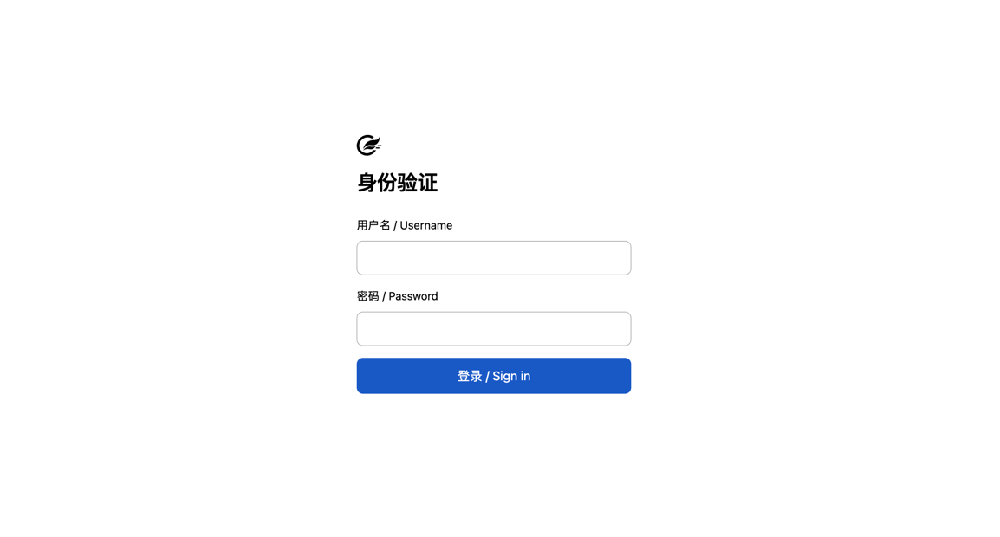
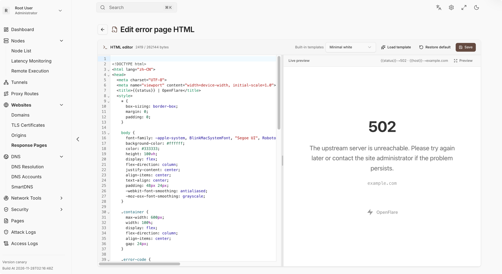
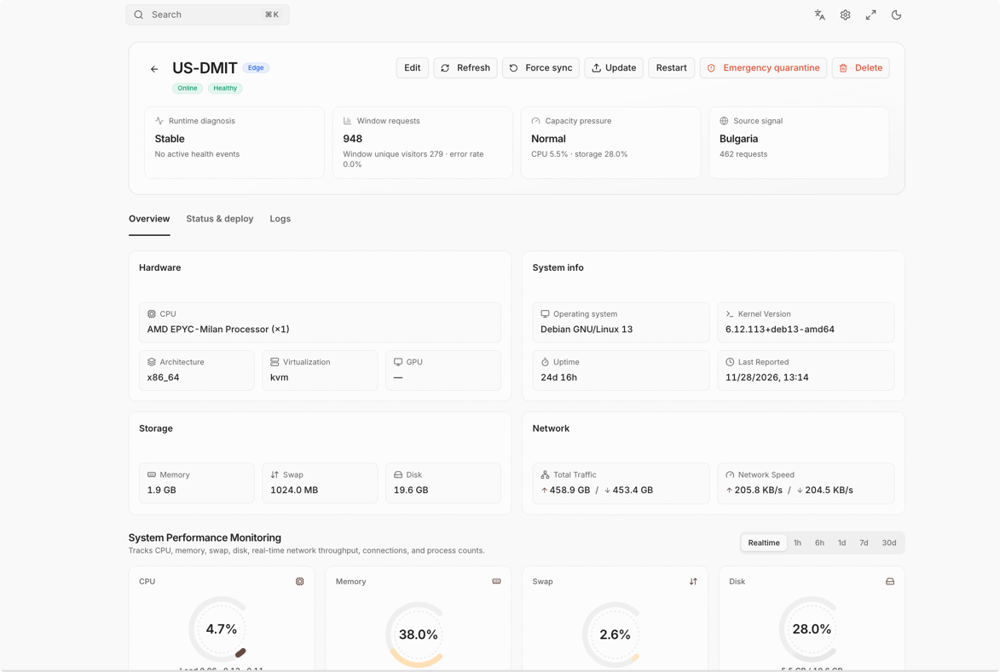
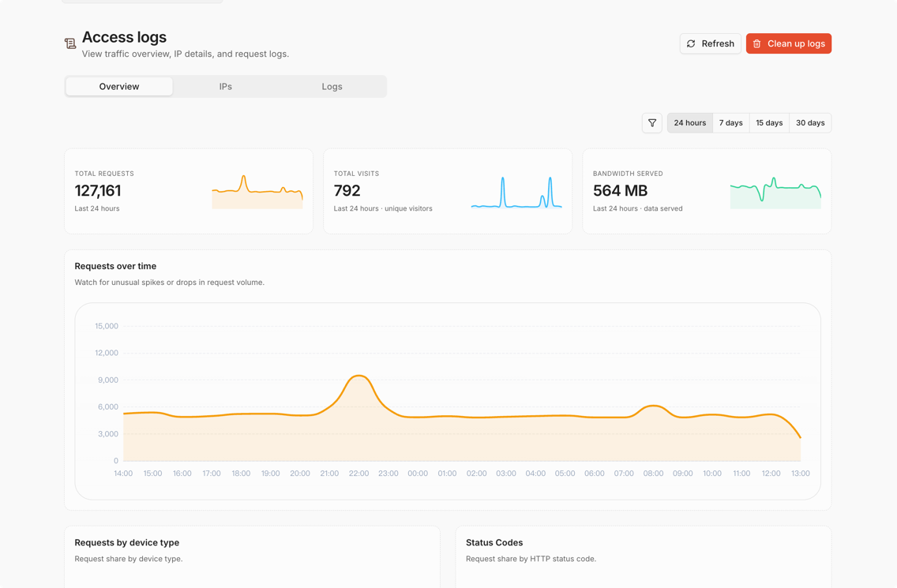

# 配置反向代理

配置源站、域名、证书绑定与路由规则，并验证边缘节点同步。

## 前置条件

- 控制端已运行，且 **节点管理** > **节点列表** 中至少有一台在线 `openflare-edge` 节点。
- 需开启 HTTPS 时，先按 [TLS 证书与自动续期](./certificates.md) 导入或申请证书。

## 1. 添加域名并绑定证书

1. 进入 **网站管理** > **域名列表**，点击 **新增 Zone** 并登记根域名（如 `example.com`，禁止通配符）。
2. 在 Zone 下添加具体域名或单层通配符域名（`api`、`@`、`*` 或 `*.s3.example.com`），按需绑定覆盖该域名的证书后保存。

使用通配符域名时，二级通配符（如 `*.s3.example.com`）的证书 SAN 须显式包含该通配符；精确域名优先于通配符，重叠通配符按最长后缀匹配。

## 2. 创建代理规则

1. 进入 **规则管理** 点击 **创建**，填写规则名称并在 **域名匹配** 选择或快捷新增域名。
2. 在 **反向代理** 页签选择 **直连上游**，选用已有源站或直接填写 `http://` / `https://` 地址后保存。

上游填写 IP 时默认以访问域名作为回源 TLS SNI 与 `Host`；若源站要求固定域名，可在 **源站 Host 请求头** 中显式指定。

### 访问认证（可选）

1. 为规则绑定全部域名的 HTTPS 证书（未加密的 HTTP 请求会自动跳转 HTTPS）。
2. 在规则 **访问认证** 页签设为 **身份验证**，设置账号、密码及会话有效期（`1–720` 小时，默认 `24`）。
3. 如需全局自定义登录页，在 **网站管理** > **响应页面** > **身份认证页** 编辑 HTML（上限 `256 KiB`，表单使用无 `action` 的同页 `POST` 提交 `username`/`password` 并预留 `{{login_error}}`）。



### 自定义错误响应页（可选）

如需替换源站或边缘网关返回的 `502`/`504` 等错误页面，可在 **网站管理** > **响应页面** 编辑全局 HTML 模板（支持 `{{status}}` 与 `{{host}}` 占位符及右侧实时预览，机制见 [源站错误页设计](../design/origin-error-page.md)）：



### 边缘缓存（可选）

在规则 **缓存** 页签开启缓存并选择策略（节点总开关与容量见 [OpenFlare Edge 性能策略](./performance-policies.md)）：

| 策略 | 适用范围 |
| --- | --- |
| **标准静态资源**（默认） | 仅缓存内置静态扩展名，不含 HTML/JSON；带 Cookie 请求仍可命中 |
| **所有可缓存 GET** | 不限扩展名；源站动态页须返回 `Cache-Control: private` 或 `no-store` |

响应带 `Set-Cookie` 时不写入缓存，策略规则与故障排查见 [故障排查](./troubleshooting.md#边缘缓存命中率异常)。

## 3. 验证同步与访问

1. 在 **节点管理** > **节点列表** 打开节点详情，确认 **状态与部署** 显示最新快照应用成功；若宿主环境修复后需重试，点击 **强制同步**。



2. 验证访问响应（未配公网 DNS 时可用 `-H "Host: ..."` 直连节点 IP），随后可在 **访问日志** 查看请求趋势、设备类型与 HTTP 状态码分布：

```bash
curl -I https://your-domain.com
curl -I -H "Host: your-domain.com" http://EDGE_NODE_IP
```


