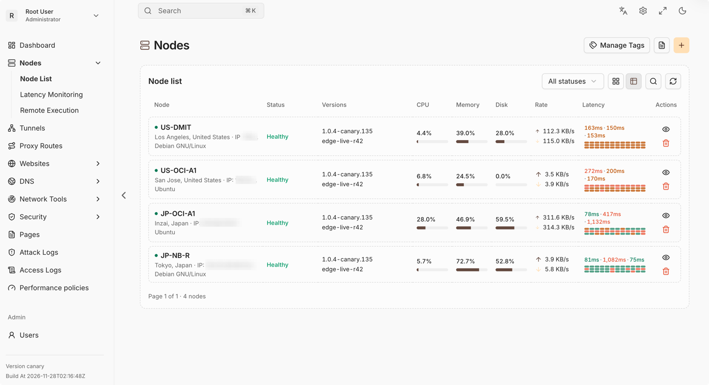
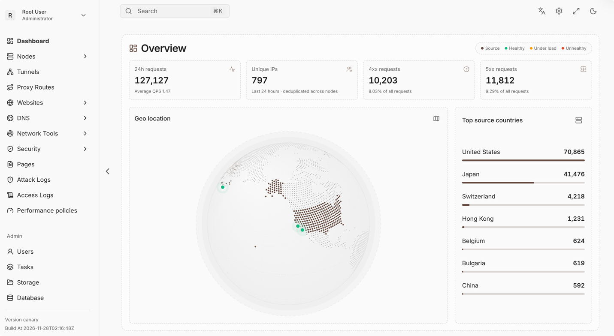

# 快速开始

启动 OpenFlare Server 并接入首个 `openflare-edge` 节点。生产环境部署见 [安装部署](../deployment/index.md)。

## 1. 启动 Server

创建 `docker-compose.yaml`（轻量体验使用 SQLite + Valkey；生产 PostgreSQL 与 ClickHouse 编排见 [Server 部署](../deployment/server.md)）：

```yaml
services:
  openflare:
    image: ghcr.io/rain-kl/openflare:latest
    container_name: openflare-server
    restart: unless-stopped
    ports:
      - "3000:3000"
    volumes:
      - ./openflare-data:/data
      - ./uploads:/app/uploads
    environment:
      TZ: Asia/Shanghai
      APP_SESSION_SECRET: 'replace-with-a-long-random-string'
      DB_ENABLED: "false"
      SQLITE_PATH: "/data/openflare.db"
      REDIS_ENABLED: "true"
      REDIS_ADDR: "redis:6379"
    depends_on:
      redis:
        condition: service_healthy

  redis:
    image: valkey/valkey:8.0-alpine
    restart: unless-stopped
    command: ["valkey-server", "--appendonly", "yes"]
    volumes:
      - ./data/valkey:/data
    healthcheck:
      test: ["CMD", "valkey-cli", "ping"]
      interval: 10s
      timeout: 5s
      retries: 5
```

启动服务并确认日志输出 `server listening`：

```bash
docker compose up -d && docker compose logs -f openflare
```

打开 `http://localhost:3000`，使用默认账号 `admin` 与密码 `12345678` 登录。

> [!WARNING]
> 登录后立即修改默认密码，并在公网环境前替换 `APP_SESSION_SECRET`。

## 2. 获取节点令牌

- **发现令牌（自动注册新节点）**：在 **系统设置** > **OpenFlare** > **Discovery Token 与部署** 复制。
- **专属令牌（接入预建节点）**：在 **节点管理** > **节点列表** 新建节点后从详情页复制。

## 3. 安装首个 Edge 节点

在开放 `80/tcp` 与 `443/tcp` 的 Linux 主机执行安装脚本（Docker 用法与全部参数见 [部署 OpenFlare Edge](../deployment/openflare-edge.md)）：

```bash
curl -fsSL https://raw.githubusercontent.com/Rain-kl/OpenFlare/main/scripts/install-openflare-edge.sh -o install-openflare-edge.sh
sudo bash install-openflare-edge.sh \
  --server-url https://openflare.example.com \
  --token-type discovery \
  --token '<DISCOVERY_TOKEN>'
```

## 4. 确认节点上线

在 **节点管理** > **节点列表** 确认节点状态为在线后，即可前往 [配置反向代理](./proxy-config.md) 发布首个站点。



站点接入流量后，可在 **数据看板** 查看全集群请求量、独立 IP、状态码分布与来源地域统计：


