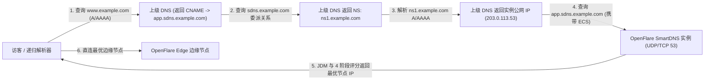

# SmartDNS 智能权威解析使用指南

OpenFlare SmartDNS（Phase 2）结合控制面实时感知的网络质量矩阵、节点负载容量与视觉化 JDM 规则引擎，为域名提供低延迟、支持 EDNS0 Client Subnet（ECS）的权威解析能力。系统支持两种权威运行形态：

- **独立 Rust 高性能实例（`openflare-dns`）**：基于 `hickory-server`、`zen-engine`、`moka` 与 `SO_REUSEPORT` 多核 UDP/TCP 监听，单核缓存命中压测可达裸 `hickory-server` 吞吐的 84%–87%。
- **控制面内嵌引擎**：在控制面配置 `smartdns.enabled: true` 时随服务端启动，适合轻量测试与过渡期本地权威解析验证。若未配置 `smartdns.binary_path`，将运行控制面内置纯 Go 引擎（`embedded-go`）；若配置了本地 `openflare-dns` 二进制路径，则由控制面托管启动该子进程。

---

## 工作原理与核心 DNS 角色

SmartDNS 通过 **NS 子域委派** 接管一个独立子域的权威解析权，再通过 **CNAME** 将业务域名指向该委派子域下的主机名，从而让访客的真实递归解析器（及 ECS 子网信息）直达 OpenFlare SmartDNS 权威节点，最终返回最优边缘节点的 `A`/`AAAA` 地址。

配置前需区分以下四个 DNS 角色（全文均以如下示例域名演示）：

| 角色 | 示例值 | 所属托管域 | 说明 |
| :--- | :--- | :--- | :--- |
| **业务域名** | `www.example.com` | 主域服务商（如 Cloudflare） | 最终访客访问的站点域名；通过仅 DNS 的 `CNAME` 指向目标主机名 |
| **委派子域（`delegation_domain`）** | `sdns.example.com` | 通过 `NS` 记录委派给 SmartDNS | 由 SmartDNS 担任权威域；业务域名可直接使用其下子域作为 `CNAME` 目标 |
| **CNAME 目标主机名** | `app.sdns.example.com` | `sdns.example.com` 区域内 | 位于委派子域下的解析目标；可由 Cloudflare 指向分组自动生成，也可手动指定 |
| **权威 NS 主机名（`ns_hosts`）** | `ns1.example.com`、`ns2.example.com` | 主域服务商（位于委派子域之外） | 指向各个 SmartDNS 权威实例公网 IP 的 `A`/`AAAA` 记录主机名 |

完整解析链路如下：



---

## 配置 DNS 前的关键约束

在添加任何 DNS 记录之前，请确认以下限制：

> [!IMPORTANT]
> **1. 权威 NS 主机名必须位于委派子域之外（Out-of-Bailiwick）**
>
> `openflare-dns` 与内嵌引擎均不会为委派子域内部的名称（例如 `ns1.sdns.example.com`）返回固定胶水 `A`/`AAAA` IP；所有落在 `delegation_domain` 范围内的 `A`/`AAAA` 查询都会进入调度策略，返回边缘代理节点 IP 而非 SmartDNS 服务器 IP。
>
> - **正确配置**：委派子域设为 `sdns.example.com`，NS 主机名设为 `ns1.example.com`、`ns2.example.com`（与 `sdns` 同级或位于另一已托管根域，如 `ns1.dns-infra.example.net`），并在其所在上级 DNS 中配置 `A`/`AAAA` 记录指向 SmartDNS 实例 IP。
> - **错误配置**：委派子域设为 `sdns.example.com`，同时将 NS 主机名设为 `ns1.sdns.example.com`（将导致递归解析器把 NS 解析到边缘代理节点，无法到达 SmartDNS 53 端口）。

> [!WARNING]
> **2. 所有 SmartDNS 相关记录必须保持「仅 DNS」（关闭代理）**
>
> - `ns1.example.com`、`ns2.example.com` 的 `A`/`AAAA` 记录必须关闭 Cloudflare 代理（仅 DNS），否则公网返回 Cloudflare 代理 IP，外部递归解析器无法连接 SmartDNS 实例的 UDP/TCP 53 端口。
> - 业务域名（如 `www.example.com`）指向 `app.sdns.example.com` 的 `CNAME` 记录同样必须保持「仅 DNS」。使用 OpenFlare「Cloudflare 指向分组」的 SmartDNS 模式时，系统会强制将成员记录锁定为非代理 `CNAME`。

- **端口与防火墙要求**：每个 SmartDNS 实例所在主机及云安全组必须同时放行入站 **`53/udp`** 与 **`53/tcp`**。标准 DNS 应答与 EDNS0 / 大报文回退均依赖 TCP 53。
- **高可用建议**：生产环境建议至少部署 2 台独立 `openflare-dns` 实例（对应 `ns1` 与 `ns2`），并分布在不同可用区或服务商。
- **根域名（Apex / `@`）说明**：DNS 协议不允许在根域（如 `example.com`）直接创建标准 `CNAME`。即便部分 DNS 服务商支持根域 CNAME 展平（Flattening），展平通常由该服务商代为递归完成，可能导致访客原始 ECS 子网丢失或精度下降。生产环境建议将业务入口配置在子域名（如 `www.example.com`、`api.example.com`），根域通过 HTTP 301/308 重定向至 `www` 子域。
- **严格按顺序执行**：必须先在控制台保存委派设置并上线至少 1 个权威实例（状态为「在线」且快照版本 `>= v1`），再于上级 DNS 添加 `NS` 委派记录并执行公网验证；否则控制面与公网递归解析器查询委派域名权威 `NS` 时会超时失败。

---

## 1. 准备工作：配置边缘节点容量与路由标签

SmartDNS 会从控制台同步所有边缘节点（`edge_node`）的公网 IPv4/IPv6、状态、负载指标、线路分组、容量参数与路由标签：

1. 进入控制台 **「节点管理 → 节点列表」**，点击右上角 **「标签管理」** 管理路由分类标签。系统初始化默认预置三条标签（可按需修改或新增，默认权重乘数范围为 `0.01 ~ 100`）：
   - `optimized`（优化线路，默认权重 `1.2`）
   - `international`（国际线路，默认权重 `1.0`）
   - `high-bandwidth`（大流量线路，默认权重 `1.1`）
2. 编辑各边缘节点，确认以下字段准确无误：
   - **节点 IP**：用于 `A`（IPv4）或 `AAAA`（IPv6）应答返回。
   - **线路分组（`network_group`）**：如 `cn2-gia`、`cmi`、`bgp`，供策略筛选条件使用。
   - **带宽上限（Mbps）**、**并发连接上限** 与 **容量基准权重**（默认 `100`，`0` 表示不限制）。
   - **SmartDNS 路由标签**：勾选所属标签，可选填写单节点权重覆盖值。

---

## 2. 在控制台配置委派设置

进入左侧栏 **「DNS 管理 → SmartDNS」**，打开 **「委派设置」** 页签（路径 `/dns/smartdns#delegation`）：

| 配置项 | 示例值 | 说明与取值范围 |
| :--- | :--- | :--- |
| **启用 SmartDNS** | 开启 | 默认开启；关闭后将停止快照同步与控制面内嵌解析服务 |
| **委派子域** | `sdns.example.com` | 必填。小写 FQDN（最长 253 字符）；DNS 指向分组将在此域名下生成 `CNAME` 目标 |
| **权威 NS 主机名** | `ns1.example.com`<br>`ns2.example.com` | 每行或以英文逗号分隔一个主机名；务必使用委派子域之外的名称 |
| **默认应答 TTL（秒）** | `60` | 合法范围 `10`–`86400`，默认 `60`。其中 `openflare-dns` 对 `NS`/`SOA` 记录最小返回 `60` 秒，`A`/`AAAA` 最小 `5` 秒 |
| **快照同步周期（秒）** | `10` | 合法范围 `3`–`300`，默认 `10`。控制面变更另触发 `250ms` 防抖重建并通过 WebSocket（`dns:snapshot_changed`）实时唤醒实例 |
| **实例版本发布仓库** | `Rain-kl/OpenFlare` | 独立实例发布版本查询仓库，保持默认即可 |

填写完成后点击 **「保存全局设置」**。实例上线后，在上级 DNS 配置 NS 及其地址，再校验公网委派。

---

## 3. 部署并上线权威解析实例

切换至 **「DNS 管理 → SmartDNS → 权威实例」** 页签，选择以下任一形态部署权威解析节点：

### 方式 A：独立 Rust 实例（`openflare-dns`，推荐生产使用）

1. 点击 **「新增」**。默认打开 **「预注册实例」**，可填写实例名称、公网地址、监听地址与机房地区。保存后使用一次性展示的实例令牌生成部署命令。
2. 切换到 **「Discovery 注册」** 可使用发现令牌自动接入。两种接入方式均可选择正式版或 Canary，以及 Linux 或 Docker 部署命令。

Linux 一键脚本示例：

```bash
curl -fsSL https://raw.githubusercontent.com/Rain-kl/OpenFlare/main/scripts/install-openflare-dns.sh -o install-openflare-dns.sh && \
  sudo bash install-openflare-dns.sh \
    --controller-url 'https://panel.example.com' \
    --token-type discovery \
    --token '<DISCOVERY_TOKEN>' \
    --public-addr '203.0.113.53' \
    --listen '0.0.0.0:53'
```

- Docker 镜像 `ghcr.io/rain-kl/openflare-dns:latest`（或 `:canary`）默认在容器内监听 `0.0.0.0:5353`，通过 `-p 53:5353/udp -p 53:5353/tcp` 映射至宿主机 53 端口，离线快照持久化于 `/var/lib/openflare-dns/last-snapshot.bin`。
- 完整安装参数、环境变量、`systemd` 安全加固与升级卸载说明请参阅 [OpenFlare SmartDNS 部署文档](../deployment/openflare-dns.md)。

在线的 Linux systemd 实例启用远程更新后，可在行操作菜单选择 **「更新」**，或勾选多个实例后点击 **「批量更新」**。选择正式版或 Canary 并确认后，列表显示更新进度，实例就绪后上报结果。主机首次接入远程更新的方式见 [Linux 远程更新](../deployment/openflare-dns.md#从控制台远程更新)。

### 方式 B：控制面内嵌引擎（适合测试与单机过渡）

在控制面 `config.yaml` 中启用 `smartdns` 配置块（或设置对应环境变量，环境变量优先级高于 YAML）：

```yaml
smartdns:
  enabled: true                 # 对应环境变量 SMARTDNS_ENABLED=true
  listen_addr: ":53"            # 对应环境变量 SMARTDNS_LISTEN_ADDR
  binary_path: ""               # 留空运行内嵌 Go 引擎；填写 openflare-dns 路径则托管子进程
  embedded_name: "Embedded SmartDNS"
  data_dir: "data/smartdns"
```

### 上线自检（在配置上级 DNS 之前执行）

1. 在控制台 **「权威实例」** 列表中确认所有目标实例状态为 **「在线」**，且快照版本已更新（例如 `v1` 及以上，而非 `v0`）。
2. 在可访问该实例 IP 的主机上执行本地直查，确认 53 端口同时响应 UDP 与 TCP 且返回权威标志（`aa`）：

```bash
# 验证 NS 应答（+norecurse 模拟上级委派后的权威直查）
dig @203.0.113.53 sdns.example.com NS +norecurse

# 验证 TCP 53 与 SOA 应答
dig @203.0.113.53 sdns.example.com SOA +tcp +norecurse
```

预期输出中 `flags:` 包含 `aa`（Authoritative Answer），且 `ANSWER SECTION` 返回已配置的 `ns1.example.com.`、`ns2.example.com.`。

---

## 4. 在上级 DNS 服务商配置委派记录

假设主域名 `example.com` 托管在外部 DNS 服务商，两台 `openflare-dns` 实例公网 IP 分别为 `203.0.113.53`（`ns1`）与 `203.0.113.54`（`ns2`），可选 IPv6 为 `2001:db8::53` 与 `2001:db8::54`，控制台配置的委派子域为 `sdns.example.com`。

### 一键配置 NS 委派

父区托管在 Cloudflare 或阿里云 DNS 时，先在 **「DNS 账号」** 验证可访问该父区的凭据，并为 NS 主机配置公网地址。保存 SmartDNS 的委派子域和 NS 主机后，在 **「委派设置」** 点击 **「一键配置」**。确认后，系统在匹配的父区创建缺失的 NS，成功添加后移除该委派子域的旧 NS。其他域名和记录类型不受此操作影响。

DNS 变更生效后，使用 **「验证 NS 委派解析」** 检查公网结果。腾讯云 DNSPod 或其他服务商使用下方的手动步骤。

### 完整 DNS 记录对照表

在主域 `example.com` 的 DNS 面板中添加如下记录：

| 记录类型 | 主机记录（Name） | 完整域名（FQDN） | 记录值（Value / Target） | 代理状态 | 建议 TTL | 作用 |
| :--- | :--- | :--- | :--- | :--- | :--- | :--- |
| `A` | `ns1` | `ns1.example.com` | `203.0.113.53` | 仅 DNS（关闭代理） | 300 秒 / 自动 | 将 NS 主机名 1 解析到 SmartDNS 实例 1 IPv4 |
| `A` | `ns2` | `ns2.example.com` | `203.0.113.54` | 仅 DNS（关闭代理） | 300 秒 / 自动 | 将 NS 主机名 2 解析到 SmartDNS 实例 2 IPv4 |
| `AAAA`（可选） | `ns1` | `ns1.example.com` | `2001:db8::53` | 仅 DNS（关闭代理） | 300 秒 / 自动 | 实例 1 支持 IPv6 监听时配置 |
| `AAAA`（可选） | `ns2` | `ns2.example.com` | `2001:db8::54` | 仅 DNS（关闭代理） | 300 秒 / 自动 | 实例 2 支持 IPv6 监听时配置 |
| `NS` | `sdns` | `sdns.example.com` | `ns1.example.com` | 不适用 | 300 秒 / 自动 | 将 `sdns.example.com` 及其下级域名委派给实例 1 |
| `NS` | `sdns` | `sdns.example.com` | `ns2.example.com` | 不适用 | 300 秒 / 自动 | 将 `sdns.example.com` 及其下级域名委派给实例 2 |

> [!CAUTION]
> 请勿在主域中为 `sdns` 或 `*.sdns` 保留同名的 `A`、`AAAA`、`CNAME` 或 `TXT` 记录。同一主机名存在 `CNAME` 或静态地址记录时，会覆盖或阻断 `NS` 子域委派，并可能导致部分 DNS 服务商拒绝保存。

### 主流 DNS 服务商操作要点

#### Cloudflare

1. 进入目标域名（`example.com`）的 **「DNS → 记录」** 页面。
2. 逐条添加 `ns1` 与 `ns2` 的 `A`（及可选 `AAAA`）记录，确认右侧代理状态开关保持 **关闭（仅 DNS）**。
3. 添加两（或多）条类型为 `NS` 的记录：名称填写 `sdns`，目标分别填写 `ns1.example.com` 与 `ns2.example.com`。
4. 若 `example.com` 已在 Cloudflare 开启 **DNSSEC**，**请勿** 为委派子域 `sdns.example.com` 添加 `DS` 记录。SmartDNS 暂不提供 DNSSEC 签名，一旦在父域写入 `DS` 记录而子域未签名，支持 DNSSEC 校验的递归解析器（如 `1.1.1.1`、`8.8.8.8`）将返回 `SERVFAIL`。

#### 阿里云 DNS / 腾讯云 DNSPod

1. 先为主机记录 `ns1`、`ns2` 添加类型 `A`（及可选 `AAAA`）记录，解析线路选择 **默认**。
2. 再添加两条类型为 `NS` 的记录，主机记录均填写 `sdns`，解析线路必须选择 **默认**（避免仅配置特定运营商线路导致海外或控制面验证查询失败），记录值分别填写 `ns1.example.com.` 与 `ns2.example.com.`（按控制台提示决定是否保留末尾点号）。
3. 确认记录列表中不存在相同主机记录 `sdns` 的冲突 `A`/`CNAME` 记录。

#### AWS Route 53 或其他自建权威 DNS（BIND / PowerDNS）

1. 在 Hosted Zone `example.com.` 中为 `ns1.example.com.` 与 `ns2.example.com.` 创建 `A`（及可选 `AAAA`）记录集。
2. 为 `sdns.example.com.` 创建一条 `NS` 记录集，在值文本框中按每行一条填入 `ns1.example.com.` 与 `ns2.example.com.`（Route 53 要求多条 NS 合并在同一条记录集中）。
3. 若使用 BIND Zone 文件格式，委派区片段如下：

```text
ns1.example.com.    300 IN A  203.0.113.53
ns2.example.com.    300 IN A  203.0.113.54
sdns.example.com.   300 IN NS ns1.example.com.
sdns.example.com.   300 IN NS ns2.example.com.
```

### 验证公网委派生效

1. 返回 OpenFlare 控制台 **「DNS 管理 → SmartDNS → 委派设置」**，点击 **「验证 NS 委派解析」**。控制面会向公共解析体系查询 `delegation_domain` 的 `NS` 记录并与已配置的 `ns_hosts` 逐一核对。
2. 也可在终端通过公网递归解析器核验委派链：

```bash
# 1. 核验 NS 主机名是否解析为 SmartDNS 实例公网 IP
dig +short ns1.example.com A @1.1.1.1
dig +short ns2.example.com A @1.1.1.1

# 2. 核验委派子域的权威 NS 列表
dig +short sdns.example.com NS @1.1.1.1

# 3. 跟踪完整委派路径，确认最后一步由实例 IP 应答
dig +trace sdns.example.com NS
```

---

## 5. 编排调度策略与决策流

打开 **「DNS 管理 → SmartDNS → 调度策略」**。系统初始化默认提供两条启用策略：

- **智能分配策略**（`smart`，默认策略，优先级 `100`）：延迟权重 `0.55`、负载权重 `0.30`、地理权重 `0.15`，启用标签权重乘数，回退模式为 `load_balance`。延迟分同时融合控制面下发的样本量加权 P95 尾部惩罚（`p95_weight` 随样本数与独立前缀数在 `[0, 0.35]` 区间动态缩放），并结合 10 分钟 5% 防抖粘滞保护减少小幅波动引起的频繁切线。
- **价值导向 ECS 灰度探索（纯被动自愈）**：当 `smart` 策略收到携带有效 EDNS0 Client Subnet（ECS）的查询且存在多个可用节点时，Go 与 Rust 数据面均会按 `(客户端前缀, 域名, 15 分钟时间片)` 确定性抽取最高 `0.5%–3%` 的请求，定向验证具备恢复潜力的 `stale` / `recovering` / 冷却到期 `degraded` 备用节点以及预测延迟接近最优的冷启动节点；探索应答自动将 DNS TTL 收敛至不超过 `25` 秒，且不写入 5% 粘滞缓存；未携带 ECS 的公共递归器查询严格按 `from_ecs` 隔离 L1 缓存，不参与探索分配，以防止单次探测应答被非 ECS 递归器大范围缓存放大。
- **容量负载均衡策略**（`load_balance`，优先级 `200`）：按容量权重与负载余量均衡调度，启用标签权重乘数，回退模式为 `all_healthy`。

### 策略匹配顺序

当 SmartDNS 收到一条 `A` 或 `AAAA` 查询时，按以下优先级依次匹配生效策略：

1. **Cloudflare SmartDNS 指向路由绑定**：命中某个已启用 SmartDNS 指向分组的 `target_host` 或其 `member_domains` 时，直接使用该分组绑定的策略。
2. **域名规则策略（`scope_type = domains`）**：按 `priority` 从小到大（同优先级按 ID 升序）匹配域名或通配符规则（如 `*.cdn.sdns.example.com`）。
3. **默认策略（`is_default = true`）**：未命中上述规则时使用唯一默认策略。
4. **全局生效策略（`scope_type = all`）**：不存在显式默认策略时使用全局作用域策略或首个启用策略。

> 未启用任何策略或没有任何匹配策略时，对 `A`/`AAAA` 的查询将返回 `NXDOMAIN`；查询 `delegation_domain` 之外且未配置在任何路由或策略域名列表中的域名将返回 `REFUSED`。

### 编辑与模拟验证

点击 **「新增策略」** 或策略名称进入独立编辑页（支持三类规则编辑方式，保存时以当前选中的规则页签为准）：

- **预设权重与筛选**：直接设置延迟权重（`w_lat`）、负载权重（`w_load`）、地理权重（`w_geo`）、标签权重乘数开关与筛选条件（国家代码、节点标签 Slug、线路分组）。筛选字段均支持搜索并多选，数据直接取自控制台节点与标签配置。
- **可视化流程**：在画布拖动端口连线，或在右侧属性面板选择分支与目标节点。从画布工具栏将条件或动作节点拖到画布；键盘操作时在工具栏选中节点类型后按 `Enter` 放置。选中节点或连线后可按 `Delete` 或 `Backspace` 移除（删除节点会同步移除其连线）。选择条件节点后可增删和排序分支；使用「仅执行首个匹配分支」时，将空条件作为最后的默认分支。条件表达式可引用：
  - `client.country`（大写 ISO 国家代码，例如 `"CN"`、`"US"`）
  - `client.region`（大写省/州代码，例如 `"CN-GD"`、`"US-CA"`）
  - `client.asn`（客户端自治系统号整数，例如 `4134`、`4837`）
  - `client.ip_family`（`"ipv4"` 或 `"ipv6"`）
  - `domain`（归一化后的小写查询域名）
  - `qtype`（`"A"` 或 `"AAAA"`）
  点击 **「校验决策流」** 检查流程合法性并预览编译后的 JDM JSON。
- **JDM JSON**：在「基本设置」选择「自定义 JDM 规则流」，或从已校验流程的预览进入 JSON 编辑。
- **决策模拟器**：点击策略行内的 **「模拟」** 或页面右上角 **「决策模拟器」**，输入域名、记录类型（`A`/`AAAA`）与模拟客户端/ECS IP，查看标准化前缀、命中策略与分支、5% 防抖粘滞保护状态以及全量候选节点的 4 阶段评分明细。

---

## 6. 将业务域名接入 SmartDNS

在配置业务域名解析前，请先在 **「网站管理 → 域名列表」** 与 **「规则管理」** 中绑定业务域名（如 `www.example.com`）的反向代理规则与 TLS 证书。访客接入 SmartDNS 后，HTTP 请求的 `Host` 与 TLS SNI 仍为业务域名本身（而非 `app.sdns.example.com`）。

### 方式 A：通过 DNS 指向分组自动同步（推荐）

业务域名托管在 Cloudflare、阿里云 DNS 或腾讯云 DNSPod 时，可以由控制台同步 `CNAME`。

1. 在 **「DNS 管理 → DNS 账号」** 添加有对应区域读取和 DNS 记录写入权限的凭据，确认验证状态为 **「API 可用」**，并在作用域中查看业务域名所属区域。
2. 打开 **「DNS 管理 → DNS 解析 → 指向分组」**，点击 **「添加分组」**（或编辑已有分组）。
3. 将指向方式切换为 **「SmartDNS 调度」**，配置：
   - **SmartDNS 调度策略**：选择目标策略。
   - **CNAME 目标主机名**：可选填写位于 `delegation_domain` 下的子域名（例如 `app.sdns.example.com`）；留空时系统会自动生成 `<规范化分组名>.<delegation_domain>`。
   - **分组 TTL**：支持 **自动**（按提供商默认行为，阿里云和腾讯云使用 600 秒）或 **手动**（`60`–`86400` 秒）。
   - **代理状态**：SmartDNS 指向分组固定使用 **仅 DNS 的 CNAME**，默认与成员级代理开关均被锁定为关闭。
4. 进入分组详情添加业务域名成员并触发同步，在 **「DNS 管理 → DNS 解析 → 同步记录」** 查看同步结果与任务明细。

### 方式 B：在其他 DNS 服务商手动接入（支持跨主域）

业务域名与委派子域**不需要属于同一个根域**。例如委派子域为 `sdns.example.com`，业务域名为 `www.customer.net` 时：

1. 在 **「调度策略」** 中准备对应策略：
   - 若使用默认策略（`is_default = true`），任何指向 `*.sdns.example.com` 的解析目标均可直接命中该策略；
   - 若需针对该业务单独指定策略，可新建一条「按域名规则匹配（`domains`）」策略，在匹配域名列表中填入 `web.sdns.example.com`（与下方 CNAME 目标一致）。
2. 在业务域名 `customer.net` 所在的 DNS 服务商添加一条 `CNAME` 记录：

| 记录类型 | 主机记录 | 完整域名 | 记录值（Target） | 代理状态 | 建议 TTL |
| :--- | :--- | :--- | :--- | :--- | :--- |
| `CNAME` | `www` | `www.customer.net` | `web.sdns.example.com` | 仅 DNS（关闭代理） | 300 秒 |

---

## 7. 端到端验证与常见故障排查

### 端到端验证

1. **控制台诊断**：进入 **「网络工具 → DNS 诊断查询」**，输入 `app.sdns.example.com`（或业务域名 `www.example.com`），分别指定不同地区的 EDNS0 客户端子网（ECS）发起 `A` 与 `AAAA` 探测，验证返回 IP 是否符合预期地区、负载与标签偏好。
2. **命令行直查（验证 ECS 与策略打分）**：

```bash
# 模拟广东电信客户子网查询 A 记录（预期返回 EDNS0 CLIENT-SUBNET /24 作用域）
dig @203.0.113.53 app.sdns.example.com A +subnet=113.108.10.0/24

# 模拟 IPv6 客户子网查询 AAAA 记录（预期返回 EDNS0 CLIENT-SUBNET /48 作用域）
dig @203.0.113.53 app.sdns.example.com AAAA +subnet=2408:8207::/48
```

3. **公网全链路递归验证（验证业务域名）**：

```bash
# 通过支持 ECS 的公共递归解析器测试完整 CNAME -> A 解析链
dig @1.1.1.1 www.example.com A
dig @8.8.8.8 www.example.com A
```

预期结果包含：
- `www.example.com.` 的 `CNAME` 记录指向 `app.sdns.example.com.`；
- `app.sdns.example.com.` 的 `A` 记录为 OpenFlare SmartDNS 动态选出的边缘节点 IP，且 TTL 与所命中策略配置一致。

### 常见 DNS 故障排查

| 现象 | 常见原因 | 排查与处理方式 |
| :--- | :--- | :--- |
| 点击「验证 NS 委派解析」提示缺少 NS 记录或超时 | 1. 尚未部署在线 SmartDNS 实例，或实例 53 端口未放行<br>2. 上级 DNS 未保存 `NS` 记录，或 `ns1`/`ns2` 的 `A` 记录开启了 CDN 代理<br>3. `ns1` 放在了委派子域内部（如 `ns1.sdns.example.com`）<br>4. 上级 DNS 缓存尚未刷新 | 1. 用 `dig @实例IP sdns.example.com NS +norecurse` 确认实例本身正常响应<br>2. 将 `ns_hosts` 改为委派子域之外的域名并确认 `A`/`AAAA` 关闭代理<br>3. 检查云安全组及本机防火墙放行 `53/udp` 与 `53/tcp` |
| 查询返回 `REFUSED` | 1. 查询域名不在 `delegation_domain`、已配置的 `domain_routes` 或 `domains` 策略范围内<br>2. 客户端前缀触发了 RRL 限流（默认每前缀 `1000` QPS / `2000` Burst） | 1. 检查「委派设置」中的 `delegation_domain` 是否已保存且拼写一致<br>2. 若使用 `domains` 策略，确认已填入目标主机名或通配符规则 |
| 查询返回 `SERVFAIL` | 1. SmartDNS 实例尚未同步到有效快照（`version = 0`）<br>2. 父域启用了 DNSSEC 且为委派子域错误配置了 `DS` 记录 | 1. 在「权威实例」检查实例与控制面连接状态及快照版本（应 `>= v1`）<br>2. 删除父域中针对委派子域的 `DS` 记录 |
| 查询 `A`/`AAAA` 返回 `NOERROR` 但 `ANSWER` 为空（`NODATA`） | 1. 边缘节点未配置对应地址族 IP（例如查询 `AAAA` 但所有在线节点仅配置了 IPv4）<br>2. 所有边缘节点处于隔离或离线状态 | 1. 在 **「节点管理 → 节点列表」** 检查在线边缘节点的 IPv4/IPv6 与隔离状态<br>2. 通过 **「决策模拟器」** 查看候选节点的过滤与排除原因（`missing_aaaa`、`offline`、`quarantined` 等） |
| 委派解析到的节点与预期地区不一致 | 1. 业务域名 CNAME 开启了 Cloudflare 代理或使用根域展平，递归查询未透传访客 ECS<br>2. 访客所使用的本地递归 DNS 不支持或未发送 ECS<br>3. 触发了 Smart 模式的 5% 防抖粘滞保护（10 分钟窗口） | 1. 确认业务域名 CNAME 与 NS 主机名均为「仅 DNS」<br>2. 使用带 `+subnet=` 的 `dig` 或「决策模拟器」对比排除递归器自身不转发 ECS 的影响 |
| Linux 安装实例启动失败，日志提示端口 53 被占用 | Ubuntu/Debian 默认 `systemd-resolved` 占用 `127.0.0.53:53` 或 `0.0.0.0:53` | 执行 `sudo ss -tulnp | grep ':53 '` 检查占用进程；若为 `systemd-resolved`，调整 `/etc/systemd/resolved.conf` 关闭 `DNSStubListener` 或改用特定网卡监听地址 |
