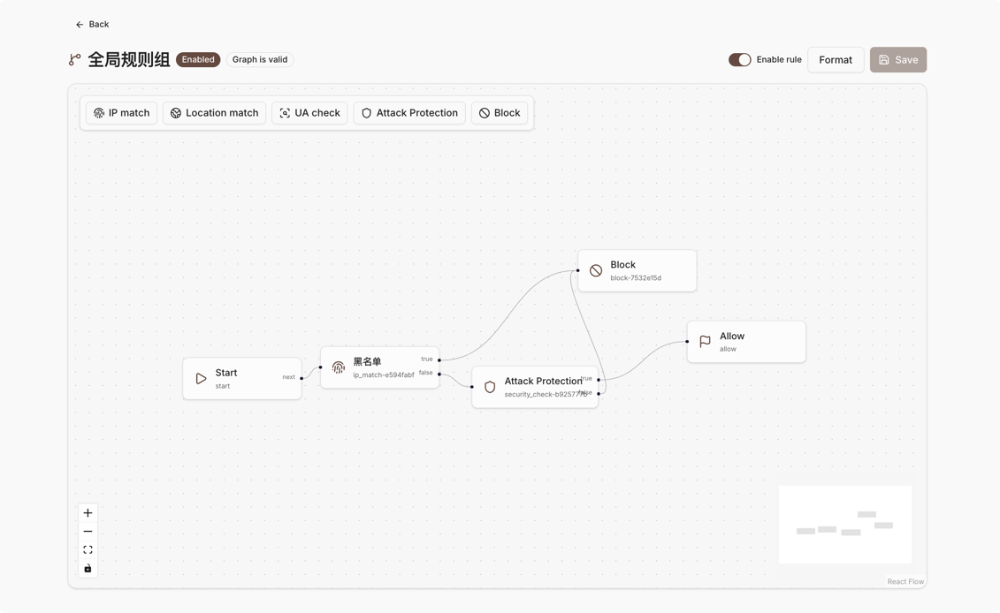
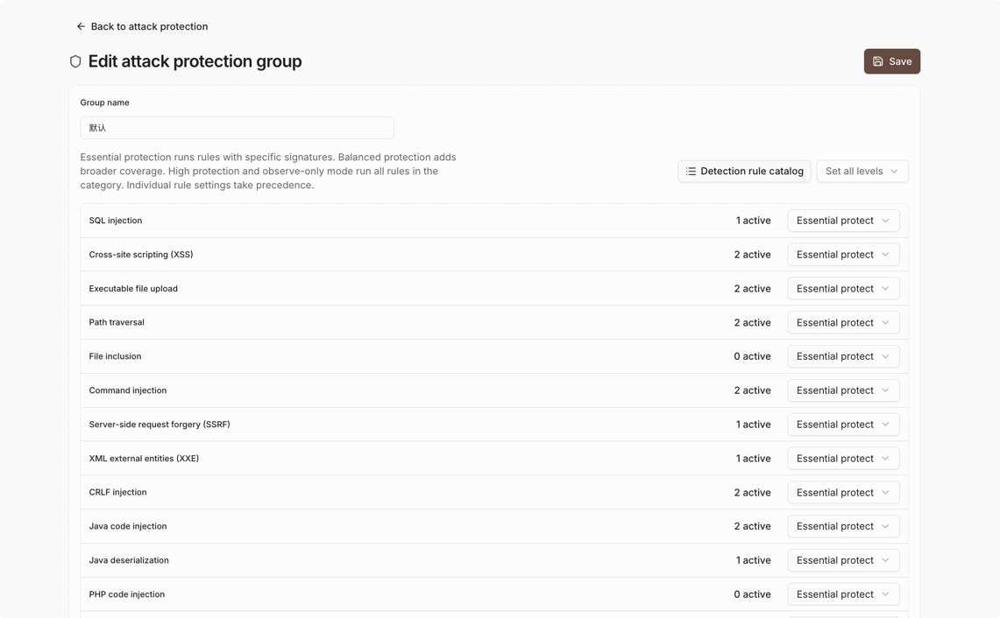

# WAF 防护使用

通过可视化规则流、攻击防护规则组与全局白名单拦截恶意请求，并将策略绑定至代理路由生效。

## 核心概念

| 模块 | 职责 |
| :--- | :--- |
| WAF 规则流 | 按“请求进入 → 条件分支 / 攻击检测 → 动作输出”编排的多路由防护图 |
| 攻击防护规则组 | 面向 SQLi、XSS、RCE 等特征的托管检测集合，支持 `detect`（仅记录）与 `block`（拦截） |
| 攻击日志 | 集中检索各路由触发记录与命中规则 ID，用于排错和误报调优 |
| 全局白名单 | 按 IP 组、域名或路径前缀/正则豁免可信流量，跳过规则流与攻击检测 |

## 1. 创建 WAF 规则流

进入 **安全性** > **WAF** > **创建规则**，按需连接节点并保存：

| 节点类型 | 用途 |
| :--- | :--- |
| 条件分支节点 | 按 IP 组、地理区域、网络组或 HTTP 字段（Path、Header、Method、User-Agent 等）分流 |
| 攻击防护节点 | 引用一个攻击防护规则组检测载荷与请求头特征 |
| 限流 / 动作节点 | 执行频率限制、直接放行、拦截或返回自定义响应页 |

> 节点内建 PoW 组件仅用于旧规则流兼容；新配置请在路由上启用独立 [PoW 工作量证明挑战](./pow-usage.md)。自动化恶意 IP 筛选语法参见 [自动 IP 组规则语法](./waf-ip-group-expr.md)。

## 2. 调优攻击防护规则组

1. 进入 **安全性** > **攻击防护**，选择预设模板（严格 / 均衡 / 基础）或创建自定义规则组。
2. 新业务上线阶段可先将规则组动作设为 `detect`，确认无误报后再切换为 `block`。
3. 若个别规则误杀正常业务（如富文本、接口参数触发 `942100`），可在 **攻击日志** 中定位规则 ID 并在规则组内单独调整或关闭。

规则引擎与 CRS 分级机制详见 [WAF 可编排规则设计](../design/waf-orchestration-design.md)。

## 3. 配置全局白名单

进入 **WAF 防护** > **全局白名单**，按 IP/CIDR 组、域名或路径规则放行内部回调、健康检查或 Webhook 端点。白名单命中后直接放行至缓存与回源链路。

## 4. 绑定路由与验证

1. 在 **代理路由** 中为站点绑定一个或多个 WAF 规则流（可同时设置新建路由的默认防护流）。
2. 发送测试探测请求并查看 **WAF 防护** > **日志**，确认命中路由、动作结果与规则 ID 符合预期。
